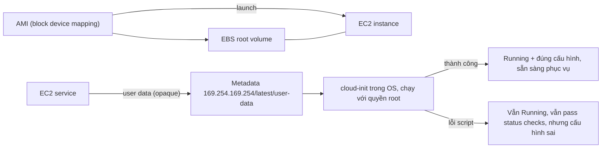

# EC2 User Data Bootstrapping

> **TL;DR:** Bootstrapping là cho instance **tự cấu hình khi launch**: ta truyền một khối **user data** (thường là script), EC2 đưa nó vào instance qua metadata service, và hệ điều hành chạy nó **với quyền root, đúng một lần ở lần launch đầu tiên**. Đây là bước đầu tiên để tự động hóa build, rút ngắn thời gian từ lúc launch tới lúc instance sẵn sàng phục vụ.

## 🖼️ Sơ đồ
![[EC2 User Data Bootstrapping.excalidraw]]
*Mở bằng plugin Excalidraw để chỉnh sửa · ảnh tĩnh: [[EC2 User Data Bootstrapping.svg]]*

![[EC2 User Data Bootstrapping - boottime.excalidraw]]
*Mở bằng plugin Excalidraw để chỉnh sửa · ảnh tĩnh: [[EC2 User Data Bootstrapping - boottime.svg]]*

## Khái niệm cốt lõi
- **Bootstrapping** là khái niệm chung trong tự động hóa hệ thống: hệ thống tự thực hiện các bước cấu hình của chính nó. Trên EC2, nó cho phép **build automation**: cài phần mềm và cấu hình sau cài đặt ngay lúc launch, thay vì dùng AMI mặc định rồi cấu hình tay.
- Cơ chế: **EC2 user data**, được đưa vào instance giống [[EC2 Instance Metadata|metadata]] và đọc tại cùng địa chỉ `169.254.169.254`, nhưng đường dẫn là `latest/user-data` (thay vì `latest/meta-data`).
- **Chỉ chạy một lần, lúc launch lần đầu.** Sửa user data rồi restart instance thì nó **không** chạy lại.
- User data **có thể sửa khi instance đang stopped**: dừng instance, đổi user data, start lại thì dữ liệu mới hiển thị trong instance, nhưng không được thực thi lại. Sau giai đoạn launch, user data chỉ còn dùng để truyền dữ liệu vào, và có cách tốt hơn cho việc đó (ví dụ [[SSM Parameter Store]]).
- **Opaque với EC2**: EC2 không kiểm tra hay diễn giải user data, chỉ chuyển nguyên khối vào. Bạn truyền lệnh xóa sạch boot volume thì instance cũng chạy. Hệ điều hành phải hiểu được thứ bạn đưa vào.
- **Không an toàn**: ai truy cập được OS của instance đều đọc được user data. Không nên (ít nhất là "ideally") đưa mật khẩu hay long-term credentials vào đây. Demo cố tình làm sai (đưa DB password vào user data) để sau này so sánh với cách đúng: [[EC2 Instance Roles]], [[SSM Parameter Store]], [[Secrets Manager]].
- **Giới hạn kích thước: 16 KB.** Cần nhiều hơn thì user data chỉ nên là một script nhỏ đi tải phần lớn hơn về (từ S3, Git...).
- API/[[CloudFormation Basics|CloudFormation]] yêu cầu user data được **base64-encode**. Console tự encode nếu bạn dán text thường (chỉ tick ô "already base64 encoded" khi dữ liệu đã được encode sẵn). Trong CloudFormation dùng hàm `Fn::Base64` (`!Base64`).

## Cách hoạt động / Kiến trúc

- Phần launch giống bình thường: AMI tạo EBS volume theo block device mapping và gắn vào instance (xem [[AMI]]).
- Khác biệt: EC2 cung cấp user data; phần mềm trong OS (trên Amazon Linux là **cloud-init**) kiểm tra metadata, thấy user data thì thực thi lúc khởi động.
- Hai kết quả:
  - Script chạy tốt: instance Running, đã cấu hình xong, sẵn sàng phục vụ.
  - Script lỗi: instance **vẫn Running** và **vẫn pass [[EC2 Status Checks and Auto Recovery|status checks]]**, vì EC2 chỉ giao dữ liệu chứ không biết script chạy ra sao. Kết quả là một instance có cấu hình hỏng ("bad config"). EC2 không báo lỗi, phải tự kiểm tra.

### Boot-time-to-service-time
Đề thi hay hỏi về thời gian từ lúc launch tới lúc instance thực sự nhận được traffic của khách hàng. Nó gồm thời gian AWS provision instance cộng thời gian cập nhật, cài đặt, cấu hình trong OS.

| Cách làm | Post-launch time | Độ linh hoạt cấu hình |
|---|---|---|
| AMI AWS cung cấp + cấu hình tay | Vài phút tới vài giờ, dễ sai | Cao nhưng thủ công |
| **Bootstrapping** (user data) | Rút ngắn nhờ tự động, nhưng vẫn phải cài lúc launch | **Cao**: tham số hóa lúc launch |
| **AMI baking** (cài sẵn vào [[AMI]]) | Gần như bằng 0 | Thấp: cấu hình đã "nướng" vào AMI |
| **Kết hợp**: bake phần nặng + bootstrap phần cuối | Thấp | Cao |

- Cách tối ưu là **kết hợp**: phần tốn thời gian (ví dụ 90% là cài ứng dụng) thì bake vào AMI, 10% cấu hình cuối thì bootstrap. Kiến trúc này dùng lại ở phần scaling (xem [[Launch Templates]], [[Auto Scaling Groups]]).

## Demo / Lab
**0142–0143: Cài WordPress thủ công (cách KHÔNG nên làm).** Kiến trúc monolithic: một instance trong subnet `sn-web-A` của Animals4life VPC chạy cả app lẫn DB (không HA). Các bước:
1. Đặt biến shell: DBName, DBUser, DBPassword, DBRootPassword.
2. `yum install` MariaDB server, Apache (`httpd`), `wget`; `amazon-linux-extras install` LAMP-MariaDB và PHP 7.2.
3. `systemctl enable` + `start` cho httpd và mariadb (chạy ngay và tự chạy khi reboot).
4. Đặt root password cho MariaDB.
5. Tải `latest.tar.gz` của WordPress vào web root `/var/www/html`, giải nén, chép file ra web root, dọn rác.
6. Copy `wp-config-sample.php` thành `wp-config.php`, dùng `sed` thay các placeholder (DB name/user/password).
7. `chown -R apache:apache` web root.
8. Tạo script `/tmp/db.setup` (CREATE DATABASE, CREATE USER, GRANT, FLUSH PRIVILEGES), chạy bằng `mysql -u root`, rồi xóa script vì nó chứa thông tin xác thực.
- Rút ra: chậm, thủ công, dễ sai ở mọi bước, không lặp lại nhất quán được (thử làm 10 hay 100 lần). Đây là động lực để tự động hóa và dùng IaC.

**0164–0165: Bootstrap WordPress bằng user data.**
- Launch Amazon Linux 2 với cùng các lệnh trên (thêm `cowsay` làm login banner) dán vào ô **User data** (Advanced details). Không cần key pair, kết nối bằng [[EC2 Instance Connect and SSH|Instance Connect]].
- Vài phút sau khi Running, instance đã có WordPress và banner tùy chỉnh mà không phải gõ lệnh nào.
- Kiểm tra: `curl http://169.254.169.254/latest/user-data` trả về đúng script đã truyền.
- **Log chẩn đoán bootstrapping**: `/var/log/cloud-init.log` và **`/var/log/cloud-init-output.log`** (file sau cho thấy từng lệnh đã chạy và output của nó). Đây là chỗ đầu tiên cần xem khi bootstrap lỗi.
- Phần 2: cùng user data nhúng vào template CloudFormation qua `Fn::Base64` và cho kết quả giống hệt. Đây là bước đầu của IaC (sau này có [[cfn-init]] và [[CFN Wait Conditions and cfn-signal|cfn-signal]]).

## 🎯 Mẹo thi SAA-C03
- User data **chỉ chạy một lần khi launch lần đầu**. Đề hỏi "sửa user data rồi reboot thì script có chạy lại không?": **không**.
- Giới hạn **16 KB**; chạy với quyền **root**; truy cập tại `http://169.254.169.254/latest/user-data`.
- User data **không bảo mật**, đừng chứa secret. Credential AWS thì dùng [[EC2 Instance Roles]]; cấu hình/secret thì dùng [[SSM Parameter Store]] hoặc [[Secrets Manager]].
- EC2 **không validate** user data. Script lỗi thì instance vẫn Running và vẫn pass status checks. Muốn "chỉ báo thành công khi cấu hình xong" thì dùng [[CFN Wait Conditions and cfn-signal|CreationPolicy + cfn-signal]].
- Đề hỏi "giảm thời gian từ launch tới sẵn sàng phục vụ" (ví dụ ASG scale-out chậm vì cài app lâu): **AMI baking** cho phần nặng, bootstrapping cho cấu hình cuối.
- Cần cấu hình linh hoạt theo môi trường lúc launch thì chọn bootstrapping. Cần nhanh nhất thì chọn bake AMI.
- (Bổ sung, ngoài bài) cloud-init có thể được cấu hình để chạy script ở **mọi lần boot** (MIME multi-part với `#cloud-config`), nhưng hành vi mặc định mà đề thi kiểm tra là **chỉ một lần**.

## Liên kết
- Tiên quyết: [[EC2 Basics]], [[EC2 Instance Metadata]], [[AMI]]
- Liên quan: [[CloudFormation Basics]], [[cfn-init]], [[CFN Wait Conditions and cfn-signal]], [[Launch Templates]], [[Auto Scaling Groups]], [[Lab - Architecture Evolution]]
- Cách đúng để truyền credential/secret: [[EC2 Instance Roles]], [[SSM Parameter Store]], [[Secrets Manager]]
- Phân biệt với: [[AMI]] (AMI baking: cấu hình sẵn, ít linh hoạt)
