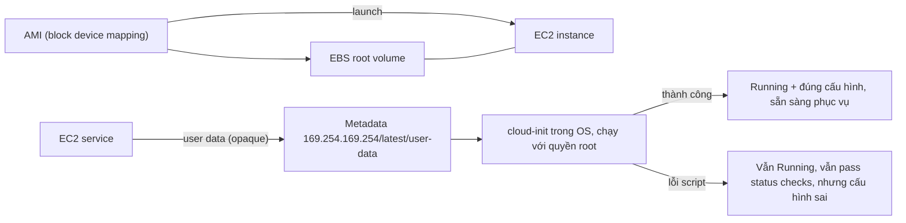

# EC2 User Data Bootstrapping

> **TL;DR:** Bootstrapping là cho instance **tự cấu hình khi launch**: ta truyền một khối **user data** (thường là script), EC2 đưa nó vào instance qua metadata service, và hệ điều hành chạy nó **với quyền root, đúng một lần ở lần launch đầu tiên**. Đây là bước đầu tiên để tự động hóa build, rút ngắn thời gian từ lúc launch tới lúc instance sẵn sàng phục vụ.

## 🖼️ Sơ đồ
![[EC2 User Data Bootstrapping.excalidraw]]
*Mở bằng plugin Excalidraw để chỉnh sửa · ảnh tĩnh: [[EC2 User Data Bootstrapping.svg]]*

![[EC2 User Data Bootstrapping - boottime.excalidraw]]
*Mở bằng plugin Excalidraw để chỉnh sửa · ảnh tĩnh: [[EC2 User Data Bootstrapping - boottime.svg]]*

## Khái niệm cốt lõi
- **Bootstrapping** là khái niệm chung trong tự động hóa hệ thống: hệ thống tự thực hiện các bước cấu hình của chính nó. Trên EC2, nó cho phép **build automation**: cài phần mềm và cấu hình sau cài đặt ngay lúc launch, thay vì dùng AMI mặc định rồi cấu hình tay.
- Cơ chế: **EC2 user data**, được đưa vào instance giống [[EC2 Instance Metadata|metadata]] và đọc tại cùng địa chỉ `169.254.169.254`, nhưng đường dẫn là `latest/user-data` (thay vì `latest/meta-data`).
- **Mặc định chỉ chạy một lần, lúc launch lần đầu.** Sửa user data rồi restart instance thì nó **không** chạy lại. Cả Linux lẫn Windows đều có cách "bật công tắc" trong agent của OS để user data chạy **mỗi lần start/reboot**, nhưng đó không phải hành vi mặc định; muốn quản lý cấu hình liên tục thì có công cụ tốt hơn (học ở phần sau của khóa).
- User data **có thể sửa khi instance đang stopped**: dừng instance, đổi user data, start lại thì dữ liệu mới hiển thị trong instance, nhưng không được thực thi lại. Sau giai đoạn launch, user data chỉ còn dùng để truyền dữ liệu vào, và có cách tốt hơn cho việc đó (ví dụ [[SSM Parameter Store]]).
- **Opaque với EC2**: EC2 không kiểm tra hay diễn giải user data, chỉ chuyển nguyên khối vào. Bạn truyền lệnh xóa sạch boot volume thì instance cũng chạy. Hệ điều hành phải hiểu được thứ bạn đưa vào: script **Bash** trên Linux, **PowerShell** trên Windows, hoặc định dạng mà công cụ riêng trong AMI custom xử lý được.
- **Không an toàn**: ai truy cập được OS của instance đều đọc được user data. Không nên (ít nhất là "ideally") đưa mật khẩu hay long-term credentials vào đây. Demo cố tình làm sai (đưa DB password vào user data) để sau này so sánh với cách đúng: [[EC2 Instance Roles]], [[SSM Parameter Store]], [[Secrets Manager]].
- **Giới hạn kích thước: 16 KB**, tính trên **dữ liệu thô trước khi base64-encode**. Cần nhiều hơn thì user data chỉ nên là một script nhỏ đi tải phần lớn hơn về (từ S3, Git...).
- User data là **thuộc tính của instance**, lấy từ metadata lúc launch, **không nằm trong AMI**. Vì vậy dùng chung được với AMI baking (xem bảng bên dưới).
- API/[[CloudFormation Basics|CloudFormation]] yêu cầu user data được **base64-encode**. Console tự encode nếu bạn dán text thường (chỉ tick ô "already base64 encoded" khi dữ liệu đã được encode sẵn). Trong CloudFormation dùng hàm `Fn::Base64` (`!Base64`).

## Cách hoạt động / Kiến trúc

- Phần launch giống bình thường: AMI tạo EBS volume theo block device mapping và gắn vào instance (xem [[AMI]]).
- Khác biệt: EC2 cung cấp user data; phần mềm trong OS (trên Amazon Linux là **cloud-init**) kiểm tra metadata, thấy user data thì thực thi lúc khởi động.
- Hai kết quả:
  - Script chạy tốt: instance Running, đã cấu hình xong, sẵn sàng phục vụ.
  - Script lỗi: instance **vẫn Running** và **vẫn pass [[EC2 Status Checks and Auto Recovery|status checks]]**, vì EC2 chỉ giao dữ liệu chứ không biết script chạy ra sao. Kết quả là một instance có cấu hình hỏng ("bad config"). EC2 không báo lỗi, phải tự kiểm tra.
- Status check và user data **độc lập hai chiều**: instance có thể **chưa pass check mà user data đã chạy xong** (demo mở được web trước khi check xong), hoặc user data lỗi mà check vẫn pass. Trừ khi script phá hỏng OS, kết quả status check không phản ánh user data.

### Boot-time-to-service-time
Đề thi hay hỏi về thời gian từ lúc launch tới lúc instance thực sự nhận được traffic của khách hàng. Nó gồm thời gian AWS provision instance cộng thời gian cập nhật, cài đặt, cấu hình trong OS.

| Cách làm | Post-launch time | Độ linh hoạt cấu hình |
|---|---|---|
| AMI AWS cung cấp + cấu hình tay | Vài phút tới vài giờ, dễ sai | Cao nhưng thủ công |
| **Bootstrapping** (user data) | Rút ngắn nhờ tự động, nhưng vẫn phải cài lúc launch | **Cao**: tham số hóa lúc launch |
| **AMI baking** (cài sẵn vào [[AMI]]) | Gần như bằng 0 | Thấp: cấu hình đã "nướng" vào AMI |
| **Kết hợp**: bake phần nặng + bootstrap phần cuối | Thấp | Cao |

- Cách tối ưu là **kết hợp**: phần tốn thời gian (ví dụ 90% là cài ứng dụng) thì bake vào AMI, 10% cấu hình cuối thì bootstrap. Kiến trúc này dùng lại ở phần scaling (xem [[Launch Templates]], [[Auto Scaling Groups]]).

## Demo / Lab
**Bootstrap web app Aus-E-Mart bằng user data (console).** Không cài tay rồi tạo AMI như demo [[AMI]], mà để user data làm hết ở lần launch đầu.
1. Stack CloudFormation 1-click `Bootstrap` (us-east-1) tạo VPC Aus-E-Mart (public subnet) và một security group mở HTTP.
2. *Launch instance* `AEM-Web-Server1`: kiến trúc **64-bit ARM**, Amazon Linux 2023, `t4g.micro`, **không key pair**, VPC Aus-E-Mart, subnet **Web A**, bật auto-assign public IP, chọn SG `Bootstrap-InstanceSecurityGroup…`.
3. *Advanced details* → ô **User data**: dán script cài mọi thứ app cần, tải web app Aus-E-Mart từ một S3 bucket và cấu hình để app **chạy lại sau restart**. Console tự base64-encode (chỉ tick ô "already base64 encoded" khi dữ liệu đã encode sẵn).
4. Đợi status check pass **rồi đợi thêm vài phút** cho user data chạy xong; mở public IP thấy web app Aus-E-Mart, không phải gõ lệnh nào trên máy.
5. Kết nối bằng [[EC2 Instance Connect and SSH|EC2 Instance Connect]]. Vì metadata service là **IMDSv2**, phải **lấy token trước** (PUT) rồi mới `curl` (xem [[EC2 Instance Metadata]]): `latest/meta-data/` trả về metadata, còn **`http://169.254.169.254/latest/user-data`** trả về đúng script đã dán. User data không bị "nướng" vào image mà agent trong OS lấy từ metadata.
6. **Log chẩn đoán bootstrapping** trong `/var/log`: `cloud-init.log` và **`cloud-init-output.log`** (`sudo cat`; file sau cho thấy từng lệnh đã chạy và output của nó). Đây là chỗ đầu tiên cần xem khi bootstrap lỗi; script phải hợp với image (package manager, phần mềm có sẵn).
7. Dọn dẹp: terminate instance, đợi `terminated` rồi xóa stack.

**Bootstrap web app Aus-E-Mart bằng template CloudFormation.**
- Template có VPC Aus-E-Mart và resource instance `AEM public instance` (AMI Amazon Linux lấy từ parameter) với thuộc tính **`UserData`** chứa đúng script trên, bọc trong hàm **`Fn::Base64`** để có định dạng EC2 yêu cầu.
- Tạo stack `bootstrap-cf` bằng link 1-click → vài phút sau mở public IP thấy app chạy, thậm chí **trước khi status check pass**, minh họa user data độc lập với status check.
- Kết hợp IaC (portable, nhất quán, lặp lại được) với user data để có instance cấu hình sẵn. Sau này có [[cfn-init]] và [[CFN Wait Conditions and cfn-signal|cfn-signal]]. Dọn dẹp: chỉ cần xóa stack.

(Bản khóa cũ: demo 0142–0143 **cài WordPress thủ công** trên Amazon Linux 2 trong subnet `sn-web-A` của Animals4life VPC để thấy cài tay chậm, dễ sai, không lặp lại nhất quán: đặt biến DBName/DBUser/DBPassword/DBRootPassword; `yum install` MariaDB, Apache, `wget`; `amazon-linux-extras install` LAMP-MariaDB và PHP 7.2; `systemctl enable` + `start`; đặt root password MariaDB; tải WordPress vào `/var/www/html`; tạo `wp-config.php` bằng `sed`; `chown -R apache:apache`; chạy script SQL `/tmp/db.setup` rồi xóa. Demo 0164–0165 dán cùng các lệnh (thêm `cowsay` làm login banner) vào user data, rồi nhúng vào CloudFormation qua `Fn::Base64`; khi đó `curl` metadata không cần token.)

## 🎯 Mẹo thi SAA-C03
- User data **chỉ chạy một lần khi launch lần đầu**. Đề hỏi "sửa user data rồi reboot thì script có chạy lại không?": **không**.
- Giới hạn **16 KB**; chạy với quyền **root**; truy cập tại `http://169.254.169.254/latest/user-data`.
- User data **không bảo mật**, đừng chứa secret. Credential AWS thì dùng [[EC2 Instance Roles]]; cấu hình/secret thì dùng [[SSM Parameter Store]] hoặc [[Secrets Manager]].
- EC2 **không validate** user data. Script lỗi thì instance vẫn Running và vẫn pass status checks. Muốn "chỉ báo thành công khi cấu hình xong" thì dùng [[CFN Wait Conditions and cfn-signal|CreationPolicy + cfn-signal]].
- Đề hỏi "giảm thời gian từ launch tới sẵn sàng phục vụ" (ví dụ ASG scale-out chậm vì cài app lâu): **AMI baking** cho phần nặng, bootstrapping cho cấu hình cuối.
- Cần cấu hình linh hoạt theo môi trường lúc launch thì chọn bootstrapping. Cần nhanh nhất thì chọn bake AMI.
- Có thể đổi cấu hình agent trong OS (Linux hoặc Windows) để user data chạy ở **mọi lần boot**, nhưng hành vi mặc định mà đề thi kiểm tra là **chỉ một lần**. (Bổ sung, bài không nói: trên Linux làm bằng cloud-init, ví dụ MIME multi-part với `#cloud-config`.)
- Giới hạn 16 KB tính trên dữ liệu **trước khi base64**; CLI/CloudFormation phải tự base64 (`Fn::Base64`), console thì tự làm.

## Liên kết
- Tiên quyết: [[EC2 Basics]], [[EC2 Instance Metadata]], [[AMI]]
- Liên quan: [[CloudFormation Basics]], [[cfn-init]], [[CFN Wait Conditions and cfn-signal]], [[Launch Templates]], [[Auto Scaling Groups]], [[Lab - Architecture Evolution]]
- Cách đúng để truyền credential/secret: [[EC2 Instance Roles]], [[SSM Parameter Store]], [[Secrets Manager]]
- Phân biệt với: [[AMI]] (AMI baking: cấu hình sẵn, ít linh hoạt), [[EC2 Image Builder]] (tự động hóa build, test, phân phối image đã bake)
