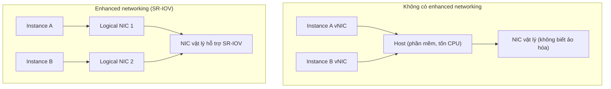

# Enhanced Networking and EBS Optimized

> **TL;DR:** Hai tối ưu hiệu năng của EC2. **Enhanced networking** dùng **SR-IOV** để card mạng vật lý "hiểu" ảo hóa, cho băng thông cao hơn, PPS cao hơn, latency thấp và ổn định, và là điều kiện cho [[EC2 Placement Groups|cluster placement group]]. **EBS optimized** cấp **băng thông riêng cho lưu lượng EBS**, tách khỏi lưu lượng data. Cả hai hiện **mặc định bật hoặc miễn phí** trên đa số instance type hiện đại.

## 🖼️ Sơ đồ
![[Enhanced Networking and EBS Optimized.excalidraw]]
*Mở bằng plugin Excalidraw để chỉnh sửa · ảnh tĩnh: [[Enhanced Networking and EBS Optimized.svg]]*

![[Enhanced Networking and EBS Optimized - ebs.excalidraw]]
*Mở bằng plugin Excalidraw để chỉnh sửa · ảnh tĩnh: [[Enhanced Networking and EBS Optimized - ebs.svg]]*

## Khái niệm cốt lõi
### Enhanced networking (SR-IOV)
- Là tính năng cải thiện hiệu năng mạng tổng thể của EC2, **bắt buộc** cho các tính năng hiệu năng cao như **cluster placement group**.
- Dùng **SR-IOV (Single Root I/O Virtualization)**: card mạng vật lý trên EC2 host **nhận biết được ảo hóa** (xem [[Virtualization]]).
- **Không có enhanced networking**: mỗi instance có virtual NIC, mọi lưu lượng đi qua **một NIC vật lý không biết gì về ảo hóa**. Host phải đứng giữa, điều phối bằng **phần mềm**, nên chậm và tốn nhiều **CPU của host**. Khi host tải nặng (CPU hoặc I/O), hiệu năng tụt, latency tăng vọt, băng thông dao động.
- **Có enhanced networking**: NIC vật lý chia ra **nhiều logical card (virtual function)**. Mỗi instance được **độc quyền** một logical card và gửi dữ liệu như thể có card vật lý riêng. NIC tự xử lý toàn bộ, host CPU gần như không tham gia.
- Lợi ích:
  - **I/O cao hơn** trên mọi instance của host, **CPU host thấp hơn**, nên **băng thông cao hơn**.
  - **PPS (packets per second) cao hơn**, tốt cho ứng dụng chuyển nhiều gói nhỏ trong mạng nội bộ.
  - **Latency thấp và ổn định** (consistent low latency).
- **Mặc định bật hoặc miễn phí** trên hầu hết instance type hiện đại. Chi tiết cách bật không cần cho kỳ thi SA Associate.

### EBS optimized
- [[EBS]] là **block storage truyền qua mạng**.
- Trước đây, mạng của instance **dùng chung** cho cả lưu lượng data và lưu lượng EBS, dẫn tới tranh chấp và hạn chế hiệu năng của cả hai.
- **EBS optimized** = tối ưu stack và **cấp dung lượng (băng thông) riêng cho EBS**. EBS đạt tốc độ cao hơn, và storage với data không ảnh hưởng lẫn nhau.
- Là thiết lập **theo từng instance** (bật/tắt).
- Phần lớn instance hiện nay **hỗ trợ và bật mặc định, không tốn thêm phí**; tắt đi cũng không có tác dụng vì phần cứng đã tích hợp sẵn. Một số instance cũ hỗ trợ nhưng **bật thì tốn thêm phí**.
- **Cần thiết** cho instance type/size hiệu năng cao, nhất là khi dùng volume hứa hẹn IOPS cao và latency thấp, ổn định như **GP2/GP3, io1/io2** (xem [[EBS Volume Types]]).

## Cách hoạt động / Kiến trúc

## Bảng so sánh / số liệu
| | Enhanced Networking | EBS Optimized |
|---|---|---|
| Giải quyết | Mạng ảo hóa qua phần mềm chậm, tốn CPU host | Data và EBS tranh chấp cùng đường mạng |
| Cơ chế | SR-IOV: logical NIC riêng cho từng instance | Băng thông dành riêng cho EBS |
| Lợi ích | Băng thông cao hơn, PPS cao hơn, latency thấp và ổn định | IOPS/throughput EBS cao và ổn định |
| Chi phí | Miễn phí / mặc định trên instance hiện đại | Mặc định trên đa số; một số đời cũ tính phí |
| Liên quan | Bắt buộc cho cluster placement group | Cần cho io1/io2, gp2/gp3 hiệu năng cao |

Bổ sung ngoài bài (thường gặp trong đề):
- **ENA (Elastic Network Adapter)**: driver enhanced networking chính hiện nay, hỗ trợ băng thông rất cao (tới 100 Gbps và hơn nữa trên instance mới). Intel 82599 VF là thế hệ cũ (tới 10 Gbps).
- **EFA (Elastic Fabric Adapter)**: ENA cộng thêm khả năng bypass OS cho **HPC/MPI, machine learning tightly coupled**. Thường đi cùng cluster placement group.

## 🎯 Mẹo thi SAA-C03
- Với kỳ thi SA Associate chỉ cần biết **hai tính năng này tồn tại và mang lại gì**, không cần cách cấu hình.
- Đề nhắc "**higher PPS**", "**lower, consistent latency**", "**higher bandwidth**" giữa các instance thì chọn **enhanced networking (SR-IOV/ENA)**, thường kèm **cluster placement group**. HPC cần MPI thì chọn **EFA**.
- Cluster placement group muốn đạt hiệu năng tối đa thì **phải** có enhanced networking.
- Đề nói EBS volume không đạt IOPS/throughput mong đợi trên instance → kiểm tra instance có **EBS optimized** không, và **giới hạn băng thông EBS của instance type**.
- EBS optimized = **băng thông riêng cho EBS**. Không nhầm với việc tăng IOPS của volume.

## Liên kết
- Tiên quyết: [[Virtualization]], [[EC2 Architecture and Resilience]], [[EBS]]
- Liên quan: [[EC2 Placement Groups]], [[EBS Volume Types]], [[EC2 Instance Types]], [[EC2 Network Interfaces IPs and DNS]]
- Phân biệt với: [[Instance Store]] (lưu trữ local, không đi qua mạng EBS)
