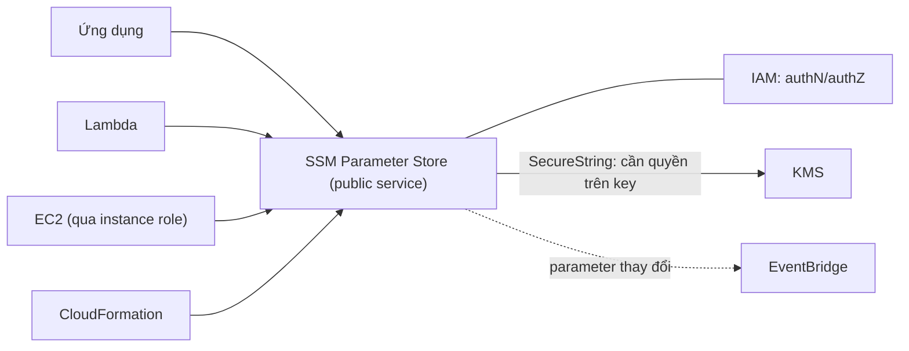

# SSM Parameter Store

> **TL;DR:** Parameter Store (thuộc AWS Systems Manager) là kho lưu **cấu hình và secret** dạng cặp name/value, có cấu trúc **phân cấp**, **versioning**, mã hóa bằng [[KMS]] và phân quyền bằng IAM. Đây là cách đúng để đưa cấu hình/secret vào EC2, Lambda, ứng dụng hay CloudFormation, thay vì nhét vào [[EC2 User Data Bootstrapping|user data]].

## 🖼️ Sơ đồ
![[SSM Parameter Store.excalidraw]]
*Mở bằng plugin Excalidraw để chỉnh sửa · ảnh tĩnh: [[SSM Parameter Store.svg]]*

## Khái niệm cốt lõi
- Mỗi **parameter** có **name** và **value** (value chứa cấu hình thật). Có thể kèm description.
- **3 kiểu parameter**:
  - **String**: chuỗi thường (DB connection string, hostname, port...).
  - **StringList**: danh sách chuỗi phân tách bằng dấu phẩy.
  - **SecureString**: mã hóa bằng **KMS** (mật khẩu, license code...). Mặc định dùng AWS managed key `alias/aws/ssm`; có thể chọn customer managed key (từ account hiện tại hoặc account khác) nếu cần rotation hay key policy tùy chỉnh.
- Lưu được license code, DB connection string, API endpoint, API secret, toàn bộ file config, cấu hình đơn giản (ví dụ bảng màu của website), password. Hữu ích khi ứng dụng chạy trải trên nhiều dịch vụ nhưng cần chung cấu hình.
- **Hierarchy**: tên có dấu `/` tạo cây giống thư mục, ví dụ `/aem-web/dbuser`, `/aem-web/dbpassword`, `/croc-container-app/`, nhánh riêng cho đội dev (`/dev-team/passwords/`). Lấy được **từng parameter** theo tên đầy đủ hoặc **cả nhánh** theo path. Cây phân cấp **tối đa 15 cấp**.
- **Versioning**: mỗi lần sửa tạo version mới (giống S3 object versioning) → dễ **cập nhật và rollback**. Ví dụ 15 web frontend EC2 khắp thế giới cùng trỏ tới một DB endpoint: đổi endpoint trong Parameter Store, có lỗi thì quay về version cũ, thay vì sửa file trên từng instance.
- **Plaintext hoặc ciphertext**: dùng ciphertext (SecureString) thì cần **thêm quyền trên KMS key**, tạo thêm một lớp bảo mật, và KMS cho thêm **audit trail** việc dùng key.
- **Public parameters** do AWS công bố, ví dụ **AMI ID mới nhất** của từng OS theo từng region (`/aws/service/ami-amazon-linux-latest/...`). Template CloudFormation dùng cái này để khỏi hard-code AMI ID theo region.
- **Thay đổi parameter có thể sinh event** (qua [[EventBridge]]) để kích hoạt quy trình ở dịch vụ khác.
- Quyền đặt được trên **từng parameter** hoặc **cả cây**.

## Cách hoạt động / Kiến trúc

- Đây là **dịch vụ public**: client phải là dịch vụ AWS hoặc truy cập được public endpoint của AWS (xem [[AWS Public vs Private Services]]). Instance trong private subnet cần NAT hoặc VPC endpoint (xem [[NAT Gateway]], [[Interface VPC Endpoints]]).
- Tích hợp chặt với IAM: client phải xác thực, dùng long-term credential hoặc tốt hơn là [[EC2 Instance Roles|IAM role]].
- **Quyền SSM và quyền KMS là hai thứ tách biệt.** Đọc SecureString ở dạng plaintext cần cả `ssm:GetParameter*` lẫn `kms:Decrypt` trên key tương ứng.

### Standard vs Advanced tier
| | Standard (mặc định) | Advanced |
|---|---|---|
| Số parameter/region | tối đa **10,000** | hơn 10,000 (tới 100,000) |
| Kích thước value | **4 KB** | **8 KB** |
| Parameter policies (expiration, thông báo khi parameter không đổi...) | Không | Có |
| **Share parameter cho account khác** | Không | **Có** |
| Chi phí | **Miễn phí** | Tính phí |
- Ngoài advanced tier, chỉ **higher throughput** mới tốn thêm tiền (bật trong *Settings* khi phải đọc rất nhiều parameter rất nhanh).
- *Settings* còn cho chọn **tier mặc định**: Standard, Advanced, hoặc **Intelligent-Tiering** (chọn tier tùy theo tính năng parameter cần; có thể phát sinh phí).
- Data type của parameter: thường là **text**, hoặc **EC2 image** (`aws:ec2:image`, giá trị là AMI ID).

## Demo / Lab
1. Systems Manager → **Application Tools** → **Parameter Store** → Create parameter. Wizard có tên (phân cấp), description, **tier** (Standard/Advanced), **type** (String, StringList, SecureString), **data type** (text / EC2 image) và value.
2. Tạo 4 parameter, tất cả dưới nhánh `/aem/`:
   - `/aem/croc-container-app/dbstring` (String, `db.allthecrocs.com:3306`, 3306 là port chuẩn của MySQL).
   - `/aem/croc-container-app/dbuser` (String, `coolcroc`). Wizard gợi ý cây phân cấp đã có khi gõ tên.
   - `/aem/croc-container-app/dbpassword` (**SecureString**): chọn KMS key trong account hiện tại (hoặc account khác); mặc định là key `alias/aws/ssm` do AWS tạo sẵn, có thể chọn customer managed key nếu cần kiểm soát hơn (ví dụ rotation).
   - `/aem/rate-my-lizard/dbstring` (String, `db.sillysite.com`).
3. Dùng **CloudShell** (đã xác thực sẵn bằng user đang đăng nhập console):
   - `aws ssm get-parameters --names /aem/rate-my-lizard/dbstring` trả về JSON gồm Name, Type, Value, **Version**, LastModifiedDate…
   - `aws ssm get-parameters-by-path --path /aem/croc-container-app` lấy cả nhánh. SecureString lúc này trả về **ciphertext**.
   - Thêm `--with-decryption` thì nhận plaintext (`coolcrocsupersecret`), **nếu có quyền trên cả Parameter Store và KMS key**.
4. Dọn dẹp: chỉ xóa các parameter `/aem/...` vừa tạo.

(Bản khóa cũ: menu Application Management; 5 parameter `/my-cat-app/dbstring` = `db.allthecats.com:3306`, `/my-cat-app/dbuser`, `/my-cat-app/dbpassword`, `/my-dog-app/dbstring`, `/rate-my-lizard/dbstring`.)

## 🎯 Mẹo thi SAA-C03
- Cần lưu cấu hình/secret tập trung, có phân cấp, version, mã hóa KMS, chi phí thấp thì chọn **Parameter Store**.
- Đề nhấn mạnh **tự động rotate secret** (đặc biệt mật khẩu RDS) thì chọn **[[Secrets Manager]]**. Parameter Store không có rotation tích hợp.
- SecureString cần **KMS**, nên phải có quyền trên cả SSM **và** KMS key.
- "Lấy AMI ID mới nhất cho mọi region trong CloudFormation" thì dùng **public parameter** của SSM (`AWS::SSM::Parameter::Value<AWS::EC2::Image::Id>`).
- `get-parameters-by-path` lấy cả nhánh; `--with-decryption` để giải mã. Cây phân cấp tối đa **15 cấp**.
- Cần **share parameter sang account khác**, hơn 10,000 parameter, value > 4 KB hoặc parameter policy (expiration) → **Advanced tier** (tính phí).
- Đây là cách tốt hơn để đưa secret vào instance so với user data: instance dùng role để đọc parameter lúc chạy.
- Parameter Store cũng có thể lưu cấu hình [[CloudWatch Agent]] để dùng chung cho cả fleet.

## Liên kết
- Tiên quyết: [[KMS]], [[IAM Roles]], [[EC2 Instance Roles]]
- Liên quan: [[CloudWatch Agent]], [[CloudFormation Basics]], [[CFN Template and Pseudo Parameters]], [[EventBridge]], [[Lambda]]
- Phân biệt với: [[Secrets Manager]] (có rotation, tính phí theo secret), [[EC2 User Data Bootstrapping]] (không an toàn cho secret)
- Các tính năng khác của Systems Manager: [[Systems Manager]], [[SSM Run Command]], [[SSM Documents]], [[SSM Patch Manager]]
