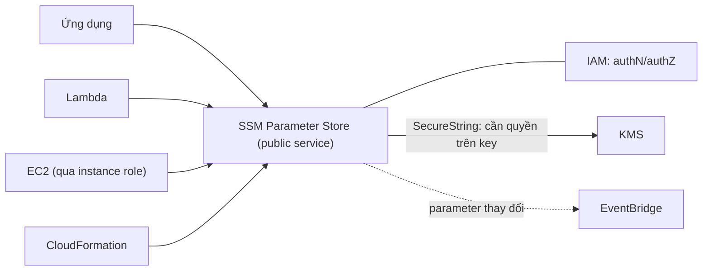

# SSM Parameter Store

> **TL;DR:** Parameter Store (thuộc AWS Systems Manager) là kho lưu **cấu hình và secret** dạng cặp name/value, có cấu trúc **phân cấp**, **versioning**, mã hóa bằng [[KMS]] và phân quyền bằng IAM. Đây là cách đúng để đưa cấu hình/secret vào EC2, Lambda, ứng dụng hay CloudFormation, thay vì nhét vào [[EC2 User Data Bootstrapping|user data]].

## 🖼️ Sơ đồ
![[SSM Parameter Store.excalidraw]]
*Mở bằng plugin Excalidraw để chỉnh sửa · ảnh tĩnh: [[SSM Parameter Store.svg]]*

## Khái niệm cốt lõi
- Mỗi **parameter** có **name** và **value** (value chứa cấu hình thật). Có thể kèm description.
- **3 kiểu parameter**:
  - **String**: chuỗi thường (DB connection string, hostname, port...).
  - **StringList**: danh sách chuỗi phân tách bằng dấu phẩy.
  - **SecureString**: mã hóa bằng **KMS** (mật khẩu, license code...). Mặc định dùng AWS managed key `alias/aws/ssm`; có thể chọn customer managed key (từ account hiện tại hoặc account khác) nếu cần rotation hay key policy tùy chỉnh.
- Lưu được license code, DB connection string, toàn bộ file config, password.
- **Hierarchy**: tên có dấu `/` tạo cây giống thư mục, ví dụ `/wordpress/DBUser`, `/wordpress/DBPassword`, `/my-cat-app/`, `/dev-team-passwords/`. Lấy được **từng parameter** theo tên đầy đủ hoặc **cả nhánh** theo path.
- **Versioning**: mỗi lần sửa tạo version mới (giống S3 object versioning).
- **Plaintext hoặc ciphertext**: dùng ciphertext (SecureString) thì cần **thêm quyền trên KMS key**, tạo thêm một lớp bảo mật.
- **Public parameters** do AWS công bố, ví dụ **AMI ID mới nhất** của từng OS theo từng region (`/aws/service/ami-amazon-linux-latest/...`). Template CloudFormation dùng cái này để khỏi hard-code AMI ID theo region.
- **Thay đổi parameter có thể sinh event** (qua [[EventBridge]]) để kích hoạt quy trình ở dịch vụ khác.
- Quyền đặt được trên **từng parameter** hoặc **cả cây**.

## Cách hoạt động / Kiến trúc

- Đây là **dịch vụ public**: client phải là dịch vụ AWS hoặc truy cập được public endpoint của AWS (xem [[AWS Public vs Private Services]]). Instance trong private subnet cần NAT hoặc VPC endpoint (xem [[NAT Gateway]], [[Interface VPC Endpoints]]).
- Tích hợp chặt với IAM: client phải xác thực, dùng long-term credential hoặc tốt hơn là [[EC2 Instance Roles|IAM role]].
- **Quyền SSM và quyền KMS là hai thứ tách biệt.** Đọc SecureString ở dạng plaintext cần cả `ssm:GetParameter*` lẫn `kms:Decrypt` trên key tương ứng.

### Standard vs Advanced tier
| | Standard (mặc định) | Advanced |
|---|---|---|
| Số parameter/region | tối đa **10,000** | hơn 10,000 (tới 100,000) |
| Kích thước value | **4 KB** | **8 KB** |
| Parameter policies (TTL/expiration...) | Không | Có |
| Chi phí | **Miễn phí** | Tính phí |
- Ngoài advanced tier, chỉ **higher throughput** mới tốn thêm tiền.

## Demo / Lab
1. Systems Manager → Application Management → **Parameter Store** → Create parameter.
2. Tạo 5 parameter: `/my-cat-app/dbstring` (String, `db.allthecats.com:3306`), `/my-cat-app/dbuser`, `/my-cat-app/dbpassword` (**SecureString**, key `alias/aws/ssm`), `/my-dog-app/dbstring`, `/rate-my-lizard/dbstring`. Console gợi ý cây phân cấp khi gõ tên.
3. Dùng **CloudShell** (shell trên console, dùng sẵn credential của user đang đăng nhập):
   - `aws ssm get-parameters --names /rate-my-lizard/dbstring` trả về JSON gồm Name, Type, Value, Version, LastModifiedDate, DataType, ARN.
   - `aws ssm get-parameters-by-path --path /my-cat-app/` lấy cả 3 parameter của nhánh. SecureString lúc này trả về **ciphertext**, cho phép thao tác mà không phải giải mã.
   - Thêm `--with-decryption` thì nhận plaintext, **nếu có quyền KMS**.
4. Dọn dẹp: xóa các parameter đã tạo.

## 🎯 Mẹo thi SAA-C03
- Cần lưu cấu hình/secret tập trung, có phân cấp, version, mã hóa KMS, chi phí thấp thì chọn **Parameter Store**.
- Đề nhấn mạnh **tự động rotate secret** (đặc biệt mật khẩu RDS) thì chọn **[[Secrets Manager]]**. Parameter Store không có rotation tích hợp.
- SecureString cần **KMS**, nên phải có quyền trên cả SSM **và** KMS key.
- "Lấy AMI ID mới nhất cho mọi region trong CloudFormation" thì dùng **public parameter** của SSM (`AWS::SSM::Parameter::Value<AWS::EC2::Image::Id>`).
- `get-parameters-by-path` lấy cả nhánh; `--with-decryption` để giải mã.
- Đây là cách tốt hơn để đưa secret vào instance so với user data: instance dùng role để đọc parameter lúc chạy.
- Parameter Store cũng có thể lưu cấu hình [[CloudWatch Agent]] để dùng chung cho cả fleet.

## Liên kết
- Tiên quyết: [[KMS]], [[IAM Roles]], [[EC2 Instance Roles]]
- Liên quan: [[CloudWatch Agent]], [[CloudFormation Basics]], [[CFN Template and Pseudo Parameters]], [[EventBridge]], [[Lambda]]
- Phân biệt với: [[Secrets Manager]] (có rotation, tính phí theo secret), [[EC2 User Data Bootstrapping]] (không an toàn cho secret)
