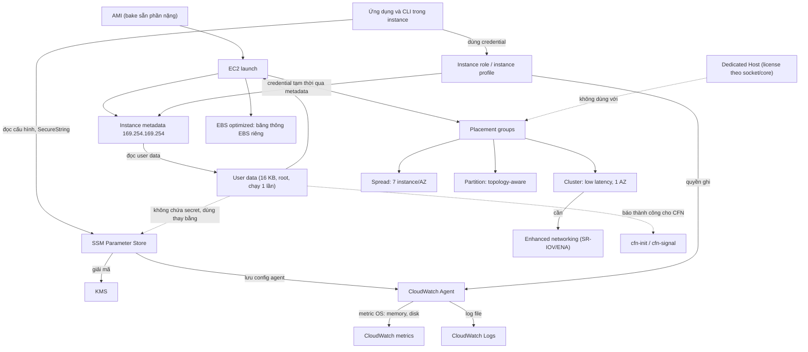

# 09 Advanced EC2

Section này đi tiếp từ [[_MOC 07 EC2|EC2 cơ bản]]: tự động cấu hình instance khi launch (user data), cấp quyền và cấu hình/secret cho ứng dụng đúng cách (instance role, Parameter Store), nhìn vào bên trong OS (CloudWatch Agent), rồi các tính năng đặt chỗ và hiệu năng phần cứng (placement groups, dedicated hosts, enhanced networking, EBS optimized). Đây là nền cho [[_MOC 13 HA and Scaling|Launch Templates và Auto Scaling]] và cho [[_MOC 19 CloudFormation|cfn-init/cfn-signal]] ở các section sau.

← [[00 Home]] · Section trước: [[_MOC 08 Containers]] · Section tiếp theo: [[_MOC 10 Route 53]] →

## Lộ trình học
1. [[EC2 User Data Bootstrapping]] — truyền script qua user data (16 KB), chạy bằng root đúng một lần ở lần launch đầu; cân bằng giữa bootstrapping và AMI baking.
2. [[EC2 Instance Roles]] — IAM role mà EC2 assume qua instance profile; credential tạm thời đưa vào qua metadata và tự rotate, thay cho access key.
3. [[SSM Parameter Store]] — kho cấu hình/secret dạng name/value có phân cấp, versioning, SecureString mã hóa KMS, phân quyền bằng IAM.
4. [[CloudWatch Agent]] — agent trong OS thu thập metric bên trong (memory, disk) và log file ứng dụng đẩy lên CloudWatch/CloudWatch Logs; cần cài, cấu hình và role.
5. [[EC2 Placement Groups]] — Cluster (hiệu năng, một AZ), Spread (tối đa 7 instance/AZ, mỗi cái một rack), Partition (topology-aware cho HDFS/Cassandra).
6. [[Dedicated Hosts]] — thuê trọn host vật lý, trả theo host; use case chính là license theo socket/core (BYOL).
7. [[Enhanced Networking and EBS Optimized]] — SR-IOV/ENA cho bandwidth, PPS cao và latency ổn định; EBS optimized cấp băng thông riêng cho EBS.

## Bản đồ khái niệm

## Liên kết sang section khác
- [[EC2 Instance Metadata]] — kênh đưa user data và credential của role vào instance.
- [[AMI]] — AMI baking, đối trọng của bootstrapping.
- [[IAM Roles]] — nền tảng của instance role; xem thêm [[Service-linked Roles and PassRole]] cho `iam:PassRole`.
- [[Secrets Manager]] — khi cần rotate secret tự động thay vì Parameter Store.
- [[CloudWatch Logs]] — đích của log mà CloudWatch Agent đẩy lên.
- [[Launch Templates]] và [[Auto Scaling Groups]] — nơi user data và instance role được dùng hàng loạt.
- [[cfn-init]] và [[CFN Wait Conditions and cfn-signal]] — bootstrapping kiểu khai báo và báo trạng thái về CloudFormation.
- [[EC2 Purchase Options]] — phân biệt Dedicated Hosts với Dedicated Instances.
- [[EBS Volume Types]] — IOPS/throughput của volume, khác với băng thông EBS optimized của instance.

## 🎯 Top mẹo thi của section
- User data **chỉ chạy một lần khi launch lần đầu**, giới hạn **16 KB**, chạy bằng **root**; sửa user data rồi reboot thì script **không** chạy lại. ([[EC2 User Data Bootstrapping]])
- Cần giảm thời gian từ launch tới sẵn sàng phục vụ: **bake AMI** cho phần nặng, bootstrapping cho cấu hình cuối. EC2 không validate user data; cần báo thành công thật sự thì dùng cfn-signal. ([[EC2 User Data Bootstrapping]])
- Ứng dụng trên EC2 cần gọi AWS API → **instance role (instance profile)**. Đáp án "lưu access key trong instance/AMI/user data" gần như chắc chắn sai. ([[EC2 Instance Roles]])
- EC2 gắn **instance profile**, không gắn role trực tiếp; có thể gắn/đổi role khi instance đang chạy; người gắn cần `iam:PassRole`. ([[EC2 Instance Roles]])
- Cấu hình/secret tập trung, phân cấp, version, rẻ → **Parameter Store**; cần **rotate tự động** (mật khẩu RDS) → [[Secrets Manager]]. ([[SSM Parameter Store]])
- SecureString cần quyền trên cả SSM **và** KMS key; AMI ID mới nhất cho mọi region trong CloudFormation → **public parameter** của SSM. ([[SSM Parameter Store]])
- Giám sát **memory/disk** hoặc đẩy **application log** từ EC2 → **CloudWatch Agent** + role có `CloudWatchAgentServerPolicy`; metric mặc định của EC2 không có memory. ([[CloudWatch Agent]])
- "Low latency, high throughput giữa các node, HPC" → **Cluster PG** (một AZ, kèm enhanced networking). ([[EC2 Placement Groups]])
- "Ít instance quan trọng, mỗi cái phần cứng riêng" → **Spread**, nhớ **7 instance/AZ**; "HDFS/HBase/Cassandra, topology-aware" → **Partition**. ([[EC2 Placement Groups]])
- Lỗi insufficient capacity trong cluster PG → launch tất cả cùng lúc, cùng instance type. ([[EC2 Placement Groups]])
- "License theo socket/core vật lý, BYOL" → **Dedicated Hosts**; chỉ cần phần cứng không chia sẻ → Dedicated Instances rẻ hơn. Dedicated Host không dùng với RDS và placement groups. ([[Dedicated Hosts]])
- "Higher PPS, lower consistent latency" → **enhanced networking (SR-IOV/ENA)**; HPC dùng MPI → **EFA**. ([[Enhanced Networking and EBS Optimized]])
- EBS volume không đạt IOPS mong đợi → kiểm tra **EBS optimized** và giới hạn băng thông EBS của instance type. ([[Enhanced Networking and EBS Optimized]])
