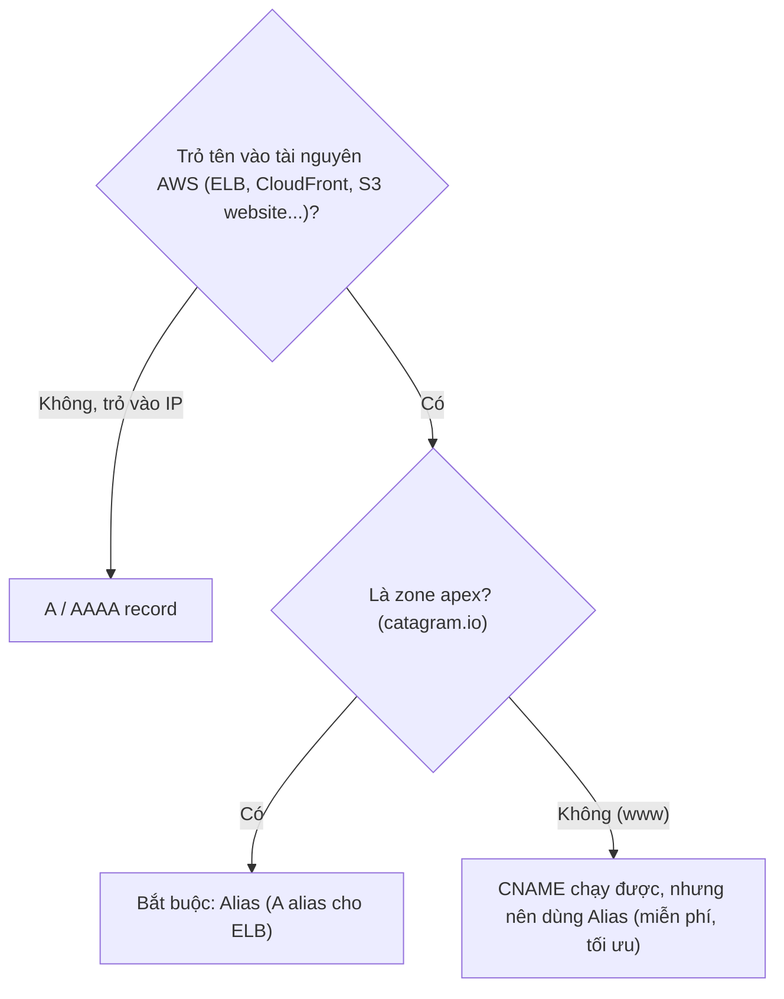

# CNAME vs Alias

> **TL;DR:** CNAME ánh xạ tên sang tên khác nhưng **không dùng được ở zone apex** (naked domain như `catagram.io`). **Alias** là loại record riêng của Route 53, ánh xạ tên sang **tài nguyên AWS**, dùng được cả ở apex lẫn record thường, và **query tới tài nguyên AWS được miễn phí**. Với tài nguyên AWS, mặc định chọn Alias.

## 🖼️ Sơ đồ
![[CNAME vs Alias.excalidraw]]
*Mở bằng plugin Excalidraw để chỉnh sửa · ảnh tĩnh: [[CNAME vs Alias.svg]]*

## Khái niệm cốt lõi
- **A record**: tên → IP (ví dụ `catagram.io → 1.3.3.7`).
- **CNAME**: tên → tên khác (ví dụ `www.catagram.io → catagram.io`), tức là tạo một tên thay thế.
- **Vấn đề**: chuẩn DNS **không cho phép CNAME ở apex/naked domain**. Trong khi đó nhiều dịch vụ AWS (ví dụ [[Elastic Load Balancer]]) **không đưa IP mà đưa một DNS name**.
  - `www.catagram.io` CNAME → DNS name của ELB: **được**.
  - `catagram.io` (apex) CNAME → ELB: **không được**.
- **Alias record**:
  - Ánh xạ một **name tới một tài nguyên AWS** (ngoài ra còn có thể alias tới record khác trong cùng hosted zone).
  - Dùng được cho **cả apex lẫn record thường**. Với record không phải apex, nó hoạt động giống CNAME.
  - **Không tính phí** query khi alias trỏ tới tài nguyên AWS → AWS khuyến khích dùng alias.
  - Alias là **subtype**: có *A alias*, *AAAA alias*, *CNAME alias*... **Type của alias phải khớp với type của record mà nó trỏ tới**. Ví dụ ELB cung cấp một DNS name dạng A record (tên → IP) → phải tạo **A record alias**.
  - Đây là phần mở rộng **riêng của AWS**, nằm ngoài chuẩn DNS → **chỉ dùng được khi Route 53 host domain**.
- Đích alias thường gặp: **API Gateway, CloudFront, Elastic Beanstalk, ELB, Global Accelerator, S3** (website endpoint). Console hiện nay còn có App Runner, AppSync, VPC interface endpoint...

## Bảng so sánh / số liệu
| Tiêu chí | CNAME | Alias (R53) |
|---|---|---|
| Ánh xạ | Tên → tên | Tên → tài nguyên AWS (hoặc record cùng zone) |
| Dùng ở zone apex | **Không** | **Có** |
| Dùng ở record thường (`www`) | Có | Có |
| Chuẩn DNS | Chuẩn | Riêng của Route 53 |
| Phí query tới tài nguyên AWS | Có tính phí | **Miễn phí** |
| Type | CNAME | A/AAAA/CNAME... khớp type của đích |
| Yêu cầu | Bất kỳ DNS provider | Domain phải host trên R53 |

## Cách hoạt động / Kiến trúc

## 🎯 Mẹo thi SAA-C03
- Đề hỏi trỏ **naked/apex domain** (`example.com`) vào **ELB / CloudFront / S3 website / API Gateway / Global Accelerator** → **Alias record** (CNAME không hợp lệ ở apex).
- Với tài nguyên AWS, **mặc định chọn Alias** (miễn phí, hỗ trợ apex).
- Trỏ tới ELB → **A record alias** (khớp type với đích). Nếu dùng IPv6 thì thêm AAAA alias.
- Alias chỉ có khi **Route 53 host zone**. Nếu DNS host ở provider khác thì không có alias của R53.
- Sẽ gặp lại alias trong demo S3 static website ([[S3 Static Website Hosting]]) và failover (secondary alias tới S3 website endpoint, xem [[R53 Failover Routing]]).

## Liên kết
- Tiên quyết: [[DNS Record Types]], [[R53 Public Hosted Zones]]
- Liên quan: [[Elastic Load Balancer]], [[CloudFront Architecture]], [[S3 Static Website Hosting]], [[API Gateway]], [[Global Accelerator]], [[R53 Failover Routing]]
- Section: [[_MOC 10 Route 53]]
