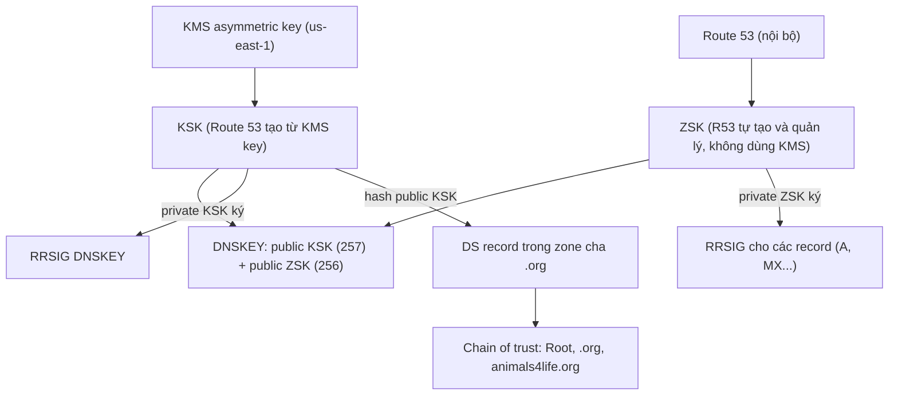

# R53 DNSSEC

> **TL;DR:** Bật DNSSEC signing cho public hosted zone trong Route 53 gồm hai việc: (1) **ký trong zone**: KSK được tạo từ một **asymmetric KMS key ở us-east-1**, còn ZSK do Route 53 tự tạo và quản lý; (2) **thiết lập chain of trust** bằng cách đặt **DS record** (hash của public KSK) vào zone cha. Nếu R53 là registrar thì làm ngay trên console, nếu không thì làm thủ công ở registrar.

## 🖼️ Sơ đồ
![[R53 DNSSEC.excalidraw]]
*Mở bằng plugin Excalidraw để chỉnh sửa · ảnh tĩnh: [[R53 DNSSEC.svg]]*

![[R53 DNSSEC - ops.excalidraw]]
*Mở bằng plugin Excalidraw để chỉnh sửa · ảnh tĩnh: [[R53 DNSSEC - ops.svg]]*

## Khái niệm cốt lõi
- Tiên quyết lý thuyết: [[DNSSEC]] (DNSKEY, RRSIG, DS, KSK/ZSK, chain of trust), [[Digital Signatures]], [[Hashing]].
- Bật qua **console UI hoặc CLI**. Quá trình bắt đầu từ **KMS** ([[KMS]]):
  - Tạo một **asymmetric key pair** (public + private) trong KMS. Có thể tạo trước hoặc tạo ngay trong lúc bật signing. Về khái niệm có thể coi đây là KSK; chính xác hơn thì Route 53 **tạo KSK từ KMS key này**.
  - KMS key **phải nằm ở us-east-1**, đây là điểm rất quan trọng. (Bổ sung: key phải là customer managed, asymmetric, spec `ECC_NIST_P256`.)
- **ZSK** (zone signing key) được Route 53 **tạo và quản lý hoàn toàn nội bộ**, **KMS không tham gia**.
- Route 53 đưa phần public của **KSK và ZSK** vào **DNSKEY record** của zone (cho resolver biết dùng public key nào để verify chữ ký).
- **Private KSK** ký các DNSKEY record → tạo **RRSIG DNSKEY**, giúp resolver xác nhận DNSKEY hợp lệ và không bị sửa.
- Đến đây là xong **bước 1, ký trong zone**. **Bước 2** là tạo **chain of trust với zone cha**: zone cha (ví dụ `.org`) cần thêm **DS (Delegation Signer) record** chứa **hash của public KSK**.
  - Domain **đăng ký qua R53** → làm ở **Registered domains** trên console (hoặc CLI). R53 liên lạc với TLD để thêm DS.
  - Domain **đăng ký ở nơi khác**, R53 chỉ host → phải **tự thêm DS** qua registrar đó (xem [[R53 Interoperability]]).
- Sau khi hoàn tất, TLD tin domain thông qua DS record, còn zone ký mọi record bằng KSK/ZSK.
- **Vận hành**:
  - Tạo **CloudWatch alarm** cho **`DNSSECInternalFailure`** và **`DNSSECKeySigningKeysNeedingAction`**. Cả hai đều báo lỗi DNSSEC cần xử lý **khẩn**: lỗi KSK hoặc lỗi tương tác với KMS (xem [[CloudWatch Basics]]).
  - Cân nhắc bật **DNSSEC validation cho VPC** (Route 53 Resolver): với zone có DNSSEC, record **fail validation** (chữ ký không khớp, không được tin cậy) sẽ **không được trả về**. Zone **không bật DNSSEC** thì **không bị ảnh hưởng**, vẫn trả kết quả bình thường.

## Cách hoạt động / Kiến trúc

## Bảng so sánh / số liệu
| Thành phần | Ai tạo/quản lý | Ghi chú |
|---|---|---|
| KMS key (asymmetric) | Bạn (KMS), **us-east-1** | Nguồn để R53 tạo KSK |
| KSK | Route 53 từ KMS key | DNSKEY flag **257**; ký DNSKEY RRset |
| ZSK | Route 53 nội bộ | DNSKEY flag **256**; ký các record trong zone |
| DS record | Zone cha (TLD) | Hash của public KSK; qua R53 Registered domains hoặc registrar ngoài |
| Thuật toán (demo) | | **13 – ECDSAP256SHA256** |

## Demo / Lab
1. Account có quyền admin, mở Route 53 → hosted zone `animals4life.org`. Chạy `dig animals4life.org DNSKEY +dnssec` → **chưa có** DNSKEY.
2. Tab **DNSSEC signing** → *Enable DNSSEC signing*. Console cảnh báo phải **làm đúng thứ tự** và với domain production phải **chờ theo TTL** giữa các bước, nếu không domain có thể không truy cập được. Zone trong demo mới và trống nên bỏ qua được.
3. Đặt tên KSK (`A4LKSK`) và chọn **Create customer managed CMK** (nay gọi là *KMS key*, giao diện có thể khác), đặt alias → *Create KSK and enable signing*. Chờ vài phút → trạng thái **Signing**, KSK **Active**.
4. `dig ... DNSKEY +dnssec` lại (có thể phải chờ cache) → thấy DNSKEY **256** (ZSK) và **257** (KSK) cùng **RRSIG DNSKEY**.
5. Thiết lập chain of trust: *View information to create DS record* → mục *Establish a chain of trust* (có hướng dẫn riêng cho R53 registrar và registrar khác). Ở **Registered domains → domain → Manage keys**: Key type **257 – KSK**, Algorithm **13 – ECDSAP256SHA256**, dán **public key** → *Add*. Thay đổi phải đi qua TLD nên mất **vài phút tới vài giờ**.
6. Kiểm tra: `dig org NS +short` lấy một NS của `.org`, rồi `dig animals4life.org DS @<NS .org>` → sau khoảng 5 phút thấy **DS record**.
7. Tạo record simple `test` A `1.1.1.1` (TTL 60). `dig test.animals4life.org A` trả kết quả thường; thêm `+dnssec` thì có thêm **RRSIG** (ký bằng private ZSK, verify bằng public ZSK trong DNSKEY) → chain of trust **end-to-end** từ root tới record.

## 🎯 Mẹo thi SAA-C03
- KMS key cho DNSSEC của Route 53 **bắt buộc ở us-east-1** (asymmetric).
- **KSK** dựa trên KMS key. **ZSK** do Route 53 quản lý, **không dùng KMS**.
- Chain of trust cần **DS record ở zone cha**: R53 là registrar thì làm trên console/CLI, registrar ngoài thì làm thủ công.
- Giám sát bằng CloudWatch alarm **DNSSECInternalFailure** và **DNSSECKeySigningKeysNeedingAction**.
- **DNSSEC validation trên VPC Resolver** chỉ ảnh hưởng zone có DNSSEC. Record sai chữ ký sẽ không được trả về.
- DNSSEC đảm bảo **tính toàn vẹn và nguồn gốc** của DNS response (chống spoofing/cache poisoning), **không mã hóa** query.

## Liên kết
- Tiên quyết: [[DNSSEC]], [[DNS Fundamentals]], [[KMS]], [[Digital Signatures]], [[Hashing]]
- Liên quan: [[R53 Public Hosted Zones]], [[R53 Interoperability]], [[CloudWatch Basics]], [[Encryption Fundamentals]], [[Route 53 Fundamentals]]
- Section: [[_MOC 10 Route 53]]
