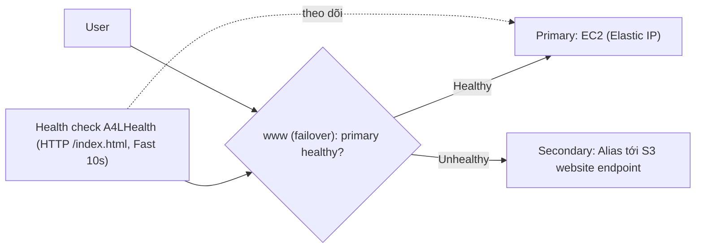

# R53 Failover Routing

> **TL;DR:** Failover routing cho phép tạo **hai record cùng tên: Primary và Secondary**. Health check gắn vào primary: khi primary healthy thì trả primary, khi primary unhealthy thì trả secondary. Đây là cách làm **active-passive failover** bằng DNS, thường với site chính trên EC2/ELB và trang dự phòng tĩnh trên **S3**.

## 🖼️ Sơ đồ
![[R53 Failover Routing.excalidraw]]
*Mở bằng plugin Excalidraw để chỉnh sửa · ảnh tĩnh: [[R53 Failover Routing.svg]]*

![[R53 Failover Routing - timeline.excalidraw]]
*Mở bằng plugin Excalidraw để chỉnh sửa · ảnh tĩnh: [[R53 Failover Routing - timeline.svg]]*

## Khái niệm cốt lõi
- Nhiều record cùng tên (`www`), gán vai trò **Primary** và **Secondary**.
- **Health check** là thành phần then chốt, thường gắn vào **primary** (xem [[R53 Health Checks]]).
  - Primary **healthy** → mọi query `www` trả giá trị của primary (ví dụ EC2 chạy catagram).
  - Primary **unhealthy** → trả **secondary** cùng tên (ví dụ S3 bucket).
- Kiến trúc phổ biến: **out-of-band failure/maintenance page**, tức là trang lỗi hoặc bảo trì chạy trên **dịch vụ khác** với site chính (EC2 → S3 static website). Nhờ vậy lỗi của site chính không kéo theo trang dự phòng.
- Mỗi record cần **Record ID** duy nhất trong nhóm cùng tên (demo: `EC2` và `S3`).
- Thời gian chuyển đổi phụ thuộc: tần suất health check (Fast 10s), failure threshold, và **TTL** của record (client cache).

## Cách hoạt động / Kiến trúc

## Bảng so sánh / số liệu
| Thành phần (demo) | Cấu hình |
|---|---|
| Primary | A record → **Elastic IP** của EC2 `A4L-web`, gắn health check `A4LHealth`, Record ID `EC2` |
| Secondary | **Alias tới S3 website endpoint** (us-east-1), không gắn health check, không evaluate target health, Record ID `S3` |
| Health check | Endpoint theo IP, HTTP, path `index.html`, **Fast (10s)**, không tạo alarm |
| TTL | 60s (1m) |

## Demo / Lab
**Phần 1 (0184), domain đăng ký bằng R53 (ví dụ `animalsforlife1337.org`), region us-east-1:**
1. Deploy stack CloudFormation 1-click (`DNS-and-failover-demo`) → tạo VPC và EC2 public `A4L-web`. Kiểm tra trang web qua IP public (dùng http, không https).
2. Cấp **Elastic IP** và associate với instance để có **IPv4 public tĩnh** (IP public thường sẽ đổi khi stop/start, xem [[EC2 Network Interfaces IPs and DNS]]).
3. Tạo S3 bucket tên **`www.<domain>`** (tên bucket phải khớp tên DNS thì mới alias được với website endpoint), bỏ *Block all public access*, upload `index.html` + `minimal.jpg` của trang failover, bật **static website hosting** (index/error = `index.html`), thêm **bucket policy** public read (thay ARN bucket vào). Xem [[S3 Static Website Hosting]].
4. Tạo health check `A4LHealth`: endpoint theo IP (Elastic IP), HTTP, path `index.html`, request interval **Fast**, không alarm. Ban đầu trạng thái là *Unknown*; tab *Health checkers* hiển thị kết quả từng checker (HTTP 200), sau vài phút chuyển *Healthy*.
5. Trong hosted zone: *Create record* → wizard → **Failover**, tên `www`, TTL 60s:
   - Primary: IP = Elastic IP, gắn health check, ID `EC2`.
   - Secondary: **Alias to S3 website endpoint**, chọn bucket, ID `S3`.
6. Truy cập `www.<domain>` → thấy site EC2.
7. **Stop instance** → health checker báo *connection timed out* → health check chuyển *Unhealthy* sau khoảng 1 phút → sau khi TTL 60s hết hạn, refresh thì thấy **trang failover trên S3**.
8. **Start lại** instance → checker dần trả 200 → health check *Healthy* → site quay lại EC2 (**fail back** tự động).

**Phần 2 (0185):** private hosted zone (xem [[R53 Private Hosted Zones]]), sau đó dọn dẹp: xóa health check, record, private zone, 2 record `www`, empty và xóa bucket, disassociate và **release Elastic IP**, xóa stack.

**Rút ra:** failover hoạt động cả hai chiều. Độ trễ chuyển đổi = phát hiện lỗi (interval × threshold) + TTL cache.

## 🎯 Mẹo thi SAA-C03
- "**Active-passive**", "chuyển sang trang bảo trì/static site trên S3 khi site chính lỗi" → **Failover routing** + health check trên primary.
- Secondary trỏ tới S3 website endpoint dùng **Alias** (xem [[CNAME vs Alias]]). Tên bucket phải trùng tên record.
- Failover qua DNS **không tức thời**: phụ thuộc health check interval/threshold và **TTL**. Muốn chuyển nhanh thì giảm TTL và dùng Fast check.
- Muốn **active-active** (nhiều tài nguyên cùng phục vụ) → không phải failover mà là [[R53 Multivalue Routing]], [[R53 Weighted Routing]], [[R53 Latency Routing]]...
- Liên hệ DR: đây là kỹ thuật DR mức DNS cho pilot light/warm standby (xem [[HA vs FT vs DR]]).

## Liên kết
- Tiên quyết: [[R53 Health Checks]], [[R53 Routing Policies]], [[R53 Public Hosted Zones]]
- Liên quan: [[S3 Static Website Hosting]], [[CNAME vs Alias]], [[EC2 Network Interfaces IPs and DNS]], [[CloudFormation Basics]], [[HA vs FT vs DR]], [[RPO and RTO]]
- Phân biệt với: [[R53 Multivalue Routing]], [[R53 Simple Routing]]
- Section: [[_MOC 10 Route 53]]
