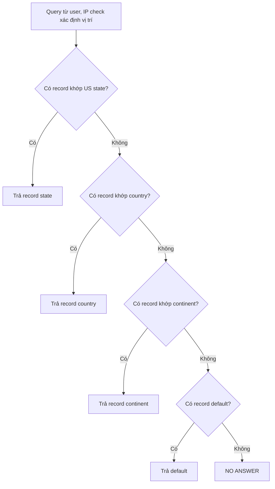

# R53 Geolocation Routing

> **TL;DR:** Record được **tag theo vị trí** (US state, country, continent hoặc default). R53 xác định vị trí user qua IP rồi trả record **khớp cụ thể nhất**: state → country → continent → default. Nếu không có gì khớp thì trả **NO ANSWER**. Geolocation **không trả record gần nhất**, chỉ trả record **liên quan đến vị trí**.

## 🖼️ Sơ đồ
![[R53 Geolocation Routing.excalidraw]]
*Mở bằng plugin Excalidraw để chỉnh sửa · ảnh tĩnh: [[R53 Geolocation Routing.svg]]*

## Khái niệm cốt lõi
- Tag record theo một trong các loại vị trí:
  - **Subdivision**: **US state** (loại nhỏ nhất).
  - **Country**: theo mã quốc gia **ISO**.
  - **Continent**: theo mã châu lục ISO (ví dụ `SA` = South America).
  - **Default**: catch-all, **tùy chọn**.
- Vị trí user được xác định bằng **IP check**. Tùy hệ thống DNS, đó có thể là IP của user hoặc của **resolver** (thường là resolver), nhưng trong phần lớn trường hợp hai vị trí này giống nhau.
- **Thứ tự khớp** (dừng ngay khi khớp):
  1. User ở US → tìm record theo **state** của user.
  2. Không khớp → tìm record theo **country**.
  3. Không khớp → tìm record theo **continent**.
  4. Không khớp → trả record **default** nếu có.
  5. Không có default → **NO ANSWER**.
- Ví dụ: user ở UK, chỉ có record tag **Canada** → **không** nhận record Canada dù đó là record duy nhất. User ở US nhưng khác state với record state → không nhận record đó, trừ khi có record cấp country/continent/default.
- Có hỗ trợ health check (như mọi policy trừ simple).

## Cách hoạt động / Kiến trúc

## 🎯 Mẹo thi SAA-C03
- Adrian nhấn mạnh nhiều lần: **geolocation không phải về proximity (khoảng cách)**, mà về **location (vị trí khớp)**.
- Use case: **giới hạn nội dung theo vùng** (chỉ phục vụ thị trường US), **nội dung theo ngôn ngữ**, tuân thủ pháp lý/bản quyền theo quốc gia, **load balance theo endpoint khu vực** dựa trên vị trí khách hàng.
- Muốn user ở mọi nơi đều nhận được câu trả lời → phải có record **default**, nếu không user ngoài vùng sẽ nhận **NO ANSWER**.
- Đề nói "gần nhất / latency thấp nhất" → **không** chọn geolocation, mà chọn [[R53 Latency Routing]] hoặc [[R53 Geoproximity Routing]].
- Nếu cần chặn truy cập nội dung theo quốc gia ở tầng CDN → xem thêm geo restriction của CloudFront ([[CloudFront Architecture]]) hoặc [[WAF]].

## Liên kết
- Tổng quan: [[R53 Routing Policies]]
- Phân biệt với: [[R53 Geoproximity Routing]], [[R53 Latency Routing]]
- Liên quan: [[R53 Health Checks]], [[CloudFront Architecture]], [[WAF]]
- Section: [[_MOC 10 Route 53]]
