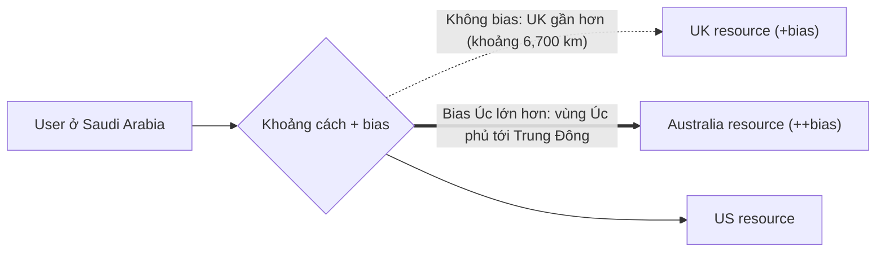

# R53 Geoproximity Routing

> **TL;DR:** Geoproximity trả record của tài nguyên **gần user nhất theo khoảng cách địa lý**. Điểm đặc biệt là có thể thêm **bias (+/-)** để **nới rộng hoặc thu hẹp** vùng phục vụ của một tài nguyên, qua đó đẩy thêm hoặc bớt traffic về nó.

## 🖼️ Sơ đồ
![[R53 Geoproximity Routing.excalidraw]]
*Mở bằng plugin Excalidraw để chỉnh sửa · ảnh tĩnh: [[R53 Geoproximity Routing.svg]]*

## Khái niệm cốt lõi
- Mục tiêu: trả record **gần khách hàng nhất**, tính theo **khoảng cách** chứ không theo latency như [[R53 Latency Routing]].
- Bạn định nghĩa **rule** cho từng tài nguyên:
  - Tài nguyên AWS → khai báo **AWS region** (ví dụ `us-east-1`, `ap-southeast-2`).
  - Tài nguyên ngoài AWS → khai báo tọa độ **latitude & longitude**.
  - Một **bias** tùy chọn.
- R53 biết vị trí tài nguyên và vị trí người gửi request, rồi trả tài nguyên **có khoảng cách nhỏ nhất (đã tính bias)**.
- **Bias**:
  - **"+" bias**: **tăng** kích thước vùng phục vụ của tài nguyên đó và **giảm** vùng của các tài nguyên lân cận.
  - **"-" bias**: thu hẹp vùng phục vụ.
  - Bias co giãn vùng địa lý dùng để định tuyến traffic. (Bổ sung: giá trị bias từ -99 đến +99.)
- Có hỗ trợ health check.

## Cách hoạt động / Kiến trúc
Ví dụ trong bài: có 3 tài nguyên ở **US**, **UK** và **Úc**. User ở **Saudi Arabia** (không có tài nguyên): cách Úc hơn 10,000 km, cách UK khoảng 6,700 km.
- Không có bias → user Saudi được route về **UK** (gần hơn).
- Đặt **+bias cho UK** (vùng phục vụ của UK lớn hơn, bao thêm các nước xung quanh) và **+bias lớn hơn nữa cho Úc** → vùng của Úc mở rộng tới tận Trung Đông → user Saudi được route về **Úc** dù UK gần hơn.

## Bảng so sánh / số liệu
| | Geoproximity | Latency | Geolocation |
|---|---|---|---|
| Cơ sở quyết định | **Khoảng cách** (có bias) | Latency ước tính | Vị trí khớp tag |
| Tag tài nguyên | AWS region **hoặc lat/long** | AWS region | State/country/continent/default |
| Tài nguyên ngoài AWS | Có (bằng tọa độ) | Không (theo region) | Có (tag theo vị trí user) |
| Điều chỉnh traffic | **Bias +/-** | Không | Không |
| Trả "gần nhất" | Có | Gần nhất theo latency | **Không** |

## 🎯 Mẹo thi SAA-C03
- Đề nói route theo **vị trí địa lý của user và tài nguyên** và muốn **dịch chuyển (shift) traffic** từ vùng này sang vùng khác → **Geoproximity + bias**.
- Từ khóa "**bias**", "expand/shrink geographic region" → chắc chắn là geoproximity.
- Tài nguyên **on-premises/ngoài AWS** với tọa độ → geoproximity hỗ trợ lat/long.
- (Khóa học quay ở thời điểm geoproximity chỉ tạo được qua **Route 53 Traffic Flow**. Hiện nay có thể tạo trực tiếp như một record thông thường.)

## Liên kết
- Tổng quan: [[R53 Routing Policies]]
- Phân biệt với: [[R53 Latency Routing]], [[R53 Geolocation Routing]]
- Liên quan: [[R53 Health Checks]], [[AWS Global Infrastructure]], [[Regional and Global Architecture]]
- Section: [[_MOC 10 Route 53]]
