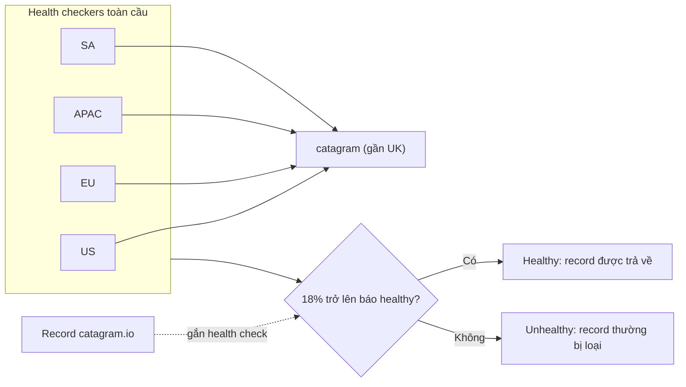

# R53 Health Checks

> **TL;DR:** Health check là đối tượng **tạo riêng** trong Route 53 (không nằm trong record), do một **fleet health checker phân tán toàn cầu** thực hiện. Có 3 loại: endpoint, CloudWatch alarm và calculated. Record gắn với health check unhealthy thường **không được trả về** trong query. Đây là nền tảng cho failover, multivalue, weighted, latency, geo... routing.

## 🖼️ Sơ đồ
![[R53 Health Checks.excalidraw]]
*Mở bằng plugin Excalidraw để chỉnh sửa · ảnh tĩnh: [[R53 Health Checks.svg]]*

![[R53 Health Checks - check types.excalidraw]]
*Mở bằng plugin Excalidraw để chỉnh sửa · ảnh tĩnh: [[R53 Health Checks - check types.svg]]*

## Khái niệm cốt lõi
- **Tách biệt khỏi record**: tạo và cấu hình riêng ở mục *Health checks* của console, sau đó record **tham chiếu** tới nó.
- **Health checker phân tán toàn cầu** (US East, US West, EU Ireland, Singapore, Sydney, Tokyo, São Paulo...). Nếu target nằm trên Internet thì **phải cho phép traffic từ các health checker**. Chặn chúng (vì tưởng là bot hay exploit) sẽ gây báo động giả.
- Check được **bất cứ thứ gì có IP public**, không chỉ tài nguyên AWS.
- **Tần suất**: mặc định **30 giây** (Standard); **Fast = 10 giây** (tính phí thêm). Đây là tần suất **của mỗi health checker**, nên endpoint thực tế nhận check dày hơn nhiều.
- **Failure threshold**: số lần check **liên tiếp** pass/fail cần thiết để đổi trạng thái (mặc định 3). Dùng làm buffer để vài lần fail lẻ tẻ không làm đổi trạng thái.
- Kết quả: **healthy** hoặc **unhealthy**. Nếu **≥ 18%** health checker báo healthy thì health check tổng là **healthy**, ngược lại là unhealthy.

### Các kiểu kiểm tra (endpoint)
| Kiểu | Điều kiện pass | Độ chính xác |
|---|---|---|
| **TCP** | Thiết lập được kết nối TCP trong **10 giây** | Thấp nhất |
| **HTTP/HTTPS** | TCP trong **4 giây** + response status **2xx hoặc 3xx** trong **2 giây** sau khi kết nối | Tốt hơn cho web app |
| **HTTP/HTTPS + string matching** | Như trên + nhận body trong **2 giây** tiếp theo, và chuỗi tìm kiếm phải xuất hiện **trọn vẹn trong 5,120 byte đầu** của body | **Chính xác nhất** (kiểm tra cả nội dung trả về) |

### Ba loại health check
1. **Endpoint**: kiểm tra trực tiếp một endpoint (IP hoặc domain name + port, protocol, host header, path).
2. **CloudWatch alarm**: phản ứng theo trạng thái một CloudWatch alarm. Alarm này có thể dựa trên metric chi tiết trong OS/ứng dụng nếu dùng [[CloudWatch Agent]] (xem [[CloudWatch Basics]]).
3. **Calculated**: "check của các check", gộp trạng thái nhiều health check con thành sức khỏe toàn ứng dụng.

## Cách hoạt động / Kiến trúc

### Tùy chọn trên console (bài demo console)
- **Specify endpoint by**: *IP address* hoặc *Domain name*. Nếu dùng domain name thì mọi health checker **resolve tên trước** rồi check IP thu được.
- **Host name**: gửi làm **Host header**, hữu ích khi server có nhiều virtual host. **Path**: check `/` hoặc một path cụ thể (ví dụ `/index.html`).
- **Advanced**: request interval (30s/10s), failure threshold, string matching, **latency graphs**, **invert health check status** (đảo healthy ↔ unhealthy, ít dùng), **disable health check** (khi tắt thì luôn được coi là **healthy**, hữu ích lúc bảo trì), chọn **health checker regions** (recommended hoặc customize).
- **Notification** (tùy chọn): tạo CloudWatch alarm gửi tới **SNS topic** (mới hoặc có sẵn) → tích hợp dịch vụ AWS khác hoặc hệ thống bên ngoài (xem [[SNS]]).

## 🎯 Mẹo thi SAA-C03
- Health check **tồn tại độc lập**, record chỉ tham chiếu tới nó.
- Cần kiểm tra **nội dung trang** chứ không chỉ "server có sống" → **HTTP/HTTPS + string matching** (5,120 byte đầu).
- Muốn health check dựa trên **metric nội bộ** (RAM, disk, app metric) → **CloudWatch alarm health check**, có thể kết hợp CloudWatch Agent.
- Muốn sức khỏe tổng của **nhiều thành phần** → **calculated health check**.
- Health check báo unhealthy dù app chạy bình thường → nghi **firewall/Security Group/WAF chặn IP của health checker**.
- Health check của R53 chỉ thấy được **endpoint public**. Tài nguyên private thì dùng CloudWatch alarm health check.
- Ngưỡng **18%** health checker healthy; mặc định 30s, fast 10s.

## Liên kết
- Tiên quyết: [[Route 53 Fundamentals]], [[CloudWatch Basics]]
- Dùng bởi: [[R53 Failover Routing]], [[R53 Multivalue Routing]], [[R53 Weighted Routing]], [[R53 Latency Routing]], [[R53 Geolocation Routing]], [[R53 Geoproximity Routing]]
- Phân biệt với: [[R53 Simple Routing]] (không hỗ trợ health check), [[ASG Health Checks]], [[Elastic Load Balancer]] (health check của ELB là riêng)
- Liên quan: [[CloudWatch Agent]], [[SNS]], [[R53 Routing Policies]]
- Section: [[_MOC 10 Route 53]]
