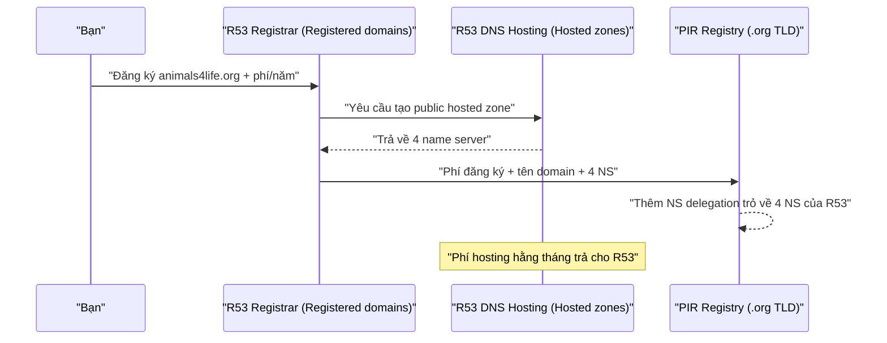
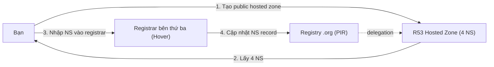

# R53 Interoperability

> **TL;DR:** Route 53 làm **hai việc khác nhau**: **Domain Registrar** (đăng ký domain với registry của TLD) và **Domain/DNS Hosting** (host zone file trên 4 name server). Thường R53 làm cả hai, nhưng có thể chỉ làm **một trong hai**, phần còn lại do bên thứ ba (ví dụ Hover) đảm nhận. Mẫu hay gặp nhất là **R53 chỉ làm hosting**.

## 🖼️ Sơ đồ
![[R53 Interoperability.excalidraw]]
*Mở bằng plugin Excalidraw để chỉnh sửa · ảnh tĩnh: [[R53 Interoperability.svg]]*

![[R53 Interoperability - hosting only.excalidraw]]
*Mở bằng plugin Excalidraw để chỉnh sửa · ảnh tĩnh: [[R53 Interoperability - hosting only.svg]]*

## Khái niệm cốt lõi
Khi đăng ký domain bằng R53, thực chất có các bước sau:
1. **Nhận tiền**: phí đăng ký domain (trả theo năm hoặc 3 năm) → vai trò **registrar**.
2. **Cấp phát 4 name server** của R53 → vai trò **hosting**.
3. **Tạo zone file** (public hosted zone) trên 4 NS đó → vai trò **hosting** (tính phí hằng tháng).
4. **Liên lạc với registry của TLD** (ví dụ `.org` do **PIR** quản lý) → vai trò **registrar**.
5. Registry thêm entry cho domain với **4 NS record** trỏ về 4 name server ở trên → domain hoạt động trên DNS công cộng.

- **Registrar**: công ty đăng ký domain **thay mặt bạn** với **registry**. Registry là đơn vị quản lý một TLD và zone file của TLD đó. Trên console, phần này nằm ở **Registered domains**.
- **DNS hosting**: cung cấp name server và zone file để bạn quản lý record. Trên console, phần này nằm ở **Hosted zones** (public hosted zone, xem [[R53 Public Hosted Zones]]).
- Hai vai trò này là hai chức năng tách biệt về khái niệm, dù khi đăng ký trên R53 bạn chỉ thấy như một bước.

## Cách hoạt động / Kiến trúc

### 1) R53 làm cả hai (mặc định)

### 2) R53 chỉ làm Registrar (hosting ở bên thứ ba)
- Vẫn trả phí đăng ký cho R53, và R53 vẫn làm việc với registry.
- Bên thứ ba (ví dụ Hover) **host zone** (thường tính phí hằng tháng). Bạn tạo zone ở đó, lấy danh sách name server, **đưa cho R53**, rồi R53 nhờ registry `.org` đặt NS record trỏ về NS của Hover.
- Nhiều bước thủ công hơn. Adrian cho rằng đây là **cách kém nhất**: chức năng registrar của R53 không có gì đặc biệt, còn phần tạo nhiều giá trị nhất của R53 (hosting) lại không được dùng. Ít gặp trong thực tế.

### 3) R53 chỉ làm Hosting (registrar là bên thứ ba), hay gặp
- Khi nào dùng: doanh nghiệp phải đăng ký qua registrar khác (hợp đồng, chiết khấu) hoặc **domain đã đăng ký từ lâu ở nơi khác** nhưng muốn dùng DNS hosting của R53.
- Các bước: **tạo public hosted zone** trên R53 (phí tháng) → lấy **4 NS** được cấp → nhập vào **registrar bên thứ ba** → registrar báo registry TLD → NS record trong TLD trỏ về R53 → zone hoạt động trên Internet.
- Làm được **ngay lúc đăng ký** hoặc **sau khi đã đăng ký** (cập nhật NS record ở registrar).

## Bảng so sánh / số liệu
| Kịch bản | Registrar | DNS hosting | Phí trả cho | Mức phổ biến |
|---|---|---|---|---|
| Cả hai trên R53 | R53 | R53 | R53 (đăng ký + hosting) | Mặc định |
| Registrar only | R53 | Bên thứ ba | R53 (đăng ký), bên thứ ba (hosting) | Hiếm, kém giá trị |
| Hosting only | Bên thứ ba | R53 | Bên thứ ba (đăng ký), R53 (hosting) | Phổ biến |

## 🎯 Mẹo thi SAA-C03
- Phải luôn tách bạch **registrar** (đăng ký, nói chuyện với registry TLD) và **DNS hosting** (zone file + name server).
- "Domain đăng ký ở GoDaddy/Hover, muốn quản lý DNS trên Route 53" → tạo **public hosted zone**, rồi **cập nhật NS record ở registrar hiện tại** (không cần transfer domain).
- "Chuyển domain sang R53" (transfer) là việc của registrar. Đổi nơi host DNS chỉ cần đổi NS record.
- Các tính năng như **Alias**, routing policy, health check chỉ có khi **R53 làm DNS hosting** (xem [[CNAME vs Alias]]).
- DNSSEC: nếu R53 là registrar thì thêm DS record ngay trên console; nếu không thì phải làm qua registrar bên ngoài (xem [[R53 DNSSEC]]).

## Liên kết
- Tiên quyết: [[Route 53 Fundamentals]], [[DNS Fundamentals]], [[R53 Public Hosted Zones]]
- Liên quan: [[R53 DNSSEC]], [[CNAME vs Alias]], [[R53 Routing Policies]], [[DNS Record Types]]
- Section: [[_MOC 10 Route 53]]
