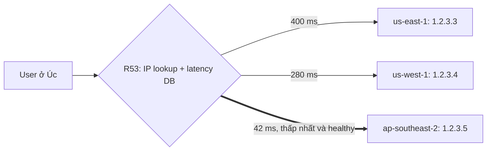

# R53 Latency Routing

> **TL;DR:** Mỗi record cùng tên được gắn một **AWS region** (record region). AWS duy trì một **database latency** giữa vùng của user và các region; R53 trả record có **latency ước tính thấp nhất** (và healthy). Dùng để tối ưu **performance và trải nghiệm người dùng** cho ứng dụng global.

## 🖼️ Sơ đồ
![[R53 Latency Routing.excalidraw]]
*Mở bằng plugin Excalidraw để chỉnh sửa · ảnh tĩnh: [[R53 Latency Routing.svg]]*

## Khái niệm cốt lõi
- Nhiều record cùng tên (`www`), mỗi record có **record region**: ví dụ `us-east-1 → 1.2.3.3`, `us-west-1 → 1.2.3.4`, `ap-southeast-2 → 1.2.3.5`.
- **Chỉ 1 record cùng tên cho mỗi AWS region**. Region là nơi đặt hạ tầng của record đó.
- Khi có query, R53 xác định vị trí user bằng **IP lookup**, tra **database latency** (vị trí user ↔ region) và chọn region latency thấp nhất.
  - Ví dụ user ở Úc: us-east-1 khoảng 400 ms, us-west-1 khoảng 280 ms, ap-southeast-2 khoảng 42 ms → trả `1.2.3.5`.
- **Kết hợp health check**: record latency thấp nhất mà unhealthy → trả record có **latency thấp tiếp theo**.
- Hạn chế: database **không real-time**, được cập nhật ở background và **không tính tới sự cố mạng cục bộ**. Dù vậy vẫn cải thiện đáng kể hiệu năng.

## Cách hoạt động / Kiến trúc

## Bảng so sánh / số liệu
| | Latency | Geoproximity | Geolocation |
|---|---|---|---|
| Tiêu chí | Latency ước tính (DB của AWS) | Khoảng cách địa lý + bias | Vị trí có khớp tag không |
| Tag record | AWS region | AWS region hoặc lat/long | State/country/continent/default |
| Luôn trả record nào đó? | Có (region tốt nhất còn healthy) | Có (gần nhất sau bias) | Không, có thể trả NO ANSWER |

## 🎯 Mẹo thi SAA-C03
- "**Lowest latency**", "best performance cho user toàn cầu", ứng dụng triển khai ở **nhiều region** → **Latency routing**.
- Giới hạn: **một record cho mỗi region** với cùng một tên.
- Đừng nhầm với geolocation (theo vị trí, có thể không trả gì) hay geoproximity (theo khoảng cách + bias).
- Nếu đề yêu cầu cải thiện performance ở **tầng mạng** (anycast IP, đi backbone AWS, failover nhanh không phụ thuộc DNS cache) → [[Global Accelerator]]. Nếu yêu cầu cache nội dung → [[CloudFront Architecture]].

## Liên kết
- Tổng quan: [[R53 Routing Policies]]
- Phân biệt với: [[R53 Geoproximity Routing]], [[R53 Geolocation Routing]], [[Global Accelerator]]
- Liên quan: [[R53 Health Checks]], [[AWS Global Infrastructure]], [[Regional and Global Architecture]], [[CloudFront Architecture]]
- Section: [[_MOC 10 Route 53]]
