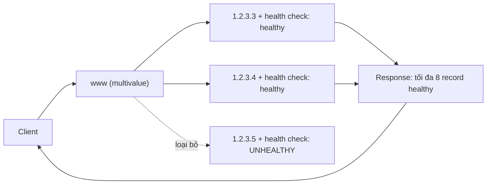

# R53 Multivalue Routing

> **TL;DR:** Multivalue routing giống sự kết hợp giữa simple và failover: tạo **nhiều record cùng tên**, mỗi record có **health check riêng**. Khi query, R53 trả **tối đa 8 record healthy** (nếu có nhiều hơn 8 thì chọn ngẫu nhiên 8) và client chọn một. Đây là cách **active-active** bằng DNS để tăng availability, **không thay thế load balancer**.

## 🖼️ Sơ đồ
![[R53 Multivalue Routing.excalidraw]]
*Mở bằng plugin Excalidraw để chỉnh sửa · ảnh tĩnh: [[R53 Multivalue Routing.svg]]*

## Khái niệm cốt lõi
- Nhiều record **cùng tên** (ví dụ 3 record `www` kiểu A: `1.2.3.3`, `1.2.3.4`, `1.2.3.5`).
- **Mỗi record độc lập** và có thể gắn một health check (xem [[R53 Health Checks]]).
- Query trả về **tối đa 8 record healthy**. Hơn 8 thì **8 được chọn ngẫu nhiên**.
- Record **fail health check không được trả về** nên client không chọn trúng nó.
- Client chọn **một** value và kết nối.
- Mục tiêu: **tăng availability** theo kiểu active-active. Nó **không** xử lý kết nối ở tầng mạng như load balancer (xem [[Elastic Load Balancer]]).

## Cách hoạt động / Kiến trúc

## Bảng so sánh / số liệu
| | Simple | Failover | Multivalue |
|---|---|---|---|
| Số record cùng tên | 1 (nhiều value) | 2 (primary/secondary) | Nhiều, mỗi record độc lập |
| Health check | Không | Có (thường trên primary) | Có, từng record |
| Trả về | Tất cả value, ngẫu nhiên | 1 record (primary hoặc secondary) | Tối đa 8 record healthy |
| Mô hình | 1 service | Active-passive | Active-active |

## 🎯 Mẹo thi SAA-C03
- "Trả về **nhiều IP**, chỉ những IP **healthy**", "tối đa **8**" → **Multivalue**.
- Phân biệt với Simple: Simple cũng trả nhiều value nhưng **không health check**.
- Multivalue **không phải** load balancer. Nếu đề cần phân phối kết nối thực sự, health check tầng ứng dụng, sticky session... thì chọn **ELB**.
- Dùng khi có nhiều tài nguyên đều phục vụ được request và muốn chọn ngẫu nhiên trong số tài nguyên còn sống.

## Liên kết
- Tổng quan: [[R53 Routing Policies]]
- Phân biệt với: [[R53 Simple Routing]], [[R53 Failover Routing]], [[R53 Weighted Routing]], [[Elastic Load Balancer]]
- Liên quan: [[R53 Health Checks]], [[HA vs FT vs DR]]
- Section: [[_MOC 10 Route 53]]
