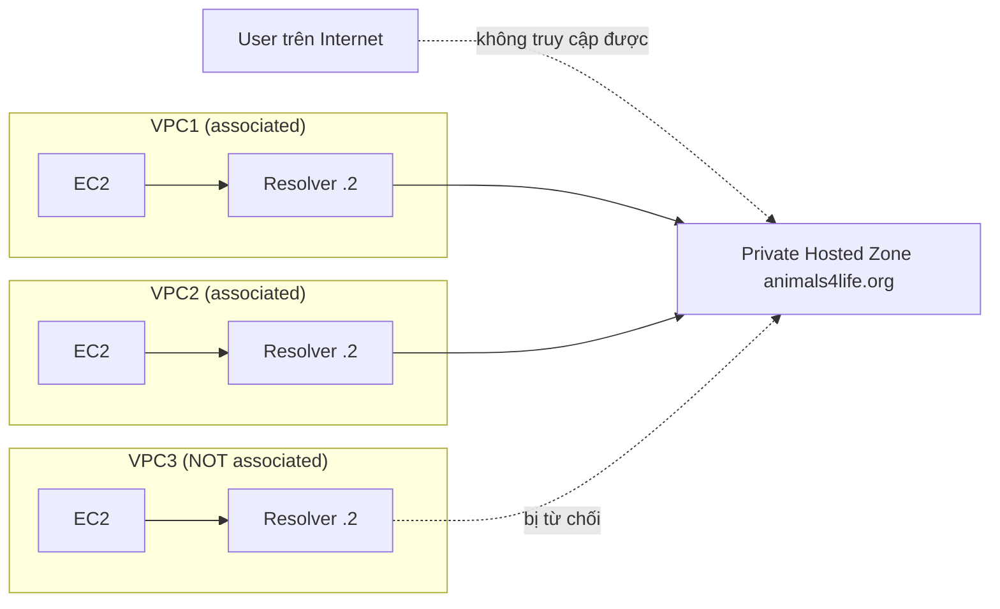

# R53 Private Hosted Zones

> **TL;DR:** Private hosted zone hoạt động y hệt public hosted zone nhưng **không public**: nó được **associate với một hoặc nhiều VPC** và chỉ resolve được từ bên trong các VPC đó. Kết hợp với public zone cùng tên tạo ra **split-view (split-horizon) DNS**.

## 🖼️ Sơ đồ
![[R53 Private Hosted Zones.excalidraw]]
*Mở bằng plugin Excalidraw để chỉnh sửa · ảnh tĩnh: [[R53 Private Hosted Zones.svg]]*

![[R53 Private Hosted Zones - split-view.excalidraw]]
*Mở bằng plugin Excalidraw để chỉnh sửa · ảnh tĩnh: [[R53 Private Hosted Zones - split-view.svg]]*

## Khái niệm cốt lõi
- "Một public hosted zone… nhưng không public": vẫn tạo resource record như bình thường, nhưng chỉ resolve được trong các VPC đã associate.
- **Association**:
  - VPC trong **cùng account**: làm được qua console UI, CLI, API.
  - VPC ở **account khác**: chỉ làm được qua **CLI/API** (không có trên console). Thực tế là hai bước: tạo *VPC association authorization* ở account sở hữu zone, rồi associate từ account sở hữu VPC.
- Muốn truy cập private zone thì client phải **chạy trong một VPC** và VPC đó phải **được associate** với zone. Từ Internet hay từ VPC không associate đều không query được.
- Client trong VPC dùng **Route 53 Resolver (VPC+2)**. VPC cần bật `enableDnsSupport` và `enableDnsHostnames` (khóa học chỉ nói "DNS được bật cho VPC").
- Dùng cho record **nhạy cảm/nội bộ** mà không muốn lộ ra DNS công cộng.
- Tên zone **không cần là domain bạn sở hữu** (demo dùng `ilikedogsreally.com`), vì zone không bao giờ được delegate từ DNS công cộng.

## Cách hoạt động / Kiến trúc

### Split-view / Split-horizon DNS
- Tạo **public hosted zone và private hosted zone trùng tên** (ví dụ `animals4life.org`).
- Bên trong VPC đã associate, resolver trả lời từ **private zone**; từ Internet, query đi qua root → TLD → name server R53 của **public zone**.
- Mẫu kiến trúc phổ biến: **private zone là superset** (chứa thêm record nhạy cảm như `accounting A 8.7.6.5`), public zone chỉ chứa một tập con (`www`, `MX`, `TXT`). Record `accounting` không truy cập được từ Internet.
- Use case: intranet công ty chạy cùng địa chỉ với website; người trong mạng thấy intranet, người ngoài thấy website; hoặc một số hệ thống chỉ resolve được trong môi trường nội bộ (ví dụ Amazon WorkSpaces trong VPC truy cập hệ thống kế toán).

## Bảng so sánh / số liệu
| | Public hosted zone | Private hosted zone |
|---|---|---|
| Truy cập từ Internet | Có | Không |
| Truy cập từ VPC | Có (qua VPC+2) | Chỉ VPC đã associate |
| Name server công cộng | 4 NS riêng cho zone | Không delegate công cộng |
| Cần sở hữu domain | Có (để delegate) | Không |
| Cross-account | Không áp dụng | Associate VPC khác account qua CLI/API |

## Demo / Lab
(Phần 2 của demo failover, bài 0185)
1. Tạo private hosted zone `ilikedogsreally.com`, associate với **default VPC** ở us-east-1.
2. Tạo record simple `www` → A `1.1.1.1`, TTL 60s.
3. Từ EC2 (nằm trong A4L-VPC1, không phải default VPC) chạy `ping www.ilikedogsreally.com` → **"Name or service not known"**, vì VPC của instance chưa được associate.
4. Edit hosted zone, thêm association với `a4l-vpc1` → chờ khoảng **4–5 phút** để có hiệu lực → ping resolve được.
- Rút ra: resolve được hay không phụ thuộc hoàn toàn vào việc **VPC của client có được associate** với zone hay không, và thay đổi association cần vài phút mới có hiệu lực.

## 🎯 Mẹo thi SAA-C03
- Cần DNS nội bộ cho tài nguyên trong VPC, không lộ ra Internet → **private hosted zone + associate VPC**.
- Cùng một tên miền nhưng nội bộ và bên ngoài thấy record khác nhau → **split-view**: public zone và private zone trùng tên.
- Instance không resolve được record trong private zone → kiểm tra (1) VPC đã associate chưa, (2) `enableDnsSupport`/`enableDnsHostnames` đã bật chưa.
- Associate private zone với VPC ở **account khác** → chỉ qua **CLI/API**, không qua console.
- On-premises muốn resolve private zone thì cần Route 53 Resolver inbound endpoint qua VPN/Direct Connect (ngoài phạm vi bài này; xem [[Site-to-Site VPN]], [[Direct Connect]]).

## Liên kết
- Tiên quyết: [[R53 Public Hosted Zones]], [[Route 53 Fundamentals]], [[DNS Fundamentals]]
- Liên quan: [[Custom VPC]], [[Default VPC]], [[VPC Sizing and Structure]], [[R53 Failover Routing]] (cùng demo), [[AWS Organizations]] (môi trường multi-account)
- Phân biệt với: [[R53 Public Hosted Zones]]
- Section: [[_MOC 10 Route 53]]
