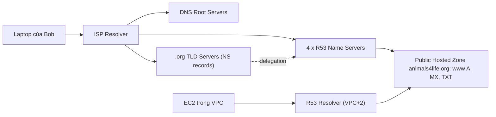

# R53 Public Hosted Zones

> **TL;DR:** Public hosted zone là một zone file (DNS database) cho một domain, được Route 53 host trên **4 public name server** riêng cho zone đó. Nó truy cập được từ **Internet** (qua cơ chế "walking the tree") và từ **VPC** (qua Route 53 Resolver ở địa chỉ VPC+2).

## 🖼️ Sơ đồ
![[R53 Public Hosted Zones.excalidraw]]
*Mở bằng plugin Excalidraw để chỉnh sửa · ảnh tĩnh: [[R53 Public Hosted Zones.svg]]*

## Khái niệm cốt lõi
- **Hosted zone** = DNS database cho một phần của không gian DNS toàn cầu, cụ thể là một domain, ví dụ `animals4life.org`. Có hai loại: **public** (note này) và **private** ([[R53 Private Hosted Zones]]).
- Route 53 là dịch vụ **globally resilient**: các name server rải khắp thế giới và cùng chứa một dataset, nên cả một region sập thì DNS vẫn chạy (xem [[Route 53 Fundamentals]], [[AWS Global Infrastructure]]).
- Hosted zone **được tạo tự động** khi bạn đăng ký domain bằng Route 53. Bạn cũng có thể **tạo riêng** để host một domain đăng ký ở nơi khác (Hover, GoDaddy...) → xem [[R53 Interoperability]].
- Hosted zone chứa các **resource record (RR)**: A, AAAA, MX, NS, TXT, CNAME... (xem [[DNS Record Types]]).
- Hosted zone là thứ mà hệ thống DNS tham chiếu tới qua **NS record (delegation)** → nó trở thành **authoritative** cho domain.
- **Chi phí**: phí hằng tháng cho mỗi hosted zone + một khoản rất nhỏ cho mỗi query. Không đáng kể với site nhỏ nhưng cần để ý với site lưu lượng lớn. (Bảng giá hiện tại khoảng 0.50 USD/zone/tháng cho 25 zone đầu, khóa học không nêu con số.)

## Cách hoạt động / Kiến trúc
- Khi tạo public hosted zone, R53 **cấp phát 4 name server** dành riêng cho zone đó và đặt zone file lên các server này.
- Để zone "sống" trên DNS công cộng: các **NS record của domain trong zone TLD** (ví dụ zone `.org`) phải trỏ về 4 name server này. Khi đăng ký bằng R53 thì R53 tự làm; nếu đăng ký nơi khác thì bạn copy 4 NS vào giao diện của registrar bên ngoài.
- **Truy cập từ Internet**: client → resolver của ISP → root servers → name server của TLD `.org` (có NS record cho `animals4life.org`) → một trong 4 name server R53 → trả record. Quá trình này gọi là **walking the tree** (chi tiết ở [[DNS Fundamentals]]).
- **Truy cập từ VPC**: instance trong VPC (nếu DNS được bật cho VPC) dùng **Route 53 Resolver tại địa chỉ VPC+2** làm DNS resolver. Resolver này query được cả public hosted zone của R53 lẫn mọi zone DNS công cộng khác trên Internet (xem [[VPC Sizing and Structure]] về địa chỉ dành riêng +2).

## Bảng so sánh / số liệu
| Thuộc tính | Public hosted zone |
|---|---|
| Số name server cấp cho mỗi zone | 4 |
| Truy cập từ | Internet công cộng + VPC (qua VPC+2 resolver) |
| Kết nối vào DNS toàn cầu | NS record trong zone TLD trỏ về 4 NS của R53 |
| Domain đăng ký ở registrar ngoài | Được: tạo zone rồi cập nhật NS ở registrar |
| Chi phí | Phí tháng cho mỗi zone + phí theo số query |

## 🎯 Mẹo thi SAA-C03
- "Public hosted zone có mấy name server?" → **4**, riêng cho từng zone.
- Domain đăng ký ở GoDaddy/Hover nhưng muốn quản lý DNS bằng R53 → **tạo public hosted zone** rồi **cập nhật NS record ở registrar** bên kia (không cần chuyển domain). Xem [[R53 Interoperability]].
- Instance trong VPC resolve DNS qua **VPC+2** (Route 53 Resolver); phải bật DNS cho VPC.
- Đã tạo zone mà domain vẫn không resolve → kiểm tra NS record ở cấp TLD/registrar có khớp 4 NS của zone không.

## Liên kết
- Tiên quyết: [[DNS Fundamentals]], [[Route 53 Fundamentals]], [[DNS Record Types]]
- Liên quan: [[R53 Interoperability]], [[R53 Routing Policies]], [[CNAME vs Alias]], [[R53 DNSSEC]], [[VPC Sizing and Structure]]
- Phân biệt với: [[R53 Private Hosted Zones]]
- Section: [[_MOC 10 Route 53]]
