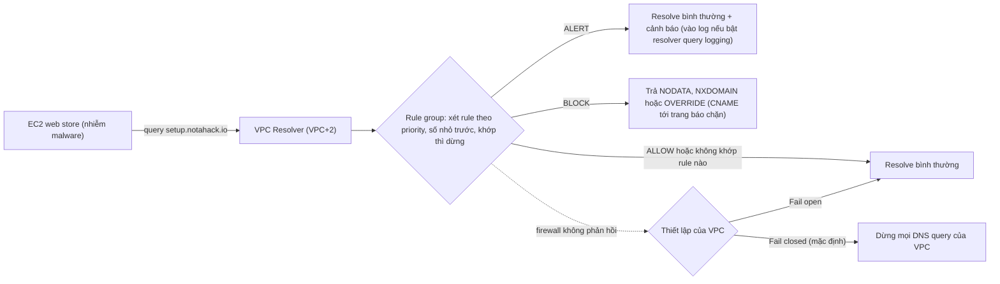

# R53 Resolver DNS Firewall

> **TL;DR:** Route 53 Resolver DNS Firewall (gọi tắt **DNS Firewall**) lọc các DNS query mà instance gửi tới **VPC Resolver (VPC+2)**, dựa trên **domain name chứ không phải IP**. Bạn tạo **rule group** gồm các rule (domain list + action **ALLOW / BLOCK / ALERT**), rồi **associate rule group với VPC** cùng region. Mục đích là chặn malware "phone home" tới server **command and control (C2)** hay rò rỉ dữ liệu qua DNS. Nó **chỉ bảo vệ VPC Resolver** và **chỉ chặn việc tra cứu tên**, không cắt kết nối đã mở sẵn.

## 🖼️ Sơ đồ
![[R53 Resolver DNS Firewall.excalidraw]]
*Mở bằng plugin Excalidraw để chỉnh sửa · ảnh tĩnh: [[R53 Resolver DNS Firewall.svg]]*

## Khái niệm cốt lõi
- **Vấn đề cần giải quyết**: mặc định instance trong VPC (ví dụ web store của Aus-E-Mart) dùng **Route 53 VPC Resolver ở địa chỉ VPC+2** để resolve DNS (xem [[R53 Public Hosted Zones]], [[VPC Sizing and Structure]]). Bản thân việc đó không sao, nhưng nếu instance **bị nhiễm virus/malware** thì DNS thường là mắt xích quan trọng của malware:
  - **Phone home**: vừa nhiễm, malware tra cứu domain của server **command and control** (ví dụ `setup.notahack.io`) để nhận lệnh tiếp theo. Domain này bạn không muốn VPC Resolver trả lời.
  - **Rò rỉ dữ liệu qua DNS**: hacker có thể gửi query theo cách đặc biệt để **mang chính dữ liệu** ra tới DNS server của chúng.
  - Mục tiêu của DNS Firewall là bảo vệ trước các kiểu tấn công **dựa trên DNS** như vậy.
- **Lọc theo domain name, không theo IP.** Mỗi rule nói một (nhóm) domain được **ALLOW**, **BLOCK** hay chỉ **ALERT** (cảnh báo khi có máy tra cứu domain đó).
  - **ALERT** là bước thử tốt trước khi BLOCK thật: xem sẽ chặn những gì mà chưa làm gãy ứng dụng.
- **Domain list**: danh sách domain mà rule dùng.
  - **AWS managed domain lists**: AWS dựng sẵn, gồm các domain đã biết liên quan tới **malware, botnet, ransomware, spyware**...
  - **Custom domain lists**: tự thêm domain bạn muốn chặn, cho phép hoặc theo dõi.
- **Chỉ áp dụng cho VPC Resolver**, không phải cho mọi DNS. Nếu trong VPC có **DNS server tự dựng** gọi thẳng ra DNS public bên ngoài thì DNS Firewall **không bảo vệ** được. Muốn chắc chắn thì dùng thêm **Network Firewall** hoặc [[NACL]] để chặn DNS query đi tới bất kỳ đâu ngoài VPC Resolver.
- **Chỉ áp dụng cho DNS** (không phải HTTP, SSH...). DNS Firewall chỉ chặn **việc tra cứu domain**, **không chặn kết nối**: máy đã nhiễm và đã mở kết nối tới domain độc hại từ trước khi bật firewall thì kết nối đó vẫn chạy, chỉ query DNS **mới** bị chặn. Đây chỉ là một mắt xích trong chuỗi bảo mật: lọc web traffic thì dùng [[WAF]], chặn IP cụ thể thì dùng [[NACL]].

## Cách hoạt động / Kiến trúc
- **Rule group** = tập hợp một hoặc nhiều **rule**. Mỗi rule = **một domain list (custom hoặc managed) + một action**. Ví dụ trong bài (region ap-southeast-2):
  - `AEM-Allowed` (custom) → ALLOW
  - `AEM-Alert` (custom) → ALERT
  - `AEM-Blocked` (custom) → BLOCK
  - một AWS managed domain list (botnet hoặc malware) → BLOCK
- Rule group **đứng riêng thì không làm gì**. Phải **associate rule group với một hoặc nhiều VPC** thì mới có hiệu lực.
  - Một rule group dùng được cho **nhiều VPC**; một VPC cũng associate được với **nhiều rule group**.
  - Rule group và VPC phải **cùng region**.
- **Thứ tự xử lý**: rule trong rule group xét theo **priority, số nhỏ nhất = ưu tiên cao nhất**; **khớp rule nào thì dừng** ở đó. VPC có nhiều rule group thì các rule group cũng được associate **theo thứ tự priority**. Query **không khớp rule nào thì được cho qua** (slide: "No match = allowed").
- **Fail open / fail closed** là thiết lập **trên VPC**, quyết định chuyện gì xảy ra khi DNS Firewall **không phản hồi**:
  - **Fail closed** (**mặc định**): mọi DNS query của **cả VPC** bị dừng. An toàn hơn, nhưng DNS của VPC có thể "chết" theo firewall.
  - **Fail open**: query được cho qua và trả về bình thường. Ưu tiên availability.

## Bảng so sánh / số liệu
| Thành phần / tùy chọn | Ý nghĩa |
|---|---|
| Action **ALLOW** | Cho resolve domain trong list |
| Action **BLOCK** | Chặn, trả lời client bằng **NODATA** (query thành công nhưng không có câu trả lời), **NXDOMAIN** (domain không tồn tại) hoặc **OVERRIDE** (trả một CNAME tùy chọn, gọi là **sinkhole**, ví dụ trang nội bộ "IT đã chặn site này") |
| Action **ALERT** | Không chặn, chỉ cảnh báo/ghi log; dùng để thử trước khi BLOCK |
| Domain list | **AWS managed** (malware, botnet, ransomware, spyware...) hoặc **custom** |
| Thứ tự | Priority số nhỏ xét trước, khớp thì dừng; không khớp = cho qua |
| Association | 1 rule group ↔ nhiều VPC, 1 VPC ↔ nhiều rule group (theo priority), **cùng region** |
| Không phản hồi | **Fail closed** (mặc định, chặn hết DNS của VPC) hoặc **Fail open** (cho qua) |
| **Walled garden** | Chặn mọi thứ mặc định, chỉ cho domain đã duyệt: rule ALLOW với domain list đã duyệt ở **priority số nhỏ nhất**, rule **BLOCK wildcard** (`*`) ở cuối. Rất an toàn nhưng khó quản lý (ví dụ VPC chỉ chạy instance payment gateway) |
| **Resolver query logging** | Bật thì action BLOCK và ALERT sinh bản ghi trong log → **audit trail**, tìm false positive khi thử, hoặc phát hiện máy nhiễm (rất nhiều block) |
| **Advanced rules** | Khớp theo **pattern** thay vì domain list, có **phát hiện theo hành vi**: chống **DGA** (malware sinh hàng nghìn domain dùng một lần mỗi ngày, block list thường không theo kịp) và **DNS tunneling** (mã hóa dữ liệu vào DNS query để tuồn ra ngoài) |

## 🎯 Mẹo thi SAA-C03
- Đề nói "chặn instance trong VPC **phân giải domain độc hại** / domain của malware, botnet, command and control", "chỉ cho phép resolve **danh sách domain đã duyệt**" → **Route 53 Resolver DNS Firewall** (rule group + domain list, associate với VPC).
- DNS Firewall lọc theo **domain name**, không theo IP. Chặn **IP** → [[NACL]]; lọc **HTTP/web request** → [[WAF]]; DNS Firewall **không** thay thế các dịch vụ đó.
- Chỉ bảo vệ query đi qua **VPC Resolver (VPC+2)**. Instance dùng DNS server riêng/DNS public thì đi vòng qua được → chặn DNS ra ngoài bằng Network Firewall hoặc NACL.
- Không cắt **kết nối đã có**; chỉ chặn **query DNS mới**.
- **Fail closed là mặc định**: firewall không phản hồi thì DNS cả VPC dừng. Ưu tiên availability → chọn **fail open**.
- "Block tất cả, chỉ allow danh sách đã duyệt" → **walled garden** (allow ở priority cao nhất, block `*` ở cuối).
- Muốn **thử** rule mà không làm gãy ứng dụng → action **ALERT** + resolver query logging trước, rồi mới BLOCK.
- Chống **DGA** và **DNS tunneling** → **advanced rules**.

## Liên kết
- Tiên quyết: [[R53 Public Hosted Zones]] (VPC Resolver ở VPC+2), [[R53 Private Hosted Zones]], [[VPC Sizing and Structure]]
- Liên quan: [[NACL]], [[WAF]], [[Layer 7 Firewall]], [[GuardDuty]], [[VPC Flow Logs]], [[R53 DNSSEC]] (DNSSEC validation cũng làm ở VPC Resolver)
- Section: [[_MOC 10 Route 53]]
