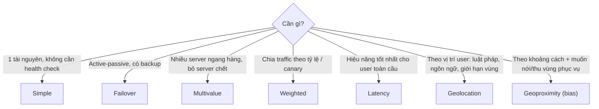

# R53 Routing Policies

> **TL;DR:** Routing policy quyết định Route 53 trả lời một DNS query **như thế nào** khi có một hoặc nhiều record cùng tên. Simple là mặc định và không có health check. Các policy còn lại (failover, multivalue, weighted, latency, geolocation, geoproximity) đều hỗ trợ [[R53 Health Checks]] và thêm "trí thông minh" vào việc chọn record.

## 🖼️ Sơ đồ
![[R53 Routing Policies.excalidraw]]
*Mở bằng plugin Excalidraw để chỉnh sửa · ảnh tĩnh: [[R53 Routing Policies.svg]]*

## Khái niệm cốt lõi
- Mọi policy đều bắt đầu từ một **hosted zone** ([[R53 Public Hosted Zones]] hoặc [[R53 Private Hosted Zones]]) và các record (thường là `www`).
- **Simple**: một record cho mỗi tên, record đó có thể có nhiều giá trị. **Không hỗ trợ health check.**
- Các policy khác cho phép **nhiều record cùng tên**, mỗi record có thêm thuộc tính riêng (primary/secondary, weight, region, location, bias...) và một **Record ID** (set identifier) duy nhất trong nhóm record cùng tên.
- Khi kết hợp health check: record **unhealthy thường không được trả về**.
- DNS có **cache theo TTL**: thay đổi do health check chỉ thấy được sau khi cache hết hạn. TTL thấp thì failover nhanh hơn (demo dùng 60s).

## Bảng so sánh / số liệu
| Policy | Nhiều record cùng tên? | Health check | Cách chọn record | Use case điển hình |
|---|---|---|---|---|
| [[R53 Simple Routing\|Simple]] | Không (1 record, nhiều value) | **Không** | Trả **tất cả** value, thứ tự ngẫu nhiên; client tự chọn | Một service duy nhất, ví dụ một web server |
| [[R53 Failover Routing\|Failover]] | Có: Primary + Secondary | Có (thường gắn vào primary) | Primary nếu healthy, nếu không thì Secondary | **Active-passive**, trang bảo trì trên S3 |
| [[R53 Multivalue Routing\|Multivalue]] | Có (mỗi record độc lập) | Có (mỗi record) | Trả **tối đa 8 record healthy**; hơn 8 thì chọn ngẫu nhiên 8 | **Active-active** đơn giản, tăng availability |
| [[R53 Weighted Routing\|Weighted]] | Có | Có | Theo tỷ lệ weight/tổng weight; unhealthy thì chọn lại | Load balancing đơn giản, **thử phiên bản mới** (5%...) |
| [[R53 Latency Routing\|Latency]] | Có, **1 record mỗi region** | Có | Region có **latency ước tính thấp nhất** tới user | Tối ưu **performance**, ứng dụng global |
| [[R53 Geolocation Routing\|Geolocation]] | Có | Có | Record **khớp vị trí** user: state → country → continent → default → NO ANSWER | **Giới hạn nội dung theo vùng**, nội dung theo ngôn ngữ |
| [[R53 Geoproximity Routing\|Geoproximity]] | Có | Có | **Khoảng cách gần nhất**, có điều chỉnh bằng **bias** (+/-) | Định tuyến theo khoảng cách, dồn thêm/bớt traffic cho một vùng |

> Hiện nay Route 53 còn có **IP-based routing** (định tuyến theo CIDR collection của client), không có trong bài giảng của khóa học.

## Cách hoạt động / Kiến trúc

### Ba cặp dễ nhầm
- **Simple vs Multivalue**: cả hai trả nhiều IP và client chọn một. Simple không health check, còn multivalue health check từng record và bỏ record chết.
- **Latency vs Geoproximity**: latency dựa trên **database latency** giữa vùng của user và AWS region. Geoproximity dựa trên **khoảng cách địa lý** và có **bias**.
- **Geolocation vs Geoproximity**: geolocation **không trả record gần nhất**, chỉ trả record **liên quan đến vị trí** (khớp state/country/continent/default). Geoproximity mới là "gần nhất".

## 🎯 Mẹo thi SAA-C03
- "Không cần health check / một web server" → **Simple**. Simple là policy **duy nhất không hỗ trợ health check**.
- "Active-passive", "trang bảo trì/static backup trên S3 khi site chính lỗi" → **Failover**.
- "Trả nhiều IP healthy, chọn ngẫu nhiên", "tối đa 8" → **Multivalue**. Multivalue **không thay thế load balancer**.
- "X% traffic tới phiên bản mới", "A/B, canary" → **Weighted**.
- "Độ trễ thấp nhất / performance cho user toàn cầu" → **Latency**.
- "Nội dung chỉ cho thị trường US", "ngôn ngữ theo quốc gia", "tuân thủ luật theo vùng" → **Geolocation**.
- "Route theo khoảng cách, mở rộng vùng phục vụ của một region" → **Geoproximity + bias**.
- Lưu ý TTL: failover qua DNS không tức thời, client cache theo TTL.

## Liên kết
- Tiên quyết: [[Route 53 Fundamentals]], [[R53 Public Hosted Zones]], [[R53 Health Checks]]
- Chi tiết từng policy: [[R53 Simple Routing]], [[R53 Failover Routing]], [[R53 Multivalue Routing]], [[R53 Weighted Routing]], [[R53 Latency Routing]], [[R53 Geolocation Routing]], [[R53 Geoproximity Routing]]
- Liên quan: [[HA vs FT vs DR]], [[Regional and Global Architecture]], [[Elastic Load Balancer]], [[Global Accelerator]]
- Section: [[_MOC 10 Route 53]]
