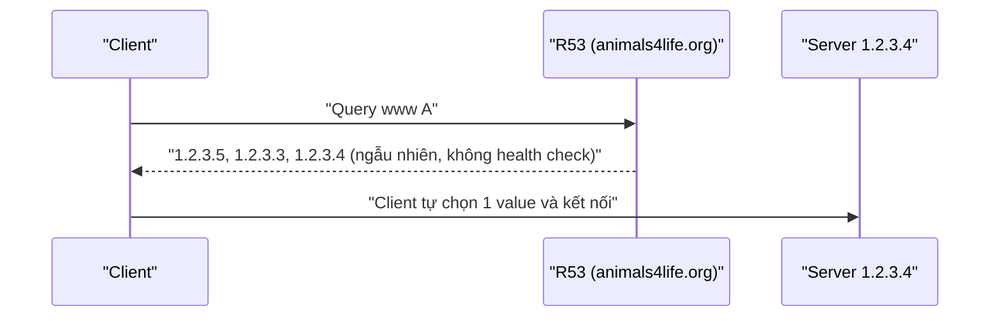

# R53 Simple Routing

> **TL;DR:** Routing policy mặc định và đơn giản nhất: **một record cho mỗi tên**, record đó có thể chứa nhiều giá trị. Mọi giá trị được trả về theo **thứ tự ngẫu nhiên** và client tự chọn một. **Không hỗ trợ health check.**

## 🖼️ Sơ đồ
![[R53 Simple Routing.excalidraw]]
*Mở bằng plugin Excalidraw để chỉnh sửa · ảnh tĩnh: [[R53 Simple Routing.svg]]*

## Khái niệm cốt lõi
- **1 record per name** (ví dụ chỉ một record `www` kiểu A trong zone `animals4life.org`).
- Một record có thể có **nhiều value**: `1.2.3.3`, `1.2.3.4`, `1.2.3.5`.
- Khi query, Route 53 trả **tất cả value trong cùng một response, thứ tự ngẫu nhiên**. Client chọn một value (ví dụ `1.2.3.4`) rồi kết nối tới server đó.
- **Không có health check**: R53 không kiểm tra tài nguyên có đang hoạt động không, nên vẫn có thể trả IP của server đã chết.
- Đây là **policy duy nhất** trong R53 không hỗ trợ health check. Mọi policy khác đều có health check và chọn record dựa vào đó.
- Ưu điểm: dễ triển khai và quản lý. Nhược điểm: kém linh hoạt, không có tính năng nâng cao.

## Cách hoạt động / Kiến trúc

## 🎯 Mẹo thi SAA-C03
- Dùng khi muốn route request tới **một service duy nhất**, ví dụ một web server.
- Đề nhắc tới yêu cầu **health check** hoặc tự động bỏ server lỗi → **không chọn Simple**. Với nhiều server ngang hàng có health check thì chọn [[R53 Multivalue Routing]].
- Đề hỏi "routing policy nào không hỗ trợ health check" → **Simple**.

## Liên kết
- Tổng quan: [[R53 Routing Policies]]
- Phân biệt với: [[R53 Multivalue Routing]] (giống nhưng có health check), [[R53 Failover Routing]]
- Liên quan: [[R53 Health Checks]], [[DNS Record Types]], [[EC2 Basics]]
- Section: [[_MOC 10 Route 53]]
