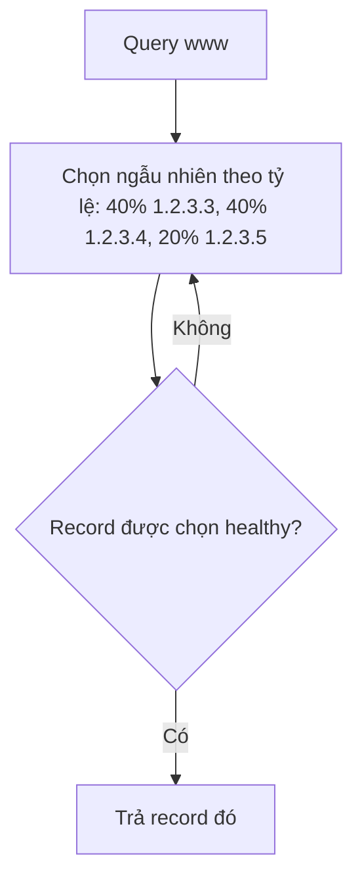

# R53 Weighted Routing

> **TL;DR:** Mỗi record cùng tên được gán một **record weight**. Xác suất một record được trả về = **weight của nó / tổng weight**. Dùng cho **load balancing đơn giản** hoặc **thử phiên bản phần mềm mới** (ví dụ 5% traffic). Có thể kết hợp health check: chọn trúng record unhealthy thì **chọn lại**.

## 🖼️ Sơ đồ
![[R53 Weighted Routing.excalidraw]]
*Mở bằng plugin Excalidraw để chỉnh sửa · ảnh tĩnh: [[R53 Weighted Routing.svg]]*

## Khái niệm cốt lõi
- Nhiều record cùng tên (ví dụ 3 record `www` A trỏ tới 3 EC2), mỗi record có **record weight**.
- Ví dụ weight 40 / 40 / 20 → tổng 100 → mỗi record được trả về lần lượt **40% / 40% / 20%** số lần.
- Công thức luôn là **weight / tổng weight**, không bắt buộc tổng bằng 100 (dùng 100 chỉ để dễ hình dung).
- **Weight = 0** → record **không bao giờ được trả về** (tạm "tắt" một record). Ngoại lệ: **nếu tất cả record đều weight 0 thì tất cả đều được xét**.
- **Kết hợp health check**: chọn record theo weight; nếu record đó **unhealthy** thì bỏ qua và **lặp lại quá trình chọn** cho tới khi được record healthy.
  - Health check **không loại record khỏi phép tính** và **không thay đổi tổng weight**.
- (Bổ sung: weight hợp lệ trong khoảng 0–255.)

## Cách hoạt động / Kiến trúc

## 🎯 Mẹo thi SAA-C03
- "Gửi **X% traffic** tới phiên bản mới / canary / blue-green bằng DNS" → **Weighted**.
- "Load balancing đơn giản bằng DNS theo tỷ lệ" → **Weighted** (nếu cần LB thật thì dùng [[Elastic Load Balancer]]).
- **Weight 0** = ngừng gửi traffic tới record đó. **Tất cả 0** = tất cả được trả như nhau.
- Record unhealthy **không làm đổi tổng weight**; R53 chỉ chọn lại.

## Liên kết
- Tổng quan: [[R53 Routing Policies]]
- Phân biệt với: [[R53 Multivalue Routing]], [[R53 Simple Routing]], [[Elastic Load Balancer]]
- Liên quan: [[R53 Health Checks]], [[EC2 Basics]]
- Section: [[_MOC 10 Route 53]]
