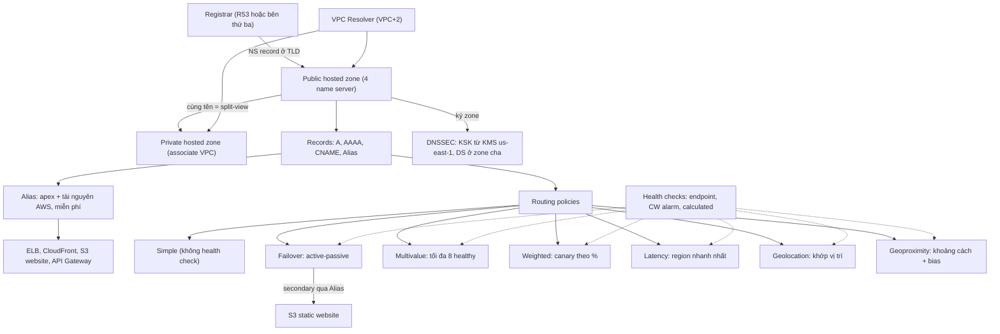

# 10 Route 53

Section này đi sâu vào Route 53 sau phần giới thiệu ở [[Route 53 Fundamentals]] và lý thuyết DNS ở [[DNS Fundamentals]]: public và private hosted zone, CNAME so với Alias, health check, bảy routing policy, cách R53 phối hợp với registrar bên ngoài, và bật DNSSEC. Routing policy và health check là nhóm câu hỏi rất hay gặp trong đề, và là mảnh DNS của các kiến trúc HA/DR ở [[_MOC 13 HA and Scaling]] và [[_MOC 15 Global Content Delivery]].

← [[00 Home]] · Section trước: [[_MOC 09 Advanced EC2]] · Section tiếp theo: [[_MOC 11 Databases]] →

## Lộ trình học
1. [[R53 Public Hosted Zones]] — zone file cho một domain, host trên 4 public name server riêng; resolve được từ Internet và từ VPC qua Resolver ở VPC+2.
2. [[R53 Private Hosted Zones]] — zone chỉ resolve trong các VPC đã associate; kết hợp với public zone cùng tên tạo split-view DNS.
3. [[CNAME vs Alias]] — CNAME không dùng được ở apex; Alias trỏ tới tài nguyên AWS, dùng được ở apex và query miễn phí.
4. [[R53 Routing Policies]] — tổng quan 7 policy và cách chọn; Simple là policy duy nhất không có health check.
5. [[R53 Simple Routing]] — một record mỗi tên, nhiều value trả về ngẫu nhiên, không health check.
6. [[R53 Health Checks]] — đối tượng độc lập do fleet checker toàn cầu chạy; ba loại endpoint, CloudWatch alarm, calculated.
7. [[R53 Failover Routing]] — Primary/Secondary cùng tên, health check trên primary; active-passive, thường dự phòng bằng S3 static site.
8. [[R53 Multivalue Routing]] — nhiều record có health check riêng, trả tối đa 8 record healthy; active-active, không thay load balancer.
9. [[R53 Weighted Routing]] — xác suất trả record = weight/tổng weight; dùng cho canary, thử phiên bản mới.
10. [[R53 Latency Routing]] — record gắn region, trả region có latency ước tính thấp nhất cho user.
11. [[R53 Geolocation Routing]] — khớp vị trí user theo state → country → continent → default; không khớp thì NO ANSWER.
12. [[R53 Geoproximity Routing]] — trả tài nguyên gần nhất theo khoảng cách, dùng bias để nới hoặc thu vùng phục vụ.
13. [[R53 Interoperability]] — tách vai trò Registrar và DNS Hosting; mẫu phổ biến là registrar bên ngoài, R53 chỉ host zone.
14. [[R53 DNSSEC]] — KSK từ asymmetric KMS key ở us-east-1, ZSK do R53 quản lý, DS record ở zone cha để lập chain of trust.

## Bản đồ khái niệm

## Liên kết sang section khác
- [[DNS Fundamentals]] và [[DNS Record Types]] — nền tảng zone, NS, walking the tree, các loại record.
- [[DNSSEC]] — lý thuyết chain of trust, KSK/ZSK trước khi bật trên R53.
- [[Route 53 Fundamentals]] — đăng ký domain và hosted zone ở mức cơ bản.
- [[S3 Static Website Hosting]] — đích secondary của failover qua Alias.
- [[Elastic Load Balancer]] — đích Alias phổ biến nhất; LB thật thay cho multivalue/weighted.
- [[Global Accelerator]] — cải thiện performance và failover tầng mạng, không phụ thuộc DNS cache.
- [[CloudFront Architecture]] — cache nội dung và geo restriction ở tầng CDN.
- [[HA vs FT vs DR]] — failover routing là kỹ thuật DR mức DNS.
- [[KMS]] — asymmetric key ở us-east-1 cho KSK của DNSSEC.
- [[Direct Connect]] — on-premises resolve private hosted zone qua Resolver endpoint trên kết nối hybrid.

## 🎯 Top mẹo thi của section
- Public hosted zone có **4 name server** riêng; domain đăng ký ở GoDaddy/Hover mà muốn dùng R53 → tạo public zone rồi **đổi NS ở registrar**, không cần transfer. ([[R53 Interoperability]])
- DNS nội bộ cho VPC → **private hosted zone + associate VPC**, bật `enableDnsSupport`/`enableDnsHostnames`; cùng tên nhưng nội bộ và bên ngoài thấy khác nhau → **split-view**. ([[R53 Private Hosted Zones]])
- Trỏ **apex domain** tới ELB/CloudFront/S3 website → **Alias** (CNAME không hợp lệ ở apex); với tài nguyên AWS mặc định chọn Alias. ([[CNAME vs Alias]])
- **Simple** là policy duy nhất **không hỗ trợ health check**. ([[R53 Simple Routing]])
- "Active-passive", "trang bảo trì trên S3 khi site chính lỗi" → **Failover** + health check trên primary. ([[R53 Failover Routing]])
- "Nhiều IP, chỉ trả IP healthy, tối đa 8" → **Multivalue**; nó **không** thay thế ELB. ([[R53 Multivalue Routing]])
- "X% traffic tới phiên bản mới, canary" → **Weighted**; weight 0 = ngừng gửi traffic. ([[R53 Weighted Routing]])
- "Lowest latency cho user toàn cầu" → **Latency**; một record mỗi region cho cùng tên. ([[R53 Latency Routing]])
- "Nội dung theo quốc gia/ngôn ngữ, giới hạn thị trường" → **Geolocation**; nó theo **vị trí khớp**, không theo khoảng cách; thiếu record default thì user ngoài vùng nhận NO ANSWER. ([[R53 Geolocation Routing]])
- "Bias", "nới/thu vùng địa lý, dịch traffic giữa các vùng" → **Geoproximity**. ([[R53 Geoproximity Routing]])
- Cần kiểm tra **nội dung trang** → HTTP/HTTPS + string matching; tài nguyên private hoặc metric nội bộ → **CloudWatch alarm health check**; gộp nhiều thành phần → **calculated**. ([[R53 Health Checks]])
- Health check báo unhealthy dù app chạy → firewall/SG/WAF đang chặn IP của health checker. ([[R53 Health Checks]])
- Failover qua DNS **không tức thời**: phụ thuộc health check interval và **TTL**. ([[R53 Routing Policies]])
- DNSSEC trên R53: KMS key **asymmetric ở us-east-1** cho KSK, ZSK do R53 quản lý; DNSSEC bảo đảm toàn vẹn và nguồn gốc, **không mã hóa** query. ([[R53 DNSSEC]])
