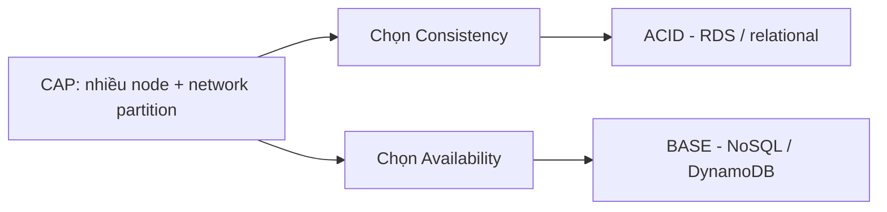

# ACID vs BASE

> **TL;DR:** ACID và BASE là hai **database transaction model**, quyết định cách một DB được kiến trúc. Theo **CAP theorem**, DB phân tán phải chọn giữa consistency và availability: **ACID ưu tiên consistency** (RDS, giới hạn scale), **BASE ưu tiên availability** (NoSQL như DynamoDB, scale và hiệu năng cao).

## 🖼️ Sơ đồ
![[ACID vs BASE.excalidraw]]
*Mở bằng plugin Excalidraw để chỉnh sửa · ảnh tĩnh: [[ACID vs BASE.svg]]*

## CAP theorem
- **C – Consistency**: mọi lần đọc nhận được **lần ghi mới nhất**, hoặc nhận lỗi.
- **A – Availability**: mọi request nhận được phản hồi **không lỗi**, nhưng **không đảm bảo** là dữ liệu mới nhất.
- **P – Partition tolerance**: hệ thống gồm nhiều node/partition mạng vẫn chạy dù có message bị rớt hoặc lỗi giữa các node.
- Định lý: một DB chỉ đạt **tối đa 2/3** yếu tố. Với DB nhiều node trên mạng (luôn phải chịu partition), khi node mất liên lạc có 2 lựa chọn:
  - **Hủy thao tác** → giảm availability, giữ consistency → hướng **ACID**.
  - **Vẫn thực hiện** → giữ availability, chấp nhận rủi ro consistency → hướng **BASE**.

## ACID
| Chữ | Ý nghĩa |
|---|---|
| **A – Atomic** | Giao dịch thành công **toàn bộ hoặc không gì cả**. Ví dụ chuyển $10 từ tài khoản A sang B: trừ A và cộng B phải cùng thành công hoặc cùng không áp dụng. |
| **C – Consistent** | Giao dịch đưa DB từ **trạng thái hợp lệ này sang trạng thái hợp lệ khác**, không có trạng thái lửng; tuân thủ ràng buộc (quan hệ bảng, miền giá trị). |
| **I – Isolated** | Các giao dịch chạy song song **không ảnh hưởng nhau**; kết quả như thể chạy tuần tự. |
| **D – Durable** | Đã commit thì **bền vững** kể cả khi mất điện, hỏng hệ thống, restart node. |

- Đa số relational DB dùng ACID → lý do ngành **tài chính** dùng chúng (quản lý dữ liệu chặt chẽ).
- Đổi lại: các quy tắc cứng nhắc **giới hạn khả năng scale**.

## BASE
| Chữ | Ý nghĩa |
|---|---|
| **BA – Basically Available** | Đọc/ghi sẵn sàng "nhiều nhất có thể" nhưng **không đảm bảo consistency** ("kinda, maybe"). DB nhân bản dữ liệu ra nhiều node để giữ availability. |
| **S – Soft state** | DB **không tự ép consistency**, đẩy trách nhiệm cho **application/developer**. Ứng dụng phải chấp nhận đọc được dữ liệu cũ, hoặc chủ động yêu cầu consistent read nếu DB hỗ trợ. |
| **E – Eventually consistent** | Nếu **đợi đủ lâu**, đọc sẽ khớp với ghi trước đó. Mặc định đọc là eventually consistent. |

- Nghe có vẻ tệ nhưng BASE cho **khả năng scale rất cao và hiệu năng cao** vì DB không phải gánh việc bảo đảm consistency.
- **DynamoDB** hoạt động kiểu BASE: hỗ trợ cả **eventually consistent** và **strongly (immediately) consistent read** — ứng dụng phải chủ động chọn. DynamoDB còn có **DynamoDB Transactions** cung cấp tính năng kiểu ACID. Xem [[DynamoDB Operations and Performance]].

## Bảng so sánh
| | ACID | BASE |
|---|---|---|
| Ưu tiên (CAP) | Consistency | Availability |
| Consistency | Ngay lập tức, DB tự ép | Eventual, ứng dụng tự lo |
| Scale | Hạn chế | Rất cao |
| Ví dụ AWS | RDS, Aurora | DynamoDB (mặc định) |
| Use case | Tài chính, giao dịch chặt | Web-scale, throughput lớn |

## 🎯 Mẹo thi SAA-C03
- Thấy **BASE** → mặc định hiểu là **NoSQL** database.
- Thấy **ACID** → mặc định hiểu là **RDS** (relational).
- Thấy **ACID đi cùng NoSQL hoặc DynamoDB** → có thể đang nói **DynamoDB Transactions**.
- ACID = scale hạn chế; câu hỏi cần scale cực lớn + chấp nhận eventual consistency → BASE/DynamoDB.
- Nhớ định nghĩa CAP: Consistency = luôn đọc dữ liệu mới nhất hoặc lỗi; Availability = luôn có phản hồi nhưng có thể cũ.

## Liên kết
- Tiên quyết: [[Database Models]]
- Dùng trong: [[RDS Architecture]], [[Aurora]], [[DynamoDB Architecture]], [[DynamoDB Operations and Performance]]
- Liên quan: [[RDS Read Replicas]] (replication async → đọc có thể cũ), [[DynamoDB Global Tables]]
- Section: [[_MOC 11 Databases]]
