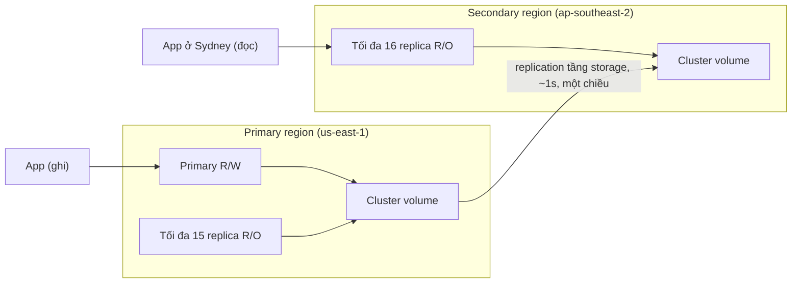

# Aurora Global Database

> **TL;DR:** Aurora Global Database sao chép một Aurora cluster từ **primary region** sang các **secondary region** ở **tầng storage**, độ trễ thường **≤ 1 giây**, không tốn CPU của DB. Dùng cho **cross-region DR/BC** (RPO và RTO thấp) và **global read scaling** (đọc latency thấp cho khách hàng quốc tế).

## 🖼️ Sơ đồ
![[Aurora Global Database.excalidraw]]
*Mở bằng plugin Excalidraw để chỉnh sửa · ảnh tĩnh: [[Aurora Global Database.svg]]*

## Khái niệm cốt lõi
- **Primary region**: giống một Aurora cluster bình thường, gồm **1 instance read/write + tối đa 15 read replica**.
- **Secondary region**: toàn bộ cluster **read-only** trong lúc hoạt động bình thường, có tối đa **16 replica** (không có writer nên cả 16 slot đều là read replica; 1 + 15 = 16).
- Tối đa **5 secondary region** theo khóa học. (Hiện nay AWS đã nâng lên 10 secondary region.)
- Replication **một chiều** (primary → secondary), **không bidirectional**.
- Replication ở **storage layer**, thường **~1 giây hoặc ít hơn**, **không ảnh hưởng hiệu năng DB** (không tốn CPU instance).
- App ghi vào primary instance ở primary region; đọc từ replica ở primary hoặc ở bất kỳ secondary nào.
- Khi có sự cố mất cả region, có thể **promote** secondary cluster lên read/write.

## Cách hoạt động / Kiến trúc

## 🎯 Mẹo thi SAA-C03
- "**Cross-region DR** cho DB quan hệ với **RPO/RTO rất thấp**" → Aurora Global Database (replication ~1s, promote secondary khi mất region). Xem [[RPO and RTO]].
- "Khách hàng ở nhiều châu lục cần **đọc latency thấp**" → thêm secondary region gần họ (global read scaling).
- "Replication không được ảnh hưởng hiệu năng DB" → replication tầng storage, không tốn CPU.
- Bẫy: Global Database là **một chiều**, chỉ có một region ghi. Nếu đề cần **ghi ở nhiều region (multi-active)** với NoSQL → [[DynamoDB Global Tables]].
- Phân biệt với cross-region read replica của RDS thường ([[RDS Read Replicas]]): đó là replication async ở mức engine; Aurora Global ở mức storage, nhanh hơn và không tốn tài nguyên instance.
- Con số: 5 secondary region (khóa học; nay là 10), 16 replica mỗi secondary, ~1s.

## Liên kết
- Tiên quyết: [[Aurora]], [[RPO and RTO]], [[HA vs FT vs DR]]
- Liên quan: [[Regional and Global Architecture]], [[Aurora Serverless]], [[R53 Failover Routing]], [[AWS Global Infrastructure]]
- Phân biệt với: [[DynamoDB Global Tables]], [[RDS Read Replicas]], [[Aurora Multi-Master]]
