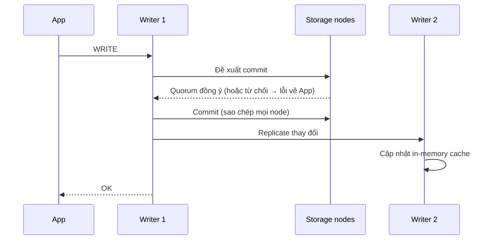
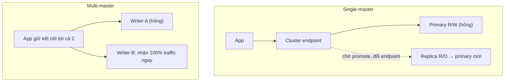

# Aurora Multi-Master

> **TL;DR:** Ở chế độ mặc định (**single-master**), Aurora có một writer và nhiều reader; failover cần thời gian để promote replica. **Multi-master** cho mọi instance trong cluster cùng đọc và ghi, nên khi một writer chết, ứng dụng chỉ việc chuyển sang writer còn lại. Đây là nền móng để xây ứng dụng gần như **fault tolerant**, đổi lại ứng dụng phải tự quản kết nối và cân tải.

## 🖼️ Sơ đồ
![[Aurora Multi-Master.excalidraw]]
*Mở bằng plugin Excalidraw để chỉnh sửa · ảnh tĩnh: [[Aurora Multi-Master.svg]]*

![[Aurora Multi-Master - write.excalidraw]]
*Mở bằng plugin Excalidraw để chỉnh sửa · ảnh tĩnh: [[Aurora Multi-Master - write.svg]]*

## Khái niệm cốt lõi

### Single-master (mặc định)
- 1 instance **read/write** + 0 hoặc nhiều replica **read-only**.
- Có **cluster endpoint** (đọc/ghi, luôn trỏ primary) và **reader endpoint** (cân tải đọc qua các replica). Xem [[Aurora]].
- Failover: primary hỏng → truy cập bị gián đoạn → cluster chọn một replica, promote lên read/write, rồi đổi cluster endpoint sang nó. Nhanh hơn RDS thường (storage dùng chung) nhưng **vẫn có gián đoạn**, nên ứng dụng không thể fault tolerant.

### Multi-master
- Mọi instance mặc định đều **read/write**; không có khái niệm failover kéo dài.
- Vẫn cùng cấu trúc cluster, cùng shared storage, nhiều instance Aurora provisioned.
- **Không có cluster endpoint** và **không có load balancing**. Ứng dụng tự kết nối tới một hoặc tất cả instance và gửi lệnh trực tiếp.

## Cách hoạt động / Kiến trúc

### Luồng ghi
1. Một writer nhận lệnh ghi từ ứng dụng và **đề xuất** commit dữ liệu tới tất cả storage node của cluster.
2. Mỗi storage node **chấp nhận hoặc từ chối**; từ chối nếu xung đột với thay đổi khác đang diễn ra (ví dụ một writer khác đang ghi cùng dữ liệu).
3. Writer cần **quorum** đồng ý. Có quorum thì commit vào shared storage (sao chép qua mọi storage node như single-master). Bị quorum từ chối thì hủy thay đổi và **trả lỗi** cho ứng dụng.
4. Khác biệt chính: thay đổi đã commit được **replicate sang các writer khác** để chúng cập nhật **in-memory cache**. Nhờ vậy đọc từ bất kỳ instance nào cũng nhất quán với storage.

### Failover so sánh

- Multi-master: ứng dụng giữ kết nối tới cả hai writer; khi một writer chết, nó gửi toàn bộ thao tác sang writer còn lại, gần như không gián đoạn.
- Multi-master là **một thành phần cần có** để xây ứng dụng fault tolerant, không phải bảo đảm tuyệt đối. Logic failover và cân tải nằm **trong ứng dụng** (xem [[HA vs FT vs DR]]).

### Cập nhật 2026
- Multi-master chỉ từng có trên **Aurora MySQL 5.6** (Aurora MySQL v1), và đã **ngừng cùng với v1 (2023)**; các version Aurora hiện tại không còn tùy chọn này. Ý tưởng vẫn đáng biết cho đề thi. Nhu cầu ghi ở nhiều nơi hiện nay được giải quyết bằng các dịch vụ khác (ví dụ Aurora DSQL cho active-active nhiều region, hoặc [[DynamoDB Global Tables]]).

## Bảng so sánh / số liệu
| | Single-master | Multi-master |
|---|---|---|
| Writer | 1 | Tất cả instance |
| Endpoint | Cluster + reader (cân tải) | Không có cluster endpoint, app kết nối từng instance |
| Load balancing | Có (reader endpoint) | Không, app tự làm |
| Failover | Promote replica, có gián đoạn | Trong ứng dụng, gần như tức thời |
| Xung đột ghi | Không có | Quorum quyết định, có thể trả lỗi |

## 🎯 Mẹo thi SAA-C03
- "Aurora, cần **fault tolerance / không gián đoạn khi writer hỏng**, nhiều writer" → Multi-master (theo khóa học).
- "Failover nhanh nhất có thể, tối thiểu downtime" mà không đòi nhiều writer → Aurora single-master + replica, có thể thêm [[RDS Proxy]].
- Bẫy: multi-master **không có load-balanced endpoint**; app phải tự quản kết nối.
- Multi-master là **trong một region**. Đừng nhầm với [[Aurora Global Database]] (một chiều, nhiều region).
- Adrian không kỳ vọng chủ đề này ra chi tiết trong đề.

## Liên kết
- Tiên quyết: [[Aurora]], [[HA vs FT vs DR]]
- Liên quan: [[RDS Multi-AZ]], [[RDS Proxy]], [[ACID vs BASE]]
- Phân biệt với: [[Aurora Global Database]], [[DynamoDB Global Tables]], [[RDS Read Replicas]]
