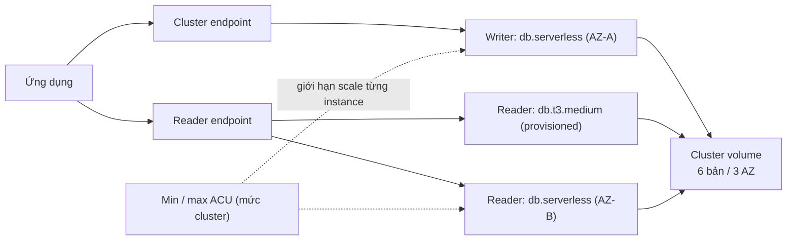

# Aurora Serverless

> **TL;DR:** Aurora Serverless (nay chỉ còn **v2**) với [[Aurora]] cũng giống [[ECS Launch Types EC2 vs Fargate|Fargate]] với ECS: thay vì chọn cỡ instance cố định, bạn chọn instance **serverless** và đặt khoảng **min/max ACU** (Aurora Capacity Unit) ở mức cluster; từng instance tự scale tại chỗ theo tải, có thể **auto-pause về 0** để chỉ trả tiền storage, và trộn được với instance provisioned trong cùng cluster. Storage vẫn là cluster volume 6 bản như Aurora provisioned.

## 🖼️ Sơ đồ
![[Aurora Serverless.excalidraw]]
*Mở bằng plugin Excalidraw để chỉnh sửa · ảnh tĩnh: [[Aurora Serverless.svg]]*

## Khái niệm cốt lõi
- Từ đây phân biệt **Aurora provisioned** (instance cố định, note [[Aurora]]) với **Aurora Serverless**.
- **Hai thế hệ**: **Serverless v1 đã hết hạn (end of life) tháng 3/2025, không tạo mới được nữa**. Bài giảng và đề thi chỉ còn quan tâm **v2**.
- Vẫn là một **cluster**, nhưng compute được đo bằng **ACU**. Mỗi ACU là một lượng compute kèm memory tương ứng, khoảng **2 GB RAM** cộng CPU và network tương ứng.
- Đặt **min ACU** và **max ACU** cho cluster; instance serverless scale giữa hai mức này theo tải. Có thể đặt min **0**: instance **auto-pause**, lúc đó chỉ trả tiền storage. Có kết nối mới thì instance **tự resume**, nhưng kết nối đầu tiên sau khi pause sẽ **chậm một chút**.
- Billing **theo giây** cho tài nguyên đang dùng, cộng storage.
- Resilience giống Aurora provisioned: cluster storage **6 storage node qua nhiều AZ**.
- Lợi ích: **đơn giản hơn** (không quản lý cỡ instance/capacity), **dễ scale** (chỉ đặt min/max cho cả cluster), **tiết kiệm** (không trả tiền cho capacity cấp sẵn mà không dùng).

## Cách hoạt động / Kiến trúc
Kiến trúc **Serverless v2** (theo bài mới):
- Cluster **y hệt** Aurora provisioned: cluster storage dùng chung, writer (primary) + reader, cluster endpoint và reader endpoint. Chỉ khác cách quản lý compute.
- Khi tạo instance, thay vì chọn cỡ như `db.t3.medium` hay `db.t4g.medium`, bạn chọn **serverless** (`db.serverless`).
- Aurora liên tục theo dõi **CPU, memory, network** của từng instance serverless: tải tăng thì instance **scale lên tại chỗ**, không gián đoạn; tải giảm thì **scale xuống dần**. Không cần scaling policy hay alarm, ứng dụng không bị ngắt khi scale.
- **Min/max ACU đặt ở mức cluster**, nhưng **mỗi instance serverless scale độc lập** (ví dụ writer ở AZ-A và một reader serverless ở AZ-B scale khác nhau theo tải ghi và đọc của riêng chúng).
- **Trộn được** instance provisioned và serverless trong cùng cluster (ví dụ writer serverless, một reader `db.t3.medium`, một reader serverless). Serverless v1 thì không trộn được.
- (Bổ sung, bài không nói) v2 scale theo bước 0.5 ACU và dùng được cùng [[Aurora Global Database]] và [[RDS Proxy]].

Kiến trúc **Serverless v1** (bản khóa cũ dạy, nay đã hết hạn): ACU được cấp từ một **warm pool do AWS quản lý** (ACU stateless, dùng chung giữa nhiều khách hàng, không có storage local); client **không kết nối trực tiếp tới ACU** mà đi qua một **shared proxy fleet** do AWS quản lý, nên khi AWS thêm/bớt ACU, ứng dụng không bị gián đoạn.

### Use cases (slide)
| Use case | Vì sao hợp |
|---|---|
| Ứng dụng **ít dùng** (ví dụ trang fan nhỏ chỉ có truy cập vài phút mỗi ngày, hoặc vài ngày mỗi tuần) | Chỉ trả theo giây khi có dùng |
| Ứng dụng **mới**, chưa rõ tải | Không phải đoán cỡ instance; đoán sai với provisioned thì đổi cỡ gây gián đoạn |
| Tải **biến động** (lúc cao lúc thấp) | Không phải cấp phát tĩnh theo peak hay trung bình |
| Tải **không dự đoán được** | Đặt khoảng ACU rộng (min thấp, max cao), theo dõi rồi tinh chỉnh |
| **Dev/test** | Đặt min 0 ACU → pause khi không có tải, chỉ trả storage, tự chạy lại khi có kết nối |
| **Multi-tenant** (doanh thu tỉ lệ với tải) | Chi phí DB tăng theo đúng doanh thu |

## Demo / Lab
**Restore snapshot Aurora provisioned vào Aurora Serverless** (demo của bản khóa cũ, chạy trên v1; khóa mới không còn demo này) (kết quả: WordPress chạy trên Serverless):
- Vì là **restore** (Aurora → Aurora) chứ không phải migrate, cần **tên snapshot** chứ không cần ARN (ngược với demo RDS → Aurora).
- Làm thủ công: chọn snapshot → **Restore snapshot** → capacity type **Serverless** → chỉ hiện version tương thích (khi quay là 2.07.1, cho thấy vì sao phải chọn version chính xác từ đầu) → VPC, DB subnet group, security group.
- Tùy chọn **Data API**: API nhẹ, kiểu connectionless, hợp với ứng dụng serverless chạy [[Lambda]].
- Đặt min/max ACU (demo: **1–2 ACU**) và **pause compute sau N phút không hoạt động** (demo: **5 phút**). Có encryption, backup, deletion protection như RDS khác.
- Quan sát: sau khi restore cluster chạy 2 ACU; để yên thì giảm xuống 1 hoặc nhảy thẳng về **0 ACU** (paused) sau 5 phút, không còn phí compute.
- Mở lại trang WordPress thì **phải chờ** vì cluster đang resume. Có lúc WordPress báo lỗi do timeout trước khi DB kịp resume, nên **ứng dụng phải chịu được thời gian kết nối lâu** sau khi pause.
- Ảnh mèo vẫn mất (lưu trên đĩa local EC2), tiếp tục dẫn tới [[EFS]].
- Production: khoảng min/max rộng hơn, min cao hơn để chịu base load, thời gian chờ pause dài hơn 5 phút.
- Chuỗi tiến hóa của section: DB chung server với app → tách ra → RDS MySQL → Aurora provisioned → Aurora Serverless.

## Bảng so sánh / số liệu
| | Aurora provisioned | Aurora Serverless |
|---|---|---|
| Compute | Instance cấp sẵn, cỡ cố định | ACU, scale giữa min/max |
| Trả tiền compute | Khi instance chạy, dù không dùng | Theo giây cho ACU đang dùng; 0 khi pause |
| Storage | Cluster volume 6 bản/3 AZ | Giống hệt |
| Kết nối | Cluster / reader endpoint | Giống hệt (v2); v1 cũ đi qua proxy fleet |
| Trộn trong 1 cluster | Có thể thêm instance serverless | Có thể thêm instance provisioned (v2) |
| Scale | Đổi cỡ instance (có gián đoạn) | Tự scale tại chỗ trong min/max ACU, không gián đoạn |
| Hợp với | Tải ổn định, dự đoán được | Tải thất thường, ít dùng, dev/test, app mới |

## 🎯 Mẹo thi SAA-C03
- Từ khóa: "**unpredictable / intermittent / infrequent** workload", "**không muốn quản lý capacity**", "trả tiền theo dùng", "dev/test tắt khi không dùng" → **Aurora Serverless**.
- "Chỉ trả storage khi không có tải" → min ACU = 0, **auto-pause**.
- Aurora Serverless **v2** là thế hệ duy nhất còn dùng (v1 hết hạn 3/2025). v2 **trộn được** instance serverless với provisioned trong cùng cluster; min/max ACU đặt ở **mức cluster**, mỗi instance scale riêng.
- Nhớ: Aurora Serverless : Aurora = Fargate : ECS.
- Bẫy: resume sau khi pause **có độ trễ** ở kết nối đầu tiên; nếu đề yêu cầu latency thấp liên tục ngay từ request đầu thì đặt min ACU > 0 hoặc dùng provisioned.
- Lambda + Aurora Serverless + muốn connectionless → **Data API** (bản khóa cũ nêu, bài mới không nói); kiểu kết nối truyền thống từ nhiều Lambda → [[RDS Proxy]].

## Liên kết
- Tiên quyết: [[Aurora]], [[RDS Backups and Restore]]
- Liên quan: [[Serverless Architecture]], [[Lambda]], [[RDS Proxy]], [[Aurora Global Database]], [[EFS]]
- Phân biệt với: [[ECS Launch Types EC2 vs Fargate]] (phép so sánh tương tự), [[DynamoDB Operations and Performance]] (on-demand capacity của NoSQL)
