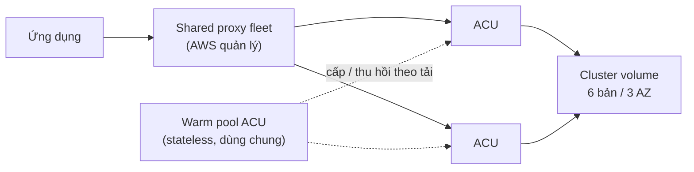

# Aurora Serverless

> **TL;DR:** Aurora Serverless với [[Aurora]] cũng giống [[ECS Launch Types EC2 vs Fargate|Fargate]] với ECS: bạn không cấp phát instance cố định mà đặt khoảng **min/max ACU** (Aurora Capacity Unit), cluster tự scale theo tải và có thể **pause về 0** để chỉ trả tiền storage. Storage vẫn là cluster volume 6 bản/3 AZ như Aurora provisioned.

## 🖼️ Sơ đồ
![[Aurora Serverless.excalidraw]]
*Mở bằng plugin Excalidraw để chỉnh sửa · ảnh tĩnh: [[Aurora Serverless.svg]]*

## Khái niệm cốt lõi
- Từ đây phân biệt **Aurora provisioned** (instance cố định, note [[Aurora]]) với **Aurora Serverless**.
- Vẫn là một **cluster**, nhưng compute được đo bằng **ACU**. Mỗi ACU là một lượng compute kèm memory tương ứng.
- Đặt **min ACU** và **max ACU**; cluster scale giữa hai mức này theo tải. Có thể xuống **0 ACU (paused)**, lúc đó chỉ trả tiền storage.
- Billing **theo giây** cho ACU đang dùng, cộng storage.
- Resilience giống Aurora provisioned: cluster storage **6 storage node qua nhiều AZ**.
- Lợi ích: **đơn giản hơn** (không quản lý instance/capacity), **dễ scale** (scale compute/memory liền mạch, không làm rớt kết nối của client), **tiết kiệm** (không trả tiền cho capacity cấp sẵn mà không dùng).

## Cách hoạt động / Kiến trúc
Kiến trúc Adrian giảng (thế hệ **Serverless v1**):
- ACU được cấp từ một **warm pool do AWS quản lý**. ACU **stateless**, dùng chung giữa nhiều khách hàng, **không có storage local**, nên gắn vào cluster rất nhanh. Khi đã gắn, ACU truy cập cluster storage giống một instance provisioned.
- Khi tải vượt capacity hiện tại (và max ACU cho phép), AWS gắn thêm ACU (hoặc ACU lớn hơn). Khi compute mới sẵn sàng, capacity cũ không còn dùng sẽ được gỡ ra.
- Vì ACU thay đổi liên tục, client **không kết nối trực tiếp tới ACU** mà đi qua một **shared proxy fleet** do AWS quản lý. Proxy môi giới kết nối giữa app và ACU, nên scale in/out không làm gián đoạn ứng dụng. Việc này diễn ra trong suốt với người dùng.
- Việc của bạn chỉ là chọn min/max ACU.

### Use cases (slide)
| Use case | Vì sao hợp |
|---|---|
| Ứng dụng **ít dùng** (blog nhỏ chỉ có truy cập vài phút mỗi ngày) | Chỉ trả theo giây khi có dùng |
| Ứng dụng **mới**, chưa rõ tải | Không phải đoán cỡ instance, DB tự scale |
| Tải **biến động** (peak 30 phút mỗi giờ, đợt sale) | Không phải cấp phát theo peak |
| Tải **không dự đoán được** | Đặt khoảng ACU rộng (min thấp, max cao), theo dõi rồi có thể để chạy lâu dài |
| **Dev/test** | Pause khi không dùng, chỉ trả storage |
| **Multi-tenant** (doanh thu tỉ lệ với tải) | Chi phí DB tăng theo đúng doanh thu |

### Cập nhật 2026
- Khóa học mô tả **v1**. Aurora Serverless **v1 đã hết hỗ trợ (cuối tháng 3/2025)**; tên bài demo cũng ghi rõ demo v1 không còn chạy được.
- **Serverless v2** scale theo bước nhỏ (0.5 ACU, mỗi ACU khoảng 2 GiB RAM), chạy chung cluster với instance provisioned, hỗ trợ reader, Multi-AZ, [[Aurora Global Database]] và [[RDS Proxy]]. Từ cuối 2024 v2 cũng hỗ trợ **min 0 ACU / auto-pause**.

## Demo / Lab
**Restore snapshot Aurora provisioned vào Aurora Serverless** (kết quả: WordPress chạy trên Serverless):
- Vì là **restore** (Aurora → Aurora) chứ không phải migrate, cần **tên snapshot** chứ không cần ARN (ngược với demo RDS → Aurora).
- Làm thủ công: chọn snapshot → **Restore snapshot** → capacity type **Serverless** → chỉ hiện version tương thích (khi quay là 2.07.1, cho thấy vì sao phải chọn version chính xác từ đầu) → VPC, DB subnet group, security group.
- Tùy chọn **Data API**: API nhẹ, kiểu connectionless, hợp với ứng dụng serverless chạy [[Lambda]].
- Đặt min/max ACU (demo: **1–2 ACU**) và **pause compute sau N phút không hoạt động** (demo: **5 phút**). Có encryption, backup, deletion protection như RDS khác.
- Quan sát: sau khi restore cluster chạy 2 ACU; để yên thì giảm xuống 1 hoặc nhảy thẳng về **0 ACU** (paused) sau 5 phút, không còn phí compute.
- Mở lại trang WordPress thì **phải chờ** vì cluster đang resume. Có lúc WordPress báo lỗi do timeout trước khi DB kịp resume, nên **ứng dụng phải chịu được thời gian kết nối lâu** sau khi pause.
- Ảnh mèo vẫn mất (lưu trên đĩa local EC2), tiếp tục dẫn tới [[EFS]].
- Production: khoảng min/max rộng hơn, min cao hơn để chịu base load, thời gian chờ pause dài hơn 5 phút.
- Chuỗi tiến hóa của section: DB chung server với app → tách ra → RDS MySQL → Aurora provisioned → Aurora Serverless.

## Bảng so sánh / số liệu
| | Aurora provisioned | Aurora Serverless |
|---|---|---|
| Compute | Instance cấp sẵn, cỡ cố định | ACU, scale giữa min/max |
| Trả tiền compute | Khi instance chạy, dù không dùng | Theo giây cho ACU đang dùng; 0 khi pause |
| Storage | Cluster volume 6 bản/3 AZ | Giống hệt |
| Kết nối | Endpoint tới instance | Qua proxy fleet (v1) |
| Hợp với | Tải ổn định, dự đoán được | Tải thất thường, ít dùng, dev/test, app mới |

## 🎯 Mẹo thi SAA-C03
- Từ khóa: "**unpredictable / intermittent / infrequent** workload", "**không muốn quản lý capacity**", "trả tiền theo dùng", "dev/test tắt khi không dùng" → **Aurora Serverless**.
- "Chỉ trả storage khi không có tải" → pause về 0 ACU.
- Nhớ: Aurora Serverless : Aurora = Fargate : ECS.
- Bẫy: resume sau khi pause **có độ trễ**; nếu đề yêu cầu latency thấp liên tục ngay từ request đầu thì đặt min ACU > 0 hoặc dùng provisioned.
- Lambda + Aurora Serverless + muốn connectionless → **Data API**; kiểu kết nối truyền thống từ nhiều Lambda → [[RDS Proxy]].

## Liên kết
- Tiên quyết: [[Aurora]], [[RDS Backups and Restore]]
- Liên quan: [[Serverless Architecture]], [[Lambda]], [[RDS Proxy]], [[Aurora Global Database]], [[EFS]]
- Phân biệt với: [[ECS Launch Types EC2 vs Fargate]] (phép so sánh tương tự), [[DynamoDB Operations and Performance]] (on-demand capacity của NoSQL)
