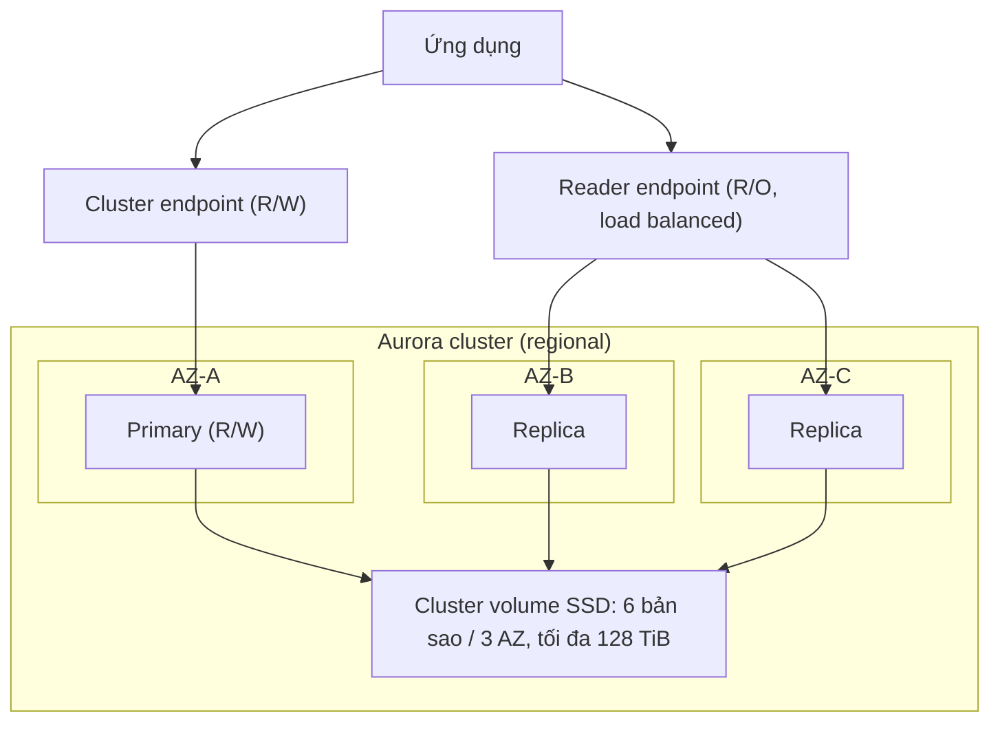

# Aurora

> **TL;DR:** Aurora chính thức thuộc RDS, nhưng kiến trúc khác hẳn nên Adrian coi nó là một sản phẩm riêng. Đơn vị cơ bản là **cluster**: 1 primary + tối đa 15 replica dùng chung một **cluster volume** SSD được sao chép 6 bản qua 3 AZ. Replica vừa đọc được trong lúc chạy bình thường vừa làm đích failover, nên bạn có lợi ích của Multi-AZ và Read Replica cùng lúc.

## 🖼️ Sơ đồ
![[Aurora.excalidraw]]
*Mở bằng plugin Excalidraw để chỉnh sửa · ảnh tĩnh: [[Aurora.svg]]*

![[Aurora - recovery.excalidraw]]
*Mở bằng plugin Excalidraw để chỉnh sửa · ảnh tĩnh: [[Aurora - recovery.svg]]*

## Khái niệm cốt lõi

### Cluster thay vì instance
- Các engine RDS khác không có khái niệm cluster; Aurora có (xem [[RDS Architecture]]).
- Compute gồm **1 primary instance** (đọc + ghi) và **0 hoặc nhiều replica**.
- Khác với standby của [[RDS Multi-AZ]] (chỉ ngồi chờ, không phục vụ đọc), replica của Aurora **phục vụ đọc ngay trong lúc hoạt động bình thường** và cũng là **đích failover**. Không cần chọn giữa availability và read scaling như khi dùng [[RDS Read Replicas]].
- Tối đa **15 replica**, replica nào cũng có thể được chọn làm đích failover. Failover nhanh hơn RDS thường vì không phải thay đổi gì ở storage.

### Cluster volume (shared storage)
- Compute instance **không có storage local**; mọi instance trong cluster dùng chung một cluster volume.
- SSD, kích thước tối đa **128 TiB** (khóa học; các version mới hơn đã nâng giới hạn lên 256 TiB).
- **6 bản sao** trải trên **3 AZ**. Khi primary ghi, Aurora sao chép **đồng bộ** lên cả 6 storage node.
- Sao chép diễn ra **ở tầng storage**, không tốn tài nguyên CPU của primary hay replica.
- Mặc định chỉ primary được ghi; primary và replica đều đọc được.
- Tự phát hiện lỗi đĩa: phần đĩa hỏng được **tự sửa** bằng dữ liệu từ các storage node khác, không corrupt. Nhờ vậy ít phải dùng point-in-time restore hay snapshot restore để cứu lỗi đĩa. Lớp storage này bền hơn nhiều so với storage của các engine RDS khác.
- Luôn là SSD hiệu năng cao (IOPS cao, latency thấp); **không có tùy chọn magnetic**.
- Vì storage thuộc về cluster chứ không thuộc instance, thêm/bớt replica **không cần cấp phát storage**, nhanh hơn nhiều.

### Storage billing và high watermark
- Không cần chọn trước dung lượng storage khi tạo cluster (trong demo, form tạo Aurora **không có** mục storage). Trả tiền theo **dung lượng thực dùng**.
- Khóa học mô tả mô hình **high watermark**: đã dùng 50 GiB rồi xóa còn 40 GiB vẫn bị tính 50 GiB (dung lượng giải phóng thì dùng lại được). Muốn giảm hẳn chi phí storage thì tạo cluster mới rồi migrate dữ liệu sang.
- Adrian cũng nói AWS đã bỏ cơ chế này ở các version mới (hiện nay storage co giãn động khi xóa dữ liệu), nhưng khi đi thi vẫn nên giả định high watermark.

### Endpoints
Endpoint là các địa chỉ DNS để kết nối. Aurora có nhiều endpoint hơn RDS thường:

| Endpoint | Trỏ tới | Dùng cho |
|---|---|---|
| **Cluster endpoint** (writer) | Luôn là primary/writer | Đọc + ghi |
| **Reader endpoint** | Load balance qua các replica (nếu chỉ có primary thì trỏ primary) | Chỉ đọc; thêm replica là tự được đưa vào |
| **Custom endpoint** | Tập con instance do bạn chọn (ví dụ theo AZ) | Phân luồng tùy ý |
| **Instance endpoint** | Từng instance riêng | Kết nối trực tiếp |

Reader endpoint tự cập nhật khi thêm replica, nên scale đọc dễ hơn hẳn RDS thường.

### Chi phí
- **Không có free tier**, vì Aurora không hỗ trợ instance micro. Nhưng với mọi cấu hình lớn hơn một RDS single-AZ micro, Aurora thường **đáng tiền hơn**.
- Compute: tính theo giờ, **billed theo giây, tối thiểu 10 phút**.
- Storage: GB-month (theo high watermark) **cộng phí I/O** cho mỗi request tới cluster storage. (Bổ sung: từ 2023 có cấu hình **Aurora I/O-Optimized**, không tính phí I/O, hợp với workload I/O nặng.)
- Backup: miễn phí dung lượng backup bằng **100% dung lượng cluster** (cluster 100 GiB → 100 GiB backup miễn phí). Với workload vừa và nhỏ, chi phí backup thường đã nằm trong giá cluster, trừ khi dữ liệu thay đổi nhiều hoặc giữ lâu.

### Backup, restore, backtrack, clone
- Automated backup và manual snapshot hoạt động **giống RDS** ([[RDS Backups and Restore]]). Restore luôn **tạo cluster mới**.
- **Backtrack**: bật theo từng cluster, cấu hình được cửa sổ thời gian. Cho phép **tua lại tại chỗ (in-place rewind)** cả cluster về thời điểm trước khi dữ liệu bị hỏng. Không phải tạo DB mới, không phải sửa cấu hình ứng dụng. (Bổ sung: hiện chỉ có ở Aurora MySQL.)
- **Fast clone**: tạo database mới từ database có sẵn mà **không copy toàn bộ dữ liệu**. Clone tham chiếu storage gốc và chỉ lưu phần khác biệt (**copy-on-write**): dữ liệu bị sửa trong clone, hoặc dữ liệu gốc bị sửa sau khi clone (clone giữ lại bản cũ). Nhanh hơn và tốn ít storage hơn nhiều so với copy.

## Cách hoạt động / Kiến trúc

## Demo / Lab
**Migrate WordPress từ snapshot RDS MariaDB/MySQL sang Aurora** (nối tiếp chuỗi WordPress của section):
- Lấy **ARN** của snapshot RDS (snapshot có bài "cat post" từ demo trước), dán vào tham số của one-click deployment [[CloudFormation Basics|CloudFormation]]. Stack tạo VPC A4L, EC2 WordPress và một Aurora cluster restore từ snapshot đó. Mất khoảng 30 phút.
- Làm thủ công: chọn snapshot → **Actions → Migrate snapshot** (không phải *Restore snapshot*, vì restore sẽ ra RDS thường) → chọn engine Aurora MySQL và **version tương thích**. Version của RDS gốc quyết định có migrate được sang Aurora/Aurora Serverless hay không, nên chọn version cẩn thận ngay từ đầu.
- Instance class: memory-optimized hoặc burstable, lớn hơn RDS thường; không thuộc free tier.
- Khi tạo Aurora từ đầu: chọn Aurora MySQL hoặc Aurora PostgreSQL; có bộ lọc version theo tính năng (global database, parallel query, Serverless v2); auth có thể là password hoặc password + IAM ([[RDS Security]]). **Không có phần cấu hình storage.**
- Giao diện console: cluster là thực thể regional, bên dưới là các instance **Writer** và **Reader**. Cluster chịu được mất một AZ với gián đoạn ngắn.
- Chụp snapshot Aurora (`a4l-wordpress-aurora-with-cat-post`) để dùng cho demo [[Aurora Serverless]].
- **Bài học quan trọng**: blog post còn nhưng **ảnh mèo mất**. Ảnh được lưu trên đĩa local của EC2 cũ (`/var/www/html/wp-content/uploads`), mà instance đó đã bị xóa cùng stack. Backup database thôi là chưa đủ; dữ liệu file của ứng dụng cũng phải được bảo vệ. Section sau dùng [[EFS]] làm shared file system để giải quyết (xem [[Lab - Architecture Evolution]]).

## Bảng so sánh / số liệu

| | RDS thường (Multi-AZ instance) | Aurora |
|---|---|---|
| Đơn vị | Instance | Cluster |
| Standby/replica | 1 standby, không đọc được | Tối đa 15 replica, đọc được, đều failover được |
| Storage | EBS riêng mỗi instance, cấp phát trước | Cluster volume dùng chung, 6 bản/3 AZ, trả theo dùng |
| Max storage | Tùy engine | 128 TiB (khóa học) |
| Storage type | gp2/gp3/io1/io2/(magnetic cũ) | Chỉ SSD |
| Endpoints | 1 endpoint (CNAME) | Cluster, reader, custom, instance |
| Free tier | Có (micro) | Không |
| Restore | Instance mới | Cluster mới, hoặc backtrack tại chỗ |

## 🎯 Mẹo thi SAA-C03
- Con số cần thuộc: **6 bản sao / 3 AZ**, **15 replica**, **128 TiB**, billing **theo giây, tối thiểu 10 phút**, backup miễn phí bằng **100%** dung lượng cluster.
- "Vừa cần HA vừa cần scale đọc mà không muốn trả tiền cho standby ngồi không" → Aurora (replica làm cả hai việc).
- "Scale đọc tự động khi thêm replica, app chỉ cần một địa chỉ đọc" → **reader endpoint**.
- "Rollback DB về vài phút trước khi lỡ xóa bảng, không đổi endpoint" → **Backtrack** (in-place). Nếu đề nói restore → luôn tạo **cluster mới**.
- "Tạo bản sao DB production để test thật nhanh, ít tốn storage" → **Fast clone** (copy-on-write).
- Failover Aurora nhanh hơn RDS thường vì storage dùng chung; muốn nhanh hơn nữa và trong suốt với app thì kết hợp [[RDS Proxy]].
- Bẫy: "Aurora nằm trong free tier" → sai.
- Migrate RDS MySQL → Aurora: dùng **migrate snapshot** (hoặc tạo Aurora read replica từ RDS MySQL); cùng engine nên không cần SCT ([[DMS]]).

## Liên kết
- Tiên quyết: [[RDS Architecture]], [[RDS Multi-AZ]], [[RDS Read Replicas]], [[RDS Backups and Restore]]
- Mở rộng: [[Aurora Serverless]], [[Aurora Global Database]], [[Aurora Multi-Master]], [[RDS Proxy]]
- Liên quan: [[RDS Security]], [[EFS]], [[Lab - Architecture Evolution]], [[HA vs FT vs DR]], [[ACID vs BASE]]
- Phân biệt với: [[DynamoDB Architecture]] (NoSQL), [[Redshift]] (OLAP)
