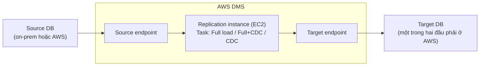
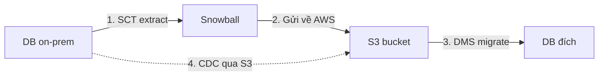

# DMS

> **TL;DR:** AWS Database Migration Service là dịch vụ migrate database có quản lý. Một **replication instance** chạy các **replication task** để chuyển dữ liệu từ **source endpoint** tới **target endpoint**, với 3 chế độ: **Full load**, **Full load + CDC**, **CDC only**. Điều kiện duy nhất: ít nhất một đầu phải nằm trong AWS. Đổi engine thì dùng thêm **SCT** để chuyển schema.

## 🖼️ Sơ đồ
![[DMS.excalidraw]]
*Mở bằng plugin Excalidraw để chỉnh sửa · ảnh tĩnh: [[DMS.svg]]*

![[DMS - snowball.excalidraw]]
*Mở bằng plugin Excalidraw để chỉnh sửa · ảnh tĩnh: [[DMS - snowball.svg]]*

## Khái niệm cốt lõi
- Migrate DB thủ công rất phức tạp: dựng replication, hoặc backup point-in-time rồi restore. Vấn đề là xử lý các thay đổi phát sinh giữa lúc backup và lúc DB mới chạy, và migrate giữa các engine khác nhau.
- Thành phần:
  - **Replication instance**: EC2 có phần mềm migration, giao tiếp với dịch vụ DMS. Một instance chạy được **nhiều replication task**.
  - **Replication task**: chứa mọi tùy chọn của một lần migrate.
  - **Source endpoint / target endpoint**: thông tin kết nối tới DB nguồn và đích.
- **Ít nhất một endpoint phải ở trong AWS**. Không dùng DMS để migrate giữa hai DB on-premises.
- Engine hỗ trợ rất rộng: MySQL, Aurora, Microsoft SQL Server, MariaDB, MongoDB, PostgreSQL, Oracle, Azure SQL và nhiều engine khác.

### 3 loại job
| Loại | Làm gì | Khi nào dùng |
|---|---|---|
| **Full load** | Copy dữ liệu hiện có, tạo bảng ở đích khi cần | Chấp nhận được downtime đủ lâu để copy hết |
| **Full load + CDC** | Full load, đồng thời ghi lại mọi thay đổi ở source rồi áp vào đích sau khi load xong | Migrate **gần như không downtime** |
| **CDC only** | Chỉ replicate thay đổi | Đã bulk load bằng công cụ khác (ví dụ export/import gốc của Oracle) rồi dùng DMS chạy tiếp phần thay đổi |

Quy trình cutover với Full load + CDC: load xong → áp thay đổi cho đến khi đạt trạng thái ổn định → tắt ứng dụng → để nốt các thay đổi cuối chảy sang đích → trỏ ứng dụng sang DB mới và khởi động lại.

## Cách hoạt động / Kiến trúc

- Dữ liệu thường đi qua mạng: internet, [[Site-to-Site VPN|VPN]], [[Direct Connect]] hoặc [[VPC Peering]].

### Schema Conversion Tool (SCT)
- DMS **không tự chuyển đổi schema**. SCT là **ứng dụng độc lập** chuyên chuyển schema giữa các engine/version khác nhau.
- **Chỉ dùng khi engine thay đổi**. Ví dụ dùng SCT: MSSQL on-prem → RDS MySQL; Oracle on-prem → Aurora.
- **Không dùng** khi engine giống nhau, dù sản phẩm khác: MySQL on-prem → RDS MySQL thì không cần SCT.
- Hỗ trợ OLTP (MySQL, MSSQL, Oracle) và OLAP (Teradata, Oracle, Vertica, Greenplum); đích OLAP thường là [[Redshift]].
- (Bổ sung) Hiện nay có thêm **DMS Schema Conversion** chạy ngay trong console DMS, cùng chức năng với SCT nhưng không cần cài ứng dụng.

### DMS + Snowball cho migration rất lớn
Migration nhiều TB qua mạng thì chậm và chiếm băng thông của doanh nghiệp, nên DMS có thể dùng [[Snow Family|Snowball]]:
1. Dùng **SCT** trích dữ liệu ra local, chép vào thiết bị Snowball.
2. Gửi thiết bị về AWS; AWS nạp dữ liệu vào **S3 bucket**.
3. **DMS migrate từ S3** vào DB đích.
4. Nếu bật **CDC**, các thay đổi phát sinh sau đợt bulk cũng đi qua S3 rồi được DMS ghi vào đích.

Trường hợp này vẫn đúng quy tắc "SCT chỉ dùng khi đổi engine", vì dữ liệu được chuyển sang một **định dạng file chung** để vận chuyển.

## 🎯 Mẹo thi SAA-C03
- Bất kỳ câu hỏi **migrate database** nào, chỉ cần một đầu ở AWS và engine được hỗ trợ → **mặc định chọn DMS**.
- "**No downtime / minimal downtime** migration" → **DMS với Full load + CDC**.
- "Đổi engine (heterogeneous), ví dụ Oracle/MSSQL → Aurora/MySQL/PostgreSQL" → **SCT + DMS**. Cùng engine (homogeneous) → **không cần SCT**.
- "Đã bulk load bằng công cụ native, chỉ cần đồng bộ thay đổi" → **CDC only**.
- "DB nhiều TB, đường mạng yếu hoặc không muốn chiếm băng thông" → **DMS + SCT + Snowball** (đi qua S3).
- Bẫy: DMS **không** migrate giữa hai DB đều on-prem.
- Phân biệt [[DataSync]] (đồng bộ **file/object**, NFS/SMB/S3/EFS) với DMS (**database**).

## Liên kết
- Tiên quyết: [[Database Models]], [[RDS Architecture]]
- Đích thường gặp: [[Aurora]], [[RDS Architecture|RDS]], [[Redshift]], [[DynamoDB Architecture|DynamoDB]], [[S3 Basics|S3]]
- Liên quan: [[Snow Family]], [[Direct Connect]], [[Site-to-Site VPN]], [[VPC Peering]], [[Databases on EC2]]
- Phân biệt với: [[DataSync]], [[Storage Gateway]], [[Transfer Family]]
