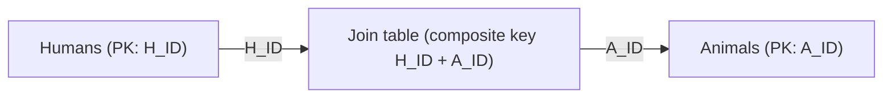

# Database Models

> **TL;DR:** Database chia thô thành **relational (SQL/RDBMS)** với schema cố định và quan hệ bảng định nghĩa trước, và **NoSQL** — một nhóm nhiều mô hình khác nhau (key-value, wide column, document, column, graph) có schema lỏng hoặc không có schema. Đề thi hay đưa ra kịch bản và bắt bạn nhận diện mô hình phù hợp để chọn đúng sản phẩm AWS.

## 🖼️ Sơ đồ
![[Database Models.excalidraw]]
*Mở bằng plugin Excalidraw để chỉnh sửa · ảnh tĩnh: [[Database Models.svg]]*

![[Database Models - row-vs-column.excalidraw]]
*Mở bằng plugin Excalidraw để chỉnh sửa · ảnh tĩnh: [[Database Models - row-vs-column.svg]]*

## Khái niệm cốt lõi
- **SQL** thật ra là *ngôn ngữ* (Structured Query Language) để lưu, cập nhật, truy vấn dữ liệu; còn **RDBMS** là hệ quản trị CSDL quan hệ. Trong thực tế người ta dùng "SQL", "SQL database", "RDBMS" lẫn lộn — đều chỉ nền tảng relational.
- **NoSQL** không phải một thứ duy nhất: là mọi thứ *không* relational. Điểm chung của đa số mô hình NoSQL: **schema yếu hoặc không có**, quan hệ giữa các bảng xử lý rất khác (hoặc không có).

## Relational (SQL / RDBMS)
- Đơn vị chính là **table**. Mỗi **column** là một **attribute** (có attribute name); mỗi **row** phải có **attribute value** cho *mọi* attribute của bảng.
- Dữ liệu liên quan nhau nằm chung một bảng (ví dụ bảng Humans: `H_ID, FName, LName, Age`; bảng Animals: `A_ID, Name, Type`).
- **Primary key**: giá trị duy nhất trong bảng, mỗi row phải có giá trị riêng.
- **Join table** dùng để biểu diễn quan hệ **many-to-many** (một người có nhiều thú, một thú có nhiều "người hầu"). Join table dùng **composite key** (`H_ID + A_ID`) — từng phần có thể lặp, nhưng *tổ hợp* phải duy nhất.
- Quan hệ giữa bảng được tạo bằng **key**.
- **Schema** (tên, kiểu dữ liệu, giá trị hợp lệ, vị trí lưu) và **relationship** đều **cố định, định nghĩa trước** khi đưa dữ liệu vào; rất khó đổi sau khi đã có dữ liệu.
- Hệ quả: SQL **không hợp** với dữ liệu có quan hệ thay đổi nhanh liên tục (ví dụ mạng xã hội).

## Các mô hình NoSQL

### Key-Value
- Chỉ là danh sách cặp **key → value**, không có structure, không có schema, không có quan hệ bảng. Ví dụ: key = thời điểm, value = số bánh bị lấy khỏi máy cho ăn trong 60 phút trước.
- Chỉ cần **key duy nhất**. Value là **opaque** với DB (text, JSON, ảnh mèo... đều được).
- Một số sản phẩm cho tạo nhiều "bảng" key-value nhưng chỉ để chia dữ liệu, không có liên kết.
- **Rất scalable** (có thể chia dữ liệu ra nhiều server) và **rất nhanh** (ít thứ cản giữa ghi và đĩa).
- Dùng nhiều cho **in-memory caching** → liên hệ [[ElastiCache]].

### Wide Column Store (biến thể của key-value)
- Mỗi item có một hoặc nhiều key: bắt buộc **partition key**, tùy chọn thêm key thứ hai — trong DynamoDB gọi là **sort key / range key**.
- Phần "cứng" duy nhất: mọi item trong một table phải dùng **cùng cấu trúc key**, và key (đơn hoặc composite) phải **duy nhất**.
- "Table" ở đây chỉ là nhóm item, không giống bảng relational.
- **Attribute tự do**: item có thể có tất cả, một phần, hoặc không có attribute nào; không cần giống nhau giữa các item.
- Nhanh, cực kỳ scalable, phù hợp khi không cần thao tác relational (SQL join...).
- Ví dụ AWS: **DynamoDB** → [[DynamoDB Architecture]].

### Document
- Lưu và truy vấn **document**, thường định dạng **JSON hoặc XML**; cấu trúc có thể khác nhau giữa các document trong cùng DB.
- Giống key-value mở rộng: mỗi document có **ID duy nhất**, nhưng nội dung document **được DB hiểu** (không opaque) → có **flexible indexing**, truy vấn được thuộc tính **lồng sâu** (nested).
- Hợp: order, collection, contact, **catalog, user profile, content management system**; document có thể có version, liên kết phân cấp.
- Kịch bản lý tưởng: thao tác trên **cả document** hoặc **deep attribute**.

### Column (columnar) vs Row-based
- **Row store** (đa số SQL DB): mỗi row lưu liền nhau trên đĩa. Đọc giá trị price của một order phải đọc cả row; truy vấn một cột trên toàn bộ dữ liệu phải duyệt qua mọi row.
  - Lý tưởng khi thao tác theo row: create/update/delete row → gọi là **OLTP (Online Transaction Processing)**: order, contact, stock DB.
- **Column store**: dữ liệu nhóm theo **column** trên đĩa (mọi order ID nằm chung, mọi size nằm chung...).
  - Rất kém cho xử lý kiểu giao dịch (thao tác cả row).
  - Rất tốt cho **reporting / analytics** trên một vài cột (ví dụ tổng số sản phẩm bán theo size).
- Ví dụ AWS: **Redshift** (data warehouse) → [[Redshift]]. Mô hình thường gặp: chuyển dữ liệu từ OLTP (row) sang column store để phân tích.

### Graph
- **Node** (đối tượng: Person, Company, City) có **properties** (cặp key-value).
- **Edge** = quan hệ giữa node, có **tên và hướng** (Nathalie `:works_for` xyz_corp; xyz_corp `:located_in` brisbane). Edge cũng có thể mang dữ liệu (ví dụ `startdate`).
- Quan hệ được **lưu trong DB cùng dữ liệu**, không phải tính lại mỗi lần query như join của SQL → truy vấn kiểu "mọi nhân viên của XYZ Corp" nhanh hơn nhiều.
- Hợp với dữ liệu nặng về quan hệ, quan hệ thay đổi linh hoạt: **social media, HR system**. (Sản phẩm AWS tương ứng là Amazon Neptune — không nêu trong bài.)

## Bảng so sánh

| Mô hình | Schema | Điểm mạnh | Use case điển hình | Ví dụ AWS |
|---|---|---|---|---|
| Relational (SQL) | Cố định, định nghĩa trước, quan hệ cố định | Quan hệ chặt, SQL, [[ACID vs BASE\|ACID]] | OLTP, tài chính, đơn hàng | [[RDS Architecture\|RDS]], [[Aurora]] |
| Key-Value | Không | Nhanh, scale, đơn giản | Cặp name/value, **in-memory cache** | [[ElastiCache]], DynamoDB |
| Wide Column | Chỉ key cố định, attribute tự do | Scale cực lớn, nhanh | Web-scale app | [[DynamoDB Architecture\|DynamoDB]] |
| Document | Linh hoạt (JSON/XML) | Index nested attribute | Catalog, profile, CMS | (DocumentDB — ngoài bài) |
| Column store | Có, nhưng lưu theo cột | Query/aggregate theo cột | Reporting, analytics, data warehouse | [[Redshift]] |
| Graph | Node/edge/property | Quan hệ phức tạp, động | Social network, HR | (Neptune — ngoài bài) |

## 🎯 Mẹo thi SAA-C03
- Đề nhắc dữ liệu chỉ là **name/value, key/value, cặp giá trị, không có structure, yêu cầu đơn giản** → **key-value store**.
- Đề nhắc **in-memory caching** → key-value store (ElastiCache, xem [[ElastiCache]]).
- **DynamoDB = wide column store** (partition key + sort key tùy chọn). Không cần SQL/relational và cần scale lớn → DynamoDB.
- **Reporting / analytics / data warehouse / column-based** → **Redshift**; **transaction / OLTP / row-based** → RDS.
- Đề nhắc **social media** hoặc **quan hệ phức tạp, thay đổi liên tục** → nghĩ ngay tới **graph database**.
- Dữ liệu dạng **document, JSON lồng nhau, catalog, user profile** → document DB.
- Schema cố định + quan hệ định nghĩa trước → relational; schema thay đổi/không có schema → NoSQL.

## Liên kết
- Tiếp theo: [[ACID vs BASE]], [[Databases on EC2]], [[RDS Architecture]]
- Sản phẩm theo mô hình: [[DynamoDB Architecture]], [[Redshift]], [[ElastiCache]], [[Aurora]]
- Liên quan: [[JSON]], [[Athena]]
- Section: [[_MOC 11 Databases]]
