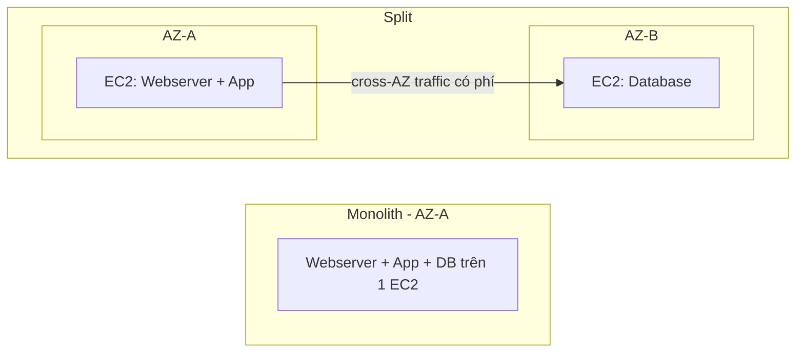

# Databases on EC2

> **TL;DR:** Tự cài database lên EC2 (self-managed) hầu như luôn là **bad practice** so với dịch vụ managed (RDS, Aurora, DynamoDB...). Nhưng có một số tình huống hợp lệ — và đề thi có câu mà đáp án đúng lại là "DB trên EC2". Cần biết cả lý do nên và không nên.

## 🖼️ Sơ đồ
![[Databases on EC2.excalidraw]]
*Mở bằng plugin Excalidraw để chỉnh sửa · ảnh tĩnh: [[Databases on EC2.svg]]*

![[Databases on EC2 - when.excalidraw]]
*Mở bằng plugin Excalidraw để chỉnh sửa · ảnh tĩnh: [[Databases on EC2 - when.svg]]*

## Khái niệm cốt lõi
Hai kiến trúc thường gặp:
1. **Monolith**: một instance chạy cả web server (Apache), application (WordPress) và database — nằm trong **một AZ**. Đây là kiến trúc Animals4life WordPress dùng tới giờ.
2. **Split architecture**: tách DB ra instance riêng. Hai instance có thể cùng AZ hoặc khác AZ (AZ-A chạy web+app, AZ-B chạy DB).

Khi tách ra:
- Tạo thêm **dependency**: app cần kết nối mạng ổn định tới DB, mất kết nối là app chết.
- Nếu tách **khác AZ** → mất phí **data transfer giữa các AZ** (nhỏ nhưng có). Traffic giữa instance **cùng AZ qua private IP** thì **miễn phí**.

## Khi nào CÓ THỂ chạy DB trên EC2
- Cần **OS-level / root access** cho DB (một số tham số tuning chỉ chỉnh được bằng root). → Luôn **chất vấn**: thường chỉ là "nghĩ là cần"; RDS cho chỉnh nhiều tham số qua parameter group mà không cần root. Yêu cầu này hay đến từ **vendor phần mềm**, và nhiều vendor nay đã hỗ trợ managed DB của AWS.
- Cần **engine DB hoặc version** AWS không cung cấp (DB mới nổi, niche) — lý do thường **hợp lệ**.
- Cần **tổ hợp OS + DB version** rất cụ thể mà AWS không có.
- Cần **kiến trúc/replication đặc thù** (kiểu replicate, thời điểm replicate) AWS không hỗ trợ.
- Đơn giản là **người ra quyết định muốn vậy**.

## Vì sao KHÔNG nên
- **Admin overhead**: phải quản lý cả EC2 (patch OS) lẫn DB host; giữ version tương thích app; upgrade/sửa lỗi ngoài giờ → tốn thời gian, stress, chi phí.
- **Backup & DR**: tự làm hết; managed DB có nhiều tự động hóa sẵn.
- **Single AZ**: EC2 và [[EBS]] đều nằm trong một AZ → AZ lỗi là DB lỗi; phải tự lo [[EBS Snapshots]] hoặc dump backup lên S3.
- **Thiếu tính năng**: bỏ lỡ các tính năng nâng cao AWS đầu tư vào sản phẩm managed.
- **Không serverless, không scale linh hoạt**: EC2 chỉ bật hoặc tắt, khó scale theo tải bursty; chi phí tối thiểu = giá giờ của instance. (So sánh [[Aurora Serverless]].)
- **Replication**: tự setup, tự giám sát, cần kỹ năng.
- **Performance**: không có các tối ưu hiệu năng mà AWS xây cho managed DB.

## Demo / Lab — Tách WordPress monolith thành App + DB
Kiến trúc: từ 1 instance `A4L-WordPress` (WordPress + MariaDB) sang 2 instance, DB chạy trên `A4L-DB-WordPress` (MariaDB riêng). Đây là bước 1 trong lộ trình tiến tới kiến trúc elastic (xem [[Lab - Architecture Evolution]]).
1. Deploy stack CloudFormation (one-click), cài WordPress, tạo bài viết "The Best Cats Ever!!!" có gallery 4 ảnh. Dữ liệu bài viết vào MariaDB local; **ảnh lưu trên file system local** của instance (vấn đề sẽ phải xử lý sau bằng shared storage như [[EFS]]).
2. Trên instance app (kết nối bằng [[EC2 Instance Connect and SSH|EC2 Instance Connect]]), dump DB: `mysqldump -u root -p a4lwordpress > a4lwordpress.sql` (`-p` có khoảng trắng phía sau → hỏi password).
3. Nạp dump vào DB mới qua **private IP**: `mysql -h <privateIP> -u a4lwordpress -p a4lwordpress < a4lwordpress.sql`.
4. Sửa `/var/www/html/wp-config.php`: đổi `DB_HOST` từ `localhost` sang private IP của instance DB.
5. Kiểm chứng: `sudo service mariadb stop` trên instance app, refresh site vẫn chạy → WordPress đang dùng DB riêng.
6. Dọn: xóa stack CloudFormation.

Bài học: hiểu kiến trúc "xấu" (self-managed) để hiểu best practice; bước tiếp theo là chuyển DB sang RDS ([[RDS Architecture]]).

## 🎯 Mẹo thi SAA-C03
- Mặc định: chọn **managed DB** (RDS/Aurora/DynamoDB) thay vì DB trên EC2.
- Nhưng nếu đề nêu: cần **OS/root access**, **engine/version không được AWS hỗ trợ**, **tổ hợp OS+DB cụ thể**, hoặc **kiến trúc replication đặc thù** → **DB trên EC2** có thể là đáp án đúng. (Với nhu cầu OS access cho Oracle/SQL Server, còn có [[RDS Custom]].)
- DB trên EC2 = **single AZ** (EC2 + EBS); muốn HA phải tự xây.
- Traffic cùng AZ qua private IP: miễn phí; cross-AZ: có phí.

## Liên kết
- Tiên quyết: [[EC2 Basics]], [[EBS]], [[Database Models]]
- Thay thế bằng: [[RDS Architecture]], [[RDS Custom]], [[Aurora]], [[DynamoDB Architecture]]
- Liên quan: [[EBS Snapshots]], [[HA vs FT vs DR]], [[Lab - Architecture Evolution]], [[DMS]]
- Section: [[_MOC 11 Databases]]
