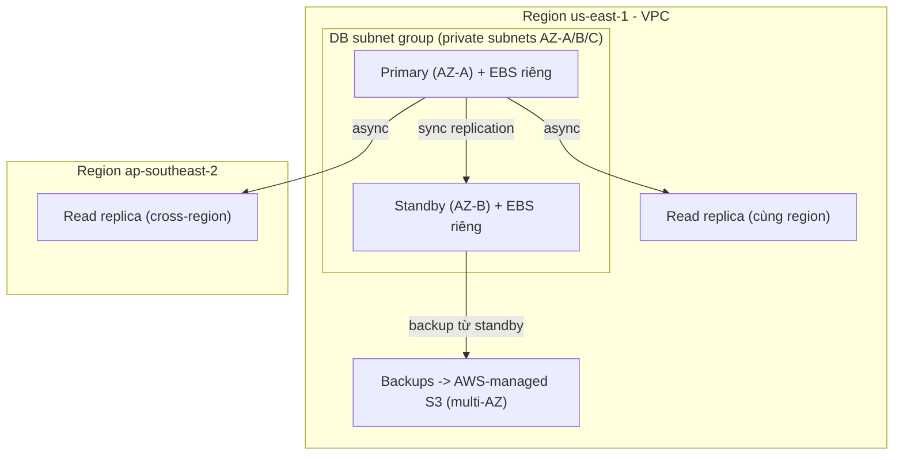

# RDS Architecture

> **TL;DR:** Amazon RDS là dịch vụ **"database server as a service"** (không phải DBaaS): bạn trả tiền và nhận một **DB instance** do AWS quản lý (phần cứng, OS, cài đặt, phần lớn bảo trì engine), trên đó chứa được **nhiều database**. RDS chạy **trong VPC**, đặt vào subnet thông qua **DB subnet group**, mỗi instance có **EBS storage riêng**.

## 🖼️ Sơ đồ
![[RDS Architecture.excalidraw]]
*Mở bằng plugin Excalidraw để chỉnh sửa · ảnh tĩnh: [[RDS Architecture.svg]]*

## Khái niệm cốt lõi
- **Database server as a service**: một RDS instance = một DB server → có thể chứa **nhiều database**. Gọi là "DBaaS" là không chính xác.
- AWS quản lý: hardware, OS, cài đặt, phần lớn bảo trì DB engine. Bạn **không có SSH, không có OS access** (ngoại lệ: [[RDS Custom]]).
- **Engine hỗ trợ**: MySQL, MariaDB, PostgreSQL (open source, không phí license) và các engine thương mại **Oracle, Microsoft SQL Server, IBM Db2** (có hệ quả về license; bản khóa cũ nêu thêm hai cách *license included* hoặc *bring your own license*).
- **[[Aurora]] KHÔNG phải RDS**: Aurora là engine/sản phẩm do AWS tự thiết kế, tương thích MySQL/PostgreSQL; nhiều đặc điểm khác (thường là tốt hơn). Hãy tách bạch Aurora với RDS trong đầu.
- RDS là dịch vụ **chạy trong VPC** (khác S3/DynamoDB là public service) — xem [[AWS Public vs Private Services]].

## Cách hoạt động / Kiến trúc

### DB Subnet Group
- Là **danh sách subnet** (trong một VPC, nhiều AZ) mà RDS được phép dùng cho instance.
- Khi launch instance (có hay không có Multi-AZ) phải chọn một DB subnet group.
- Với [[RDS Multi-AZ|Multi-AZ]]: RDS chọn một subnet cho **primary**, một subnet ở **AZ khác** cho **standby** (ngẫu nhiên nếu bạn không chỉ định).
- Subnet **private** → chỉ truy cập từ trong VPC hoặc mạng kết nối vào (VPN, Direct Connect, [[VPC Peering]]).
- Subnet **public** → có thể bật **public accessibility** (cấp public address) để truy cập từ Internet — **không khuyến khích** về bảo mật, nhưng cần biết là có lựa chọn này.
- Một subnet group dùng được cho nhiều instance, nhưng sẽ bị bó vào cùng tập subnet. Best practice của giảng viên: **một DB subnet group cho mỗi RDS deployment**.

### Storage, replication, backup
- **Mỗi RDS instance có EBS storage riêng** (primary và standby mỗi bên một volume) — khác Aurora dùng shared cluster volume.
- **Multi-AZ**: primary → standby bằng **synchronous replication** (dữ liệu ghi tới primary là replicate ngay). Xem [[RDS Multi-AZ]].
- **Read replica**: **asynchronous replication**, cùng region hoặc **cross-region**; dùng để scale read hoặc tăng resilience/DR liên region. Xem [[RDS Read Replicas]].
- **Backup**: lưu vào **S3 do AWS quản lý** (bạn không thấy bucket) → dữ liệu replicate qua nhiều AZ trong region, sống sót khi một AZ hỏng. Có Multi-AZ thì backup lấy từ **standby** → tránh được **IO pause** mà deployment single-AZ gặp trên primary khi backup; vẫn có thể thấy **IO latency tăng nhẹ trong thời gian ngắn**, nhưng ảnh hưởng thấp hơn nhiều. Xem [[RDS Backups and Restore]].
- **Endpoint**: mỗi instance có **endpoint DNS name (CNAME)** + port; ứng dụng kết nối qua tên này, không qua IP.
- **Truy cập mạng**: kiểm soát bằng **VPC [[Security Groups|Security Group]]** gắn vào network interface của instance.

## Chi phí RDS
RDS tính tiền theo **tài nguyên cấp phát** (giống EC2), không theo mức dùng:
1. **Instance size & type** — giá theo giờ, tính theo giây.
2. **Multi-AZ hay không** — thêm instance thì thêm tiền (mức tùy kiến trúc Multi-AZ; ngoài kiểu instance 1 standby còn có kiểu **cluster 2 standby đọc được**, xem [[RDS Multi-AZ]]).
3. **Storage type & amount** — phí per GB-tháng; provisioned IOPS đắt hơn (giống [[EBS Volume Types|EBS]]).
4. **Data transfer** — per GB vào/ra Internet hoặc region khác (bản khóa cũ nêu, bài mới không nói).
5. **Backups & snapshots** — được **miễn phí dung lượng snapshot bằng dung lượng storage đã mua** (ví dụ 2 TB storage → 2 TB snapshot free); vượt quá tính theo **GB-tháng** (1 GB × 1 tháng = 500 GB × 2 tháng... cùng đơn vị tính).
6. **Licensing** — engine thương mại (Oracle, SQL Server, Db2) có phí thêm.

## Demo / Lab — Migrate DB từ EC2 sang RDS
Tiếp nối [[Databases on EC2]]: Aus-E-Mart Web Store chạy trên instance app, DB đang ở MariaDB trên một EC2 riêng (stack one-click tạo sẵn cả hai).
1. Tạo **DB subnet group** `AEM-subnetgroup` trong `aem-vpc1` gồm 3 database subnet (`sn-db-A/B/C`, us-east-1a/b/c). Console cảnh báo Multi-AZ DB cluster cần nhiều subnet, đó chính là mục đích của subnet group.
2. **Create database** (console nay tên là "Aurora and RDS"): ngoài **Full configuration** còn có lối tắt *restore from S3* và *express configuration*. Engine **MySQL** Community; **template** Production / Dev/Test / **Sandbox**: template chỉ tự chọn hoặc ẩn bớt tùy chọn, Sandbox chỉ cho **single-AZ DB instance** và ít instance class. Chọn **engine version** cẩn thận (AWS giữ nhiều version vì ứng dụng chưa chắc theo kịp version mới; *extended support* là dịch vụ trả phí).
3. **DB instance identifier** phải duy nhất trong account + region (`aemwebstore`); master username `aem`, password self-managed; ngoài password authentication còn có tích hợp **IAM** và **Kerberos** ([[RDS Security]]).
4. Instance class `db.t4g.micro`, storage **gp3 20 GiB** (tối thiểu; provisioned IOPS cho yêu cầu hiệu năng đặc biệt).
5. Connectivity: chọn *Don't connect to an EC2 compute resource* (tự cấu hình SG); network type có **dual-stack** (IPv4 + IPv6) nếu VPC hỗ trợ; chọn VPC `aem-vpc1` (**không đổi được VPC sau khi tạo**) và subnet group; **Public access = No**; tạo **security group mới** `aem-vpc1-rds-sg`; AZ = no preference; không dùng RDS Proxy.
6. Additional configuration: tạo **initial database** `aem-webstore` (không nhập thì RDS **không tạo database nào**); parameter/option group để mặc định; **encryption bật sẵn theo mặc định**; tắt automated backup và auto minor version upgrade cho demo; có maintenance window, deletion protection. Tạo mất 5–45 phút.
7. Mở security group của RDS: mặc định có rule 3306 cho **IP của bạn**; thêm inbound rule **MySQL/Aurora (3306)** với **source là security group của các instance** (SG referencing).
8. Trên app instance: lấy thông tin kết nối có sẵn trong file cấu hình của ứng dụng, `mysqldump` từ MariaDB EC2 → file `.sql`, nạp vào RDS bằng `mysql -h <RDS endpoint> ...`.
9. Sửa host DB trong `/etc/aem-webstore/env` thành **RDS endpoint**, `systemctl restart aem-webstore`. Stop instance MariaDB → web store vẫn chạy → đã dùng RDS.
10. Dọn dẹp thủ công vì RDS tạo ngoài CloudFormation: xóa DB (bỏ final snapshot), xóa subnet group, xóa security group, xóa stack.

Ghi chú: version engine quan trọng, ví dụ khi muốn chuyển snapshot RDS sang [[Aurora]] (bản khóa cũ nêu, bài mới không nói). RDS MySQL phải chọn dung lượng storage khi tạo, còn Aurora thì không (xem [[Aurora]]).

## 🎯 Mẹo thi SAA-C03
- RDS = **managed DB server**, **không có OS/SSH access**. Cần OS access → [[RDS Custom]] (Oracle/SQL Server) hoặc [[Databases on EC2]].
- **Aurora ≠ RDS** — đừng gán đặc điểm kiến trúc RDS (EBS riêng mỗi instance, standby) cho Aurora.
- RDS nằm **trong VPC**, đặt qua **DB subnet group**; private subnet là mặc định nên dùng; public accessibility chỉ khả thi với public subnet và không khuyến khích.
- Multi-AZ = **synchronous**; read replica = **asynchronous** (có thể cross-region).
- Backup RDS lưu **S3 do AWS quản lý**, regional resilient; Multi-AZ → backup từ standby (tránh IO pause trên primary, chỉ còn latency tăng nhẹ).
- Engine: MySQL, MariaDB, PostgreSQL (open source) + Oracle, SQL Server, **IBM Db2** (thương mại, thêm phí license).
- Kiểm soát truy cập mạng vào RDS bằng **Security Group** (tham chiếu SG của app tier là cách chuẩn).
- Kết nối bằng **endpoint DNS name**, không bằng IP.

## Liên kết
- Tiên quyết: [[Database Models]], [[ACID vs BASE]], [[Databases on EC2]], [[VPC Subnets]]
- Tính năng: [[RDS Multi-AZ]], [[RDS Backups and Restore]], [[RDS Read Replicas]], [[RDS Security]], [[RDS Proxy]]
- Phân biệt với: [[Aurora]], [[RDS Custom]], [[DynamoDB Architecture]]
- Liên quan: [[EBS]], [[Security Groups]], [[DMS]], [[Lab - Architecture Evolution]]
- Section: [[_MOC 11 Databases]]
