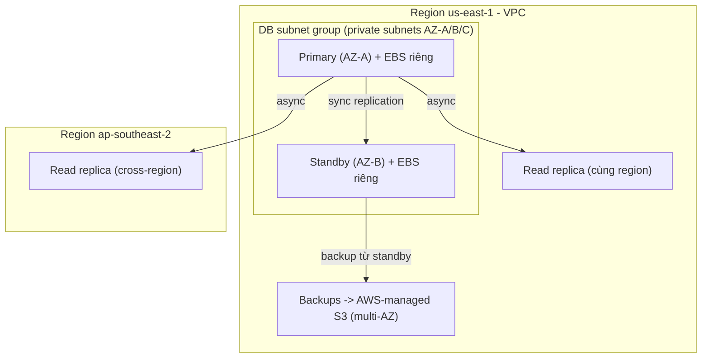

# RDS Architecture

> **TL;DR:** Amazon RDS là dịch vụ **"database server as a service"** (không phải DBaaS): bạn trả tiền và nhận một **DB instance** do AWS quản lý (phần cứng, OS, cài đặt, phần lớn bảo trì engine), trên đó chứa được **nhiều database**. RDS chạy **trong VPC**, đặt vào subnet thông qua **DB subnet group**, mỗi instance có **EBS storage riêng**.

## 🖼️ Sơ đồ
![[RDS Architecture.excalidraw]]
*Mở bằng plugin Excalidraw để chỉnh sửa · ảnh tĩnh: [[RDS Architecture.svg]]*

## Khái niệm cốt lõi
- **Database server as a service**: một RDS instance = một DB server → có thể chứa **nhiều database**. Gọi là "DBaaS" là không chính xác.
- AWS quản lý: hardware, OS, cài đặt, phần lớn bảo trì DB engine. Bạn **không có SSH, không có OS access** (ngoại lệ: [[RDS Custom]]).
- **Engine hỗ trợ**: MySQL, MariaDB, PostgreSQL (open source, không phí license) và **Oracle, Microsoft SQL Server** (thương mại; chọn *license included* hoặc *bring your own license*).
- **[[Aurora]] KHÔNG phải RDS**: Aurora là engine/sản phẩm do AWS tự thiết kế, tương thích MySQL/PostgreSQL; nhiều đặc điểm khác (thường là tốt hơn). Hãy tách bạch Aurora với RDS trong đầu.
- RDS là dịch vụ **chạy trong VPC** (khác S3/DynamoDB là public service) — xem [[AWS Public vs Private Services]].

## Cách hoạt động / Kiến trúc

### DB Subnet Group
- Là **danh sách subnet** (trong một VPC, nhiều AZ) mà RDS được phép dùng cho instance.
- Khi launch instance (có hay không có Multi-AZ) phải chọn một DB subnet group.
- Với [[RDS Multi-AZ|Multi-AZ]]: RDS chọn một subnet cho **primary**, một subnet ở **AZ khác** cho **standby** (ngẫu nhiên nếu bạn không chỉ định).
- Subnet **private** → chỉ truy cập từ trong VPC hoặc mạng kết nối vào (VPN, Direct Connect, [[VPC Peering]]).
- Subnet **public** → có thể bật **public accessibility** (cấp public address) để truy cập từ Internet — **không khuyến khích** về bảo mật, nhưng cần biết là có lựa chọn này.
- Một subnet group dùng được cho nhiều instance, nhưng sẽ bị bó vào cùng tập subnet. Best practice của Adrian: **một DB subnet group cho mỗi RDS deployment**.

### Storage, replication, backup
- **Mỗi RDS instance có EBS storage riêng** (primary và standby mỗi bên một volume) — khác Aurora dùng shared cluster volume.
- **Multi-AZ**: primary → standby bằng **synchronous replication** (dữ liệu ghi tới primary là replicate ngay). Xem [[RDS Multi-AZ]].
- **Read replica**: **asynchronous replication**, cùng region hoặc **cross-region**; dùng để scale read hoặc tăng resilience/DR liên region. Xem [[RDS Read Replicas]].
- **Backup**: lưu vào **S3 do AWS quản lý** (bạn không thấy bucket) → dữ liệu replicate qua nhiều AZ trong region, sống sót khi một AZ hỏng. Có Multi-AZ thì backup lấy từ **standby** → không ảnh hưởng hiệu năng primary. Xem [[RDS Backups and Restore]].
- **Endpoint**: mỗi instance có **endpoint DNS name (CNAME)** + port; ứng dụng kết nối qua tên này, không qua IP.
- **Truy cập mạng**: kiểm soát bằng **VPC [[Security Groups|Security Group]]** gắn vào network interface của instance.

## Chi phí RDS
RDS tính tiền theo **tài nguyên cấp phát** (giống EC2), không theo mức dùng:
1. **Instance size & type** — giá theo giờ, tính theo giây.
2. **Multi-AZ hay không** — thêm instance thì thêm tiền (mức tùy kiến trúc Multi-AZ).
3. **Storage type & amount** — phí per GB-tháng; provisioned IOPS đắt hơn (giống [[EBS Volume Types|EBS]]).
4. **Data transfer** — per GB vào/ra Internet hoặc region khác.
5. **Backups & snapshots** — được **miễn phí dung lượng snapshot bằng dung lượng storage đã mua** (ví dụ 2 TB storage → 2 TB snapshot free); vượt quá tính theo **GB-tháng** (1 GB × 1 tháng = 500 GB × 2 tháng... cùng đơn vị tính).
6. **Licensing** — với engine thương mại (Oracle, SQL Server).

## Demo / Lab — Migrate DB từ EC2 sang RDS
Tiếp nối [[Databases on EC2]]: WordPress trên `A4L-WordPress`, DB đang ở MariaDB trên `A4L-DB-WordPress`.
1. Tạo **DB subnet group** `A4LSNGroup` trong `A4L-VPC1` gồm 3 database subnet (`sn-db-A/B/C`, us-east-1a/b/c).
2. **Create database** (Standard create): engine **MySQL** Community; template **Free tier** (không cho Multi-AZ), instance class `db.t3.micro`; storage **20 GiB** (tối thiểu), tắt **storage autoscaling** (production nên bật: tự tăng dung lượng khi chạm ngưỡng); chọn VPC + subnet group; **Public access = No**; tạo **security group mới** `A4LVPC-RDS-SG`; AZ = no preference; password authentication; tạo **initial database** `a4lwordpress` (mặc định RDS instance không có database nào). Thấy các tùy chọn: automated backup (retention, backup window), maintenance window, deletion protection. Tạo mất 5–45 phút.
3. Mở security group của RDS, thêm inbound rule **MySQL/Aurora (3306)** với **source là security group của các instance** (SG referencing).
4. Trên app instance: `mysqldump` từ MariaDB EC2 (qua private IP) → file `.sql`; nạp vào RDS bằng `mysql -h <RDS endpoint> ...` (không cần ghi port vì dùng port mặc định 3306).
5. Sửa `DB_HOST` trong `wp-config.php` thành **RDS endpoint (CNAME)**. Stop instance MariaDB → blog vẫn chạy → đã dùng RDS.
6. Dọn dẹp thủ công vì RDS tạo ngoài CloudFormation: xóa DB (bỏ final snapshot, không giữ automated backup), xóa subnet group, xóa security group, xóa stack.

Ghi chú từ demo: version engine quan trọng (ví dụ muốn chuyển snapshot RDS sang [[Aurora]] cần version tương thích; [[Aurora Serverless]] còn hạn chế hơn). Aurora không cần cấp phát storage trước, RDS MySQL thì cần.

## 🎯 Mẹo thi SAA-C03
- RDS = **managed DB server**, **không có OS/SSH access**. Cần OS access → [[RDS Custom]] (Oracle/SQL Server) hoặc [[Databases on EC2]].
- **Aurora ≠ RDS** — đừng gán đặc điểm kiến trúc RDS (EBS riêng mỗi instance, standby) cho Aurora.
- RDS nằm **trong VPC**, đặt qua **DB subnet group**; private subnet là mặc định nên dùng; public accessibility chỉ khả thi với public subnet và không khuyến khích.
- Multi-AZ = **synchronous**; read replica = **asynchronous** (có thể cross-region).
- Backup RDS lưu **S3 do AWS quản lý**, regional resilient; Multi-AZ → backup từ standby.
- Kiểm soát truy cập mạng vào RDS bằng **Security Group** (tham chiếu SG của app tier là cách chuẩn).
- Kết nối bằng **endpoint DNS name**, không bằng IP.

## Liên kết
- Tiên quyết: [[Database Models]], [[ACID vs BASE]], [[Databases on EC2]], [[VPC Subnets]]
- Tính năng: [[RDS Multi-AZ]], [[RDS Backups and Restore]], [[RDS Read Replicas]], [[RDS Security]], [[RDS Proxy]]
- Phân biệt với: [[Aurora]], [[RDS Custom]], [[DynamoDB Architecture]]
- Liên quan: [[EBS]], [[Security Groups]], [[DMS]], [[Lab - Architecture Evolution]]
- Section: [[_MOC 11 Databases]]
