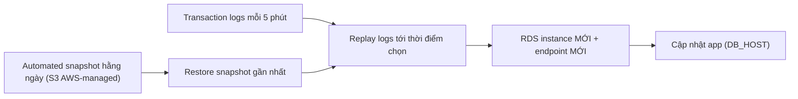

# RDS Backups and Restore

> **TL;DR:** RDS có hai loại backup: **manual snapshot** (bạn tự chạy, không bao giờ tự hết hạn) và **automated backup** (snapshot hằng ngày + **transaction log mỗi 5 phút**, giữ **0–35 ngày**, cho phép **point-in-time restore**). Cả hai lưu trong **S3 do AWS quản lý**. **Restore luôn tạo instance MỚI với endpoint mới** và không nhanh — tốt cho RPO, kém cho RTO.

## 🖼️ Sơ đồ
![[RDS Backups and Restore.excalidraw]]
*Mở bằng plugin Excalidraw để chỉnh sửa · ảnh tĩnh: [[RDS Backups and Restore.svg]]*

## Khái niệm cốt lõi
- Cả **automated backup** và **snapshot** đều lưu trong **AWS-managed S3 bucket** → **không thấy bucket trong S3 console** của bạn (chỉ thấy backup trong RDS console). Đề thi có hỏi điểm này.
- Vì nằm trên S3 nên backup **regionally resilient** (replicate qua nhiều AZ trong region).
- Backup/snapshot chụp **cả instance** (mọi database trên đó), không phải từng database.
- Nguồn backup:
  - Có **Multi-AZ** → lấy từ **standby** → IO pause không ảnh hưởng ứng dụng. Xem [[RDS Multi-AZ]].
  - **Single-AZ** (dev/test) → lấy từ instance duy nhất → có thể **khựng hiệu năng**.

## Manual snapshot
- **Không tự động**: bạn chạy thủ công, bằng script hoặc ứng dụng.
- Hoạt động giống [[EBS Snapshots]]: lần đầu là **full copy**; các lần sau là **incremental** (chỉ dữ liệu thay đổi). Lần đầu lâu; sau đó nhanh, trừ khi dữ liệu thay đổi nhiều.
- Mỗi lần snapshot có **gián đoạn ngắn** giữa compute và storage (single-AZ có thể ảnh hưởng app; Multi-AZ thì xảy ra trên standby).
- **Không hết hạn** — tồn tại **kể cả sau khi xóa RDS instance**; chỉ mất khi bạn tự xóa. (Quan trọng cho thi và cho chi phí.)
- Tần suất tùy ý (tháng/tuần/ngày/giờ). **Snapshot càng dày → RPO càng thấp**.

## Automated backup
- Thực chất là **snapshot tự động mỗi ngày một lần** (full rồi incremental), chạy trong **backup window** (để AWS chọn hoặc tự đặt; single-AZ nên đặt vào giờ ít dùng vì có IO pause).
- Thêm vào đó: **transaction log được ghi ra S3 mỗi 5 phút** (log chứa các thao tác làm thay đổi dữ liệu).
- Snapshot + transaction log → **point-in-time restore với độ mịn 5 phút** → RPO lý thuyết **~5 phút**.
- **Retention: 0–35 ngày** (0 = tắt automated backup). AWS tự dọn backup quá hạn.
- Khi xóa instance có thể chọn **giữ automated backup**, nhưng chúng **vẫn hết hạn theo retention period**.
- Muốn giữ dữ liệu **lâu hơn 35 ngày** sau khi xóa instance → tạo **final snapshot** (snapshot thủ công, bạn toàn quyền, phải tự xóa).

## Cross-region backup
- RDS có thể **replicate backup (snapshot và transaction log) sang region khác**.
- **Không mặc định** — phải bật rõ ràng trong cấu hình automated backup.
- Tính phí **data transfer cross-region** + **storage ở region đích**.

## Restore
- **Restore tạo một RDS instance MỚI** → **endpoint DNS mới** → phải **cập nhật ứng dụng** trỏ sang endpoint mới. (RDS thường không restore in-place; khác với tính năng Backtrack của [[Aurora]].)
- **Restore từ manual snapshot** → về **đúng một thời điểm** (lúc tạo snapshot) → RPO thường kém, trừ khi snapshot ngay trước sự cố.
- **Restore từ automated backup** → chọn **bất kỳ thời điểm nào (độ mịn 5 phút)** trong retention: RDS restore **snapshot gần nhất** rồi **replay transaction log** tới thời điểm chọn → **RPO tốt**.
- **Restore không nhanh** — DB lớn có thể rất lâu → tính vào **RTO**. Muốn RTO thấp → [[RDS Read Replicas]] (promote nhanh).

## Bảng so sánh

| | Manual snapshot | Automated backup |
|---|---|---|
| Kích hoạt | Thủ công / script | Tự động, mỗi ngày trong backup window |
| Transaction log | Không | Mỗi 5 phút lên S3 |
| Restore tới | Thời điểm tạo snapshot | Bất kỳ điểm nào (độ mịn 5 phút) trong retention |
| Hết hạn | **Không bao giờ** (tự xóa) | Theo retention **0–35 ngày** |
| Sau khi xóa instance | Vẫn còn | Có thể giữ, nhưng vẫn hết hạn theo retention |
| Lưu ở | S3 AWS-managed | S3 AWS-managed |

## Demo / Lab — Snapshot và restore khi dữ liệu bị hỏng
1. Tạo manual snapshot `a4lwordpress-with-cat-post-mysql-<version>` (Actions → Take snapshot). Snapshot đầu tiên là full, mất ~5 phút.
2. Mô phỏng **data corruption**: đổi tiêu đề bài viết thành "Not the Best Cats Ever".
3. Snapshots → chọn snapshot → **Restore snapshot**: nhập **DB identifier mới** `a4lwordpress-restore`, chọn VPC, subnet group, public access = No, **RDS security group**, instance class `db.t3.micro`. Mất ~10 phút.
4. So sánh endpoint: instance restore có **endpoint DNS khác** instance gốc (phần đầu chứa tên instance + chuỗi ngẫu nhiên, sau là `<region>.rds.amazonaws.com`).
5. Sửa `DB_HOST` trong `wp-config.php` sang endpoint mới → bài viết đúng xuất hiện lại.
6. Dọn dẹp: xóa instance restore (không final snapshot, không giữ automated backup) → **system snapshot** của nó bị xóa theo (ngay hoặc khi hết retention); **manual snapshot vẫn còn** và được giữ lại để dùng cho demo [[Aurora]] tiếp theo.

## 🎯 Mẹo thi SAA-C03
- Backup RDS nằm trong **S3 do AWS quản lý** — **không thấy trong S3 console** của bạn.
- **Manual snapshot không hết hạn**, sống sót sau khi xóa instance. **Automated backup** hết hạn theo retention **tối đa 35 ngày**.
- Cần giữ dữ liệu > 35 ngày → **manual/final snapshot** (hoặc [[AWS Backup]]).
- **Point-in-time restore** dùng automated backup + **transaction log 5 phút** → RPO ~5 phút.
- **Restore = instance mới + endpoint mới** → phải đổi cấu hình ứng dụng.
- Restore chậm → **RTO cao**; câu hỏi yêu cầu RTO thấp → read replica. Câu hỏi về **data corruption** → restore từ backup (point-in-time), **không** dùng read replica (replica cũng bị hỏng theo).
- Cross-region backup replication **phải bật thủ công**, có phí transfer + storage.
- Multi-AZ → backup từ standby → không ảnh hưởng hiệu năng.

## Liên kết
- Tiên quyết: [[RDS Architecture]], [[RPO and RTO]], [[EBS Snapshots]]
- Liên quan: [[RDS Multi-AZ]], [[RDS Read Replicas]], [[AWS Backup]], [[HA vs FT vs DR]], [[S3 Basics]]
- Phân biệt với: [[Aurora]] (Backtrack, restore khác)
- Section: [[_MOC 11 Databases]]
