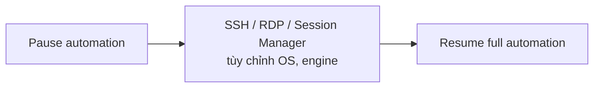

# RDS Custom

> **TL;DR:** RDS Custom là lựa chọn ở giữa RDS thường (AWS quản lý hết, không được vào OS) và tự chạy DB trên EC2 (bạn quản lý từ OS trở lên). Bạn vẫn có automation của RDS nhưng được SSH/RDP vào OS và tùy chỉnh engine. Chỉ hỗ trợ **Oracle** và **Microsoft SQL Server**.

## 🖼️ Sơ đồ
![[RDS Custom.excalidraw]]
*Mở bằng plugin Excalidraw để chỉnh sửa · ảnh tĩnh: [[RDS Custom.svg]]*

## Khái niệm cốt lõi
- **RDS thường**: database server as a service, AWS quản lý gần như mọi thứ, quyền vào OS và engine bị giới hạn ([[RDS Architecture]]).
- **DB trên EC2**: tự quản, linh hoạt tối đa nhưng gánh toàn bộ phần việc từ OS trở lên ([[Databases on EC2]]).
- **RDS Custom** lấp khoảng giữa: dùng được RDS, nhưng có quyền tùy biến gần giống tự chạy engine trên EC2.
- Engine hỗ trợ: **Oracle** và **MS SQL Server**.
- Truy cập OS và engine qua **SSH, RDP, Session Manager** (xem [[EC2 Instance Connect and SSH]]).
- Adrian nói đây là chủ đề rất hẹp; với đề thi chỉ cần biết nó tồn tại và nó dùng để làm gì.

## Cách hoạt động / Kiến trúc

### Tài nguyên nằm ở đâu
- **RDS thường**: EC2 host, EBS và backup S3 nằm trong môi trường do AWS quản lý. Trong account của bạn **không thấy** EC2 instance, EBS volume hay backup nào. Kết nối mạng có được là nhờ RDS **inject ENI** vào VPC của bạn.
- **RDS Custom**: mọi thứ chạy **trong AWS account của bạn**. Bạn sẽ thấy EC2 instance, EBS volume và backup trong account.

### Tùy biến an toàn
- Trước khi tùy chỉnh, phải **pause database automation** để automation của RDS không can thiệp trong lúc bạn sửa.
- Tùy chỉnh xong thì **resume** (bật lại full automation) để DB trở về trạng thái sẵn sàng cho production.

## Bảng so sánh / số liệu
Phân chia trách nhiệm theo slide (C = customer, S = shared, A = AWS), tương tự [[Shared Responsibility Model]]:

| Hạng mục | On-premises | RDS | RDS Custom | DB trên EC2 |
|---|---|---|---|---|
| Application optimization | C | C | C | C |
| Scaling | C | A | S | C |
| HA | C | A | S | C |
| Backups | C | A | S | C |
| DB patches | C | A | S | C |
| OS patches | C | A | S | C |
| OS install | C | A | S | C |
| Hardware | C | A | A | A |

- Chạy DB trên EC2 so với on-prem chỉ được lợi ở phần hardware.
- RDS Custom: hardware do AWS, application optimization do bạn, mọi thứ khác là **chia sẻ**.

## 🎯 Mẹo thi SAA-C03
- "Cần managed RDS nhưng phải truy cập OS / cài agent / tùy chỉnh engine, engine là Oracle hoặc SQL Server" → **RDS Custom**.
- Nếu engine là MySQL/PostgreSQL mà cần quyền OS → không có RDS Custom, phải chạy trên EC2.
- Nhận diện: tài nguyên (EC2, EBS, backup) **hiện trong account của bạn**; RDS thường thì không.
- Trước khi tùy chỉnh phải **pause automation**.

## Liên kết
- Tiên quyết: [[RDS Architecture]], [[Databases on EC2]]
- Liên quan: [[Shared Responsibility Model]], [[Cloud Service Models]], [[EC2 Instance Connect and SSH]], [[RDS Security]]
- Phân biệt với: [[Aurora]], [[RDS Multi-AZ]]
