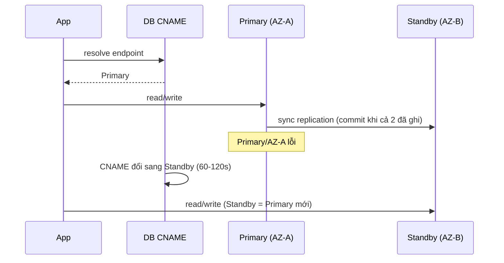
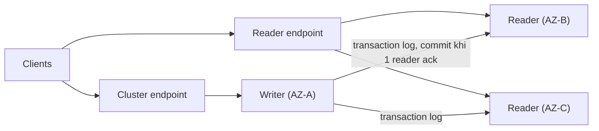

# RDS Multi-AZ

> **TL;DR:** Multi-AZ là cơ chế **high availability** của RDS trong **một region**. Có hai kiểu: **Multi-AZ Instance** (kiểu cũ: 1 primary + **1 standby** đồng bộ, standby không phục vụ đọc/ghi, failover **60–120 giây** qua đổi DNS) và **Multi-AZ Cluster** (kiểu mới: **1 writer + 2 reader** đọc được, replicate qua transaction log, failover **~35 giây**).

## 🖼️ Sơ đồ
![[RDS Multi-AZ.excalidraw]]
*Mở bằng plugin Excalidraw để chỉnh sửa · ảnh tĩnh: [[RDS Multi-AZ.svg]]*

![[RDS Multi-AZ - cluster.excalidraw]]
*Mở bằng plugin Excalidraw để chỉnh sửa · ảnh tĩnh: [[RDS Multi-AZ - cluster.svg]]*

## Multi-AZ Instance deployment (kiểu "classic")

### Cách hoạt động
- Primary instance replicate **synchronous** sang **standby replica** ở **AZ khác**. Standby có cùng database và dữ liệu.
- Replication ở **mức storage** (kém hiệu quả hơn kiểu cluster). Cơ chế cụ thể tùy engine: MySQL, MariaDB, Oracle, PostgreSQL dùng công nghệ failover của Amazon; **SQL Server** dùng **Database Mirroring** hoặc **Always On Availability Groups** — đều bị trừu tượng hóa, chỉ cần nhớ "synchronous".
- Mọi truy cập qua **database CNAME** (endpoint DNS), mặc định trỏ tới primary. **Mọi đọc và ghi đều vào primary**; **không** truy cập được standby kể cả để đọc.
- **Backup được lấy từ standby** → không thêm tải cho primary (backup lưu S3, replicate nhiều AZ). Xem [[RDS Backups and Restore]].
- Khi primary gặp sự cố, RDS phát hiện và **failover**: **CNAME đổi sang trỏ vào standby**, standby trở thành primary mới.
  - Vì là thay đổi DNS nên mất **60–120 giây** → có gián đoạn ngắn. Giảm bằng cách **tắt DNS caching** trong ứng dụng cho tên này.

### Điểm cần nhớ
- Data ghi vào primary **và** replicate xong sang standby mới tính là **committed** (synchronous).
- **Không thuộc free tier** (trả thêm cho standby).
- Chỉ **MỘT** standby, và standby **không dùng được để đọc hay ghi**.
- Failover **60–120 s**.
- **Chỉ trong cùng region** (khác AZ, cùng region). Cross-region → dùng [[RDS Read Replicas]].
- Failover xảy ra khi: **AZ outage**, **primary failure**, **manual failover**, **đổi instance type**, **patching phần mềm** (failover để vá instance không có client rồi chuyển lại → giữ availability khi bảo trì).

## Multi-AZ Cluster deployment (kiểu mới)
- **1 writer + 2 reader** DB instance, ở các **AZ khác nhau**. Chỉ đúng **2 reader** (Aurora thì nhiều hơn).
- **Writer** đọc + ghi (giống primary); **reader dùng được cho đọc** → **scale read** một phần. Cần ứng dụng hỗ trợ (gửi đọc và ghi tới endpoint khác nhau).
- Ghi được coi là **committed khi ít nhất 1 reader xác nhận** đã ghi.
- Phần cứng nhanh hơn: **Graviton** + **local NVMe SSD**; ghi vào local storage siêu nhanh rồi **flush xuống EBS** (vừa nhanh vừa có độ bền của EBS).
- **Mỗi instance vẫn có storage cục bộ riêng** — khác [[Aurora]] (shared cluster volume).
- Replication qua **transaction log** → hiệu quả hơn; **failover ~35 giây + thời gian apply transaction log**.
- **Endpoint**:
  - **Cluster endpoint**: trỏ writer; dùng cho đọc, ghi, quản trị (tương đương CNAME ở kiểu instance).
  - **Reader endpoint**: trỏ tới reader khả dụng (đôi khi cả writer) → cân bằng tải đọc.
  - **Instance endpoint**: mỗi instance một cái; không nên dùng trực tiếp vì không tự chuyển khi instance lỗi — chỉ để test/fault finding.

## Bảng so sánh

| | Multi-AZ Instance | Multi-AZ Cluster | [[Aurora]] (để phân biệt) |
|---|---|---|---|
| Thành phần | 1 primary + 1 standby | 1 writer + 2 reader | 1 writer + tới 15 replica |
| Standby/reader phục vụ đọc? | **Không** | **Có** | Có |
| Replication | Synchronous, mức storage | Transaction log, commit khi ≥1 reader ack | Shared cluster storage |
| Storage | EBS riêng mỗi instance | Local NVMe + EBS riêng mỗi instance | Shared cluster volume |
| Failover | 60–120 s (đổi CNAME) | ~35 s + apply log | Nhanh (xem note Aurora) |
| Endpoint | 1 CNAME | Cluster / reader / instance | Cluster / reader / instance / custom |
| Phạm vi | Cùng region | Cùng region | Cùng region (cross-region: [[Aurora Global Database]]) |

(Hiện nay Multi-AZ DB cluster chỉ hỗ trợ engine **MySQL và PostgreSQL**; khóa học không nêu điểm này.)

## Demo / Lab — Bật Multi-AZ và thử failover
- Stack `RDS-MultiAZ-Snap` tạo WordPress + RDS MySQL single-AZ (us-east-1a). Single-AZ → **không chịu được lỗi AZ**.
- Bật Multi-AZ: **Modify** → Availability & durability: *Create a standby instance* → chọn **Apply immediately** (thay vì đợi **maintenance window**; cảnh báo có thể ảnh hưởng hiệu năng/outage).
- Phía sau, RDS **snapshot primary → restore sang standby ở AZ khác (trong DB subnet group) → thiết lập sync replication**. Mất ~10 phút; xong mới là Multi-AZ thật.
- Mô phỏng sự cố: **Actions → Reboot → "Reboot with failover"** → CNAME chuyển sang standby, primary cũ được restart. Blog tạm không tải được rồi chạy lại → failover **không tức thời** (60–120 s).

## 🎯 Mẹo thi SAA-C03
- Với RDS (không tính Aurora): **synchronous = Multi-AZ**, **asynchronous = read replica**.
- Multi-AZ (instance) là để **HA/availability, không phải để scale đọc**: standby **không phục vụ read**. Đề muốn scale đọc → [[RDS Read Replicas]] (hoặc Multi-AZ Cluster / Aurora).
- Multi-AZ chỉ **trong một region**; cần chống lỗi **cả region** → cross-region read replica.
- Failover = **đổi DNS CNAME**, ứng dụng không cần đổi cấu hình endpoint; mất **60–120 s** (cluster ~35 s).
- Backup lấy từ **standby** → không có IO pause trên primary.
- Không có trong free tier.
- Đề nhắc "1 writer + 2 readable standby", "failover dưới 35 giây", "Graviton + NVMe" → **Multi-AZ DB Cluster**.
- Đừng nhầm Multi-AZ Cluster của RDS với Aurora: RDS cluster chỉ 2 reader và storage riêng từng instance.

## Liên kết
- Tiên quyết: [[RDS Architecture]], [[HA vs FT vs DR]], [[AWS Global Infrastructure]]
- Liên quan: [[RDS Backups and Restore]], [[RDS Read Replicas]], [[RPO and RTO]], [[DNS Fundamentals]]
- Phân biệt với: [[Aurora]], [[Aurora Global Database]], [[RDS Read Replicas]]
- Section: [[_MOC 11 Databases]]
