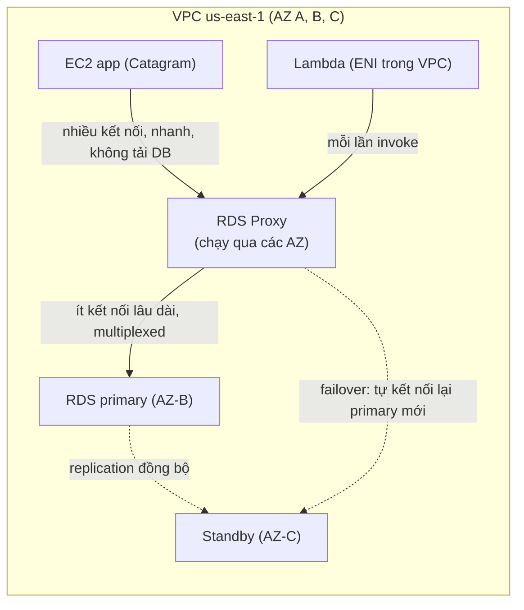

# RDS Proxy

> **TL;DR:** RDS Proxy là database proxy fully managed cho RDS và Aurora. Ứng dụng kết nối tới proxy; proxy giữ một **connection pool** lâu dài tới DB và **multiplex** nhiều kết nối client lên ít kết nối DB. Kết quả: DB đỡ tải, Lambda không phải mở/đóng kết nối mỗi lần chạy, và failover **trong suốt** với ứng dụng (nhanh hơn trên 60% với Aurora).

## 🖼️ Sơ đồ
![[RDS Proxy.excalidraw]]
*Mở bằng plugin Excalidraw để chỉnh sửa · ảnh tĩnh: [[RDS Proxy.svg]]*

## Khái niệm cốt lõi

### Vì sao cần
- **Mở và đóng kết nối** tốn thời gian và tài nguyên. Với các thao tác đọc/ghi nhỏ, phần này thường chiếm phần lớn chi phí và gây latency.
- Với **serverless**: mỗi lần [[Lambda]] được gọi lại mở/đóng kết nối, trong khi Lambda tính tiền theo thời gian chạy.
- **Xử lý lỗi DB** rất khó: chờ bao lâu, làm gì trong lúc chờ, khi nào coi là lỗi, chuyển sang standby thế nào. Tự viết trong ứng dụng thì vừa tốn công vừa rủi ro.
- Tự vận hành proxy thì phải lo scaling và resilience. RDS Proxy giải quyết phần này.
- Mô hình: **Ứng dụng → Proxy (connection pooling) → Database**.

### Key facts (slide)
- **Fully managed** DB proxy cho **RDS và Aurora**.
- **Auto scaling, highly available** sẵn, ít việc quản trị.
- **Connection pooling** giảm tải DB theo hai cách: không mở/đóng kết nối liên tục, và **multiplexing** (ít kết nối proxy→DB phục vụ nhiều kết nối client→proxy).
- **Chỉ truy cập được từ trong VPC** (hoặc mạng private nối vào VPC), không truy cập từ internet.
- Truy cập qua **proxy endpoint**, giống một DB endpoint bình thường, **không cần sửa ứng dụng**.
- Có thể **bắt buộc SSL/TLS**.
- **Giảm thời gian failover hơn 60%** (với Aurora khoảng 66–67%).
- **Che giấu lỗi DB** khỏi ứng dụng.

## Cách hoạt động / Kiến trúc

- Kết nối client → proxy nhanh và không tạo tải lên DB server.
- Pool proxy → DB được tạo và duy trì lâu dài, không theo từng request hay từng lần gọi Lambda.
- Khi failover (ví dụ [[RDS Multi-AZ]] chuyển primary → standby): client vẫn nối vào proxy và **chờ**; proxy tự lập kết nối mới tới primary mới ở phía sau. Ứng dụng không phải đợi CNAME của DB đổi, và không biết mình đang nói chuyện với proxy.

## 🎯 Mẹo thi SAA-C03
- Lỗi "**too many connections**", đặc biệt với instance nhỏ/burstable (**T2/T3**) → RDS Proxy.
- **Lambda + RDS** (nhiều invocation đồng thời mở kết nối) → RDS Proxy. Lambda có thể dùng **IAM authentication** qua execution role ([[RDS Security]]); credential DB phía proxy lấy từ [[Secrets Manager]].
- Ứng dụng chạy lâu dài (SaaS) cần latency thấp → dùng pool có sẵn thay vì mở kết nối theo từng tương tác.
- "Giảm thời gian failover / failover **trong suốt với ứng dụng**" → RDS Proxy (giảm > 60%).
- Bẫy: RDS Proxy **không public**, chỉ truy cập từ VPC.
- Bẫy: proxy không phải cache. Muốn giảm tải đọc thì dùng [[RDS Read Replicas]] hoặc [[ElastiCache]].

## Liên kết
- Tiên quyết: [[RDS Architecture]], [[RDS Multi-AZ]], [[Lambda]]
- Liên quan: [[Aurora]], [[Aurora Serverless]], [[Serverless Architecture]], [[Secrets Manager]], [[RDS Security]], [[Interface VPC Endpoints]]
- Phân biệt với: [[ElastiCache]], [[RDS Read Replicas]], [[Elastic Load Balancer]] (cân tải HTTP/TCP, không pool kết nối DB)
