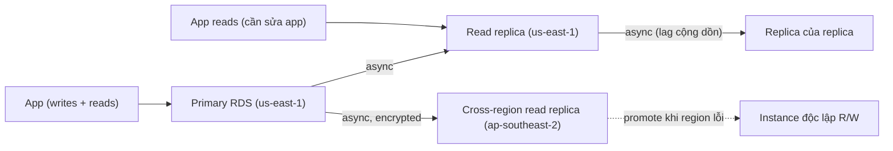

# RDS Read Replicas

> **TL;DR:** Read replica là bản sao **chỉ đọc** của một RDS instance, đồng bộ bằng **asynchronous replication**, đặt được **cùng region hoặc region khác**. Dùng để **scale đọc** (tới 5 replica trực tiếp theo khóa học) và để đạt **RPO/RTO gần 0** khi gặp **sự cố hỏng hóc** (promote nhanh) — nhưng **không** cứu được khi **dữ liệu bị corrupt**.

## 🖼️ Sơ đồ
![[RDS Read Replicas.excalidraw]]
*Mở bằng plugin Excalidraw để chỉnh sửa · ảnh tĩnh: [[RDS Read Replicas.svg]]*

![[RDS Read Replicas - when.excalidraw]]
*Mở bằng plugin Excalidraw để chỉnh sửa · ảnh tĩnh: [[RDS Read Replicas - when.svg]]*

## Khái niệm cốt lõi
- **Read-only** cho tới khi được **promote**; sau khi promote thành RDS instance bình thường (đọc/ghi).
- Khác standby của [[RDS Multi-AZ|Multi-AZ instance]] (không dùng được gì): read replica **dùng được cho đọc**. (Multi-AZ Cluster giống như kết hợp Multi-AZ instance + read replica.)
- Là **thực thể riêng**, không thuộc instance chính: có **endpoint riêng** → ứng dụng **phải được sửa** để dùng. Ứng dụng (ví dụ WordPress) mặc định **không biết** replica tồn tại → không có hỗ trợ của app thì replica vô dụng.
- **Không có automatic failover** tới read replica.

### Synchronous vs Asynchronous
- **Synchronous (Multi-AZ)**: ghi lên primary và standby như một thao tác duy nhất.
- **Asynchronous (read replica)**: ghi lên primary → coi là **committed** → **sau đó** mới replicate sang replica → có **replication lag** (thường vài giây, tùy mạng và lượng ghi).
- Với RDS (bỏ qua Aurora): **sync = Multi-AZ, async = read replica**.

### Cross-region read replica
- Đặt replica ở **region khác**; AWS lo toàn bộ networking giữa region, **trong suốt** và **mã hóa in transit**.

## Vì sao quan trọng

### 1. Read performance / read scaling
- Tối đa **5 read replica trực tiếp** cho mỗi DB instance (theo khóa học), mỗi cái thêm một "instance" năng lực đọc → **scale out đọc** đơn giản. (Hiện nay MySQL, MariaDB, PostgreSQL cho tới **15** read replica; Oracle và SQL Server vẫn 5.)
- Replica có thể có **replica của chính nó** (nhiều tầng) → scale đọc thêm, nhưng **lag cộng dồn** thành vấn đề.
- **Global read performance**: workload đọc ở region khác đọc trực tiếp từ cross-region replica, không ảnh hưởng primary.

### 2. RPO / RTO
- Snapshot và backup cải thiện **RPO**, nhưng **RTO là vấn đề** vì restore chậm (xem [[RDS Backups and Restore]]).
- Read replica cho **RPO gần 0** (dữ liệu được sync liên tục).
- **Promote nhanh** → **RTO gần 0**.
- **Chỉ dùng cho failure, không dùng cho data corruption**: corrupt dữ liệu trên primary sẽ được replicate sang replica.
- Cross-region replica → cải thiện **global availability / global resilience**: dùng làm region failover khi AWS gặp sự cố lớn ở cả region.

## Bảng so sánh

| | [[RDS Multi-AZ\|Multi-AZ Instance]] | Read Replica |
|---|---|---|
| Mục đích | HA trong region | Scale đọc, DR (kể cả cross-region) |
| Replication | Synchronous | **Asynchronous** (có lag) |
| Dùng để đọc? | Không | Có (read-only) |
| Endpoint | Chung CNAME | Endpoint riêng, app phải biết |
| Failover | Tự động (60–120 s) | **Thủ công: promote** |
| Phạm vi | Cùng region | Cùng region hoặc cross-region |
| Bảo vệ khỏi corruption | Không | Không |

## 🎯 Mẹo thi SAA-C03
- Đề nói **scale read**, **read-heavy workload**, **báo cáo làm chậm DB chính** → **read replica**.
- Đề nói **asynchronous** → read replica; **synchronous** → Multi-AZ.
- Cần **DR cross-region** / **global resilience** / **đọc gần người dùng ở region khác** với RDS → **cross-region read replica** (với Aurora → [[Aurora Global Database]]).
- **RTO thấp khi instance/region lỗi** → promote read replica. **Data corruption** → **không** dùng replica; dùng **point-in-time restore**.
- Read replica **không tự failover**, **không tự được ứng dụng dùng** — cần sửa app để trỏ endpoint replica.
- Replica nhiều tầng → **lag tăng**.

## Liên kết
- Tiên quyết: [[RDS Architecture]], [[RPO and RTO]], [[ACID vs BASE]] (eventual consistency khi đọc replica)
- So sánh: [[RDS Multi-AZ]], [[RDS Backups and Restore]]
- Liên quan: [[Aurora]], [[Aurora Global Database]], [[RDS Proxy]], [[ElastiCache]], [[HA vs FT vs DR]], [[Horizontal vs Vertical Scaling]]
- Section: [[_MOC 11 Databases]]
