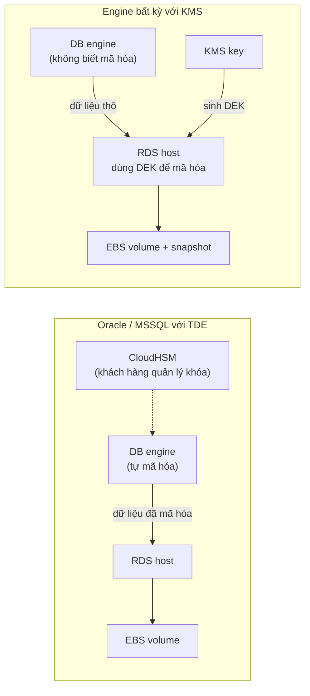
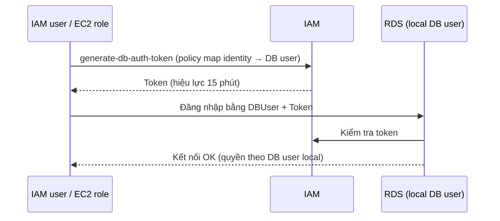

# RDS Security

> **TL;DR:** Bảo mật dữ liệu trong RDS gồm 4 mảng: **authentication** (ai đăng nhập được), **authorization** (được làm gì), **encryption in transit** (SSL/TLS giữa client và DB) và **encryption at rest** (KMS/EBS do host làm, hoặc TDE do engine làm). Điểm hay bị hỏi: IAM DB Authentication chỉ thay thế **mật khẩu** khi đăng nhập; quyền bên trong DB vẫn do user local của engine quyết định.

## 🖼️ Sơ đồ
![[RDS Security.excalidraw]]
*Mở bằng plugin Excalidraw để chỉnh sửa · ảnh tĩnh: [[RDS Security.svg]]*

![[RDS Security - iam-auth.excalidraw]]
*Mở bằng plugin Excalidraw để chỉnh sửa · ảnh tĩnh: [[RDS Security - iam-auth.svg]]*

## Khái niệm cốt lõi

### Encryption in transit
- Mọi engine của RDS đều hỗ trợ mã hóa đường truyền client ↔ RDS instance bằng [[SSL and TLS|SSL/TLS]].
- Có thể bắt buộc dùng SSL/TLS **theo từng database user** (mandatory per user).

### Encryption at rest: KMS + EBS (mặc định, mọi engine)
- Việc mã hóa do **RDS host** và lớp lưu trữ EBS đảm nhận ([[EBS Encryption]]). Database engine không hề biết dữ liệu bị mã hóa: nó ghi dữ liệu "thô", host mã hóa trước khi đẩy xuống EBS.
- Dùng [[KMS]]: chọn một KMS key (khóa học gọi là CMK), có thể là AWS managed hoặc customer managed. Key này sinh ra **data encryption key (DEK)**; DEK được nạp lên RDS host khi cần và dùng cho thao tác mã hóa/giải mã thực tế (envelope encryption, xem [[Encryption Fundamentals]]).
- Khi bật, **storage, log, snapshot và replica** đều được mã hóa bằng cùng một KMS key. Dữ liệu truyền giữa primary và replica cũng được mã hóa.
- **Không thể tắt mã hóa** sau khi đã bật.
- (Bổ sung, không có trong bài) Encryption at rest phải chọn lúc tạo instance. Muốn mã hóa một DB đang không mã hóa: tạo snapshot → copy snapshot có bật encryption → restore từ bản copy đó ([[RDS Backups and Restore]]).

### Encryption at rest: TDE (Transparent Data Encryption)
- Chỉ **Microsoft SQL Server** và **Oracle** hỗ trợ.
- Mã hóa/giải mã xảy ra **bên trong database engine**, không phải ở host. Dữ liệu đã được mã hóa ngay từ lúc engine ghi ra đĩa, nên mức độ phải tin tưởng vào bên khác thấp hơn.
- **RDS Oracle + TDE + [[CloudHSM]]**: khóa nằm trong HSM do khách hàng quản lý, AWS không tiếp xúc với khóa. Kiểu này loại bỏ AWS khỏi chuỗi tin cậy, phù hợp với yêu cầu tuân thủ khắt khe.

## Cách hoạt động / Kiến trúc

### So sánh hai kiểu mã hóa at rest

### IAM Database Authentication
Bình thường đăng nhập RDS dùng **database user local** (username/password của engine), nằm ngoài sự kiểm soát của IAM. Khi tạo instance chỉ có một user master được tạo; còn lại do bạn tự quản.

Có thể cấu hình RDS cho phép đăng nhập bằng IAM:
1. Bật IAM DB authentication trên RDS instance, rồi tạo một local DB user cấu hình để xác thực bằng **AWS authentication token**.
2. Gắn policy cho IAM user hoặc [[IAM Roles|IAM role]] (ví dụ [[EC2 Instance Roles|instance role]] của EC2). Policy này **ánh xạ IAM identity đó sang local DB user**.
3. Identity gọi `generate-db-auth-token`. Token có hiệu lực **15 phút**.
4. Dùng DB username + token thay cho password để đăng nhập.

- **Đây chỉ là authentication, không phải authorization.** Quyền trên các object trong DB vẫn được gán cho local DB user và do engine kiểm soát. IAM không cấp quyền gì bên trong database.
- Chỉ hoạt động khi bạn chủ động bật trên instance.
- (Bổ sung) IAM DB auth hỗ trợ RDS MySQL, MariaDB, PostgreSQL và Aurora MySQL/PostgreSQL; không áp dụng cho RDS Oracle và SQL Server.

## Bảng so sánh / số liệu

| Cơ chế | Engine | Ai mã hóa | Key | Ghi chú |
|---|---|---|---|---|
| SSL/TLS in transit | Mọi engine | Client ↔ endpoint | Cert của RDS | Có thể bắt buộc theo từng user |
| KMS + EBS at rest | Mọi engine | RDS host | KMS key → DEK | Áp dụng cho storage, log, snapshot, replica; không gỡ được |
| TDE | MSSQL, Oracle | DB engine | Do engine quản (Oracle có thể dùng CloudHSM) | Ít phải tin tưởng AWS hơn |
| IAM DB auth | MySQL/MariaDB/PostgreSQL/Aurora | — | Token 15 phút | Chỉ authentication |

## 🎯 Mẹo thi SAA-C03
- "Đăng nhập DB không dùng password / dùng IAM role của EC2 hoặc Lambda để vào DB" → **IAM DB Authentication** + `generate-db-auth-token`. Nhưng nếu đề hỏi "kiểm soát quyền đọc/ghi bảng bằng IAM" thì đó là bẫy: **IAM không làm authorization** trong RDS.
- Token có hiệu lực **15 phút**.
- "Mã hóa trong engine, AWS không được thấy khóa" → **TDE** (MSSQL/Oracle); thêm "khóa trong HSM do khách hàng quản lý" → **Oracle TDE + CloudHSM**.
- Encryption at rest bằng KMS: snapshot, log, replica **đều mã hóa theo** và **không thể tắt**. Cần mã hóa DB đang plaintext → đi đường snapshot → copy (encrypt) → restore.
- "Bắt buộc mã hóa kết nối từ client" → SSL/TLS, có thể ép theo user; nếu có RDS Proxy thì proxy cũng ép được TLS ([[RDS Proxy]]).

## Liên kết
- Tiên quyết: [[RDS Architecture]], [[KMS]], [[Encryption Fundamentals]], [[SSL and TLS]]
- Liên quan: [[EBS Encryption]], [[CloudHSM]], [[IAM Roles]], [[EC2 Instance Roles]], [[RDS Backups and Restore]], [[RDS Read Replicas]], [[Secrets Manager]], [[RDS Proxy]]
- Phân biệt với: [[S3 Encryption]] (SSE ở S3 có nhiều chế độ hơn), [[Security Groups]] (kiểm soát mạng, không phải danh tính)
