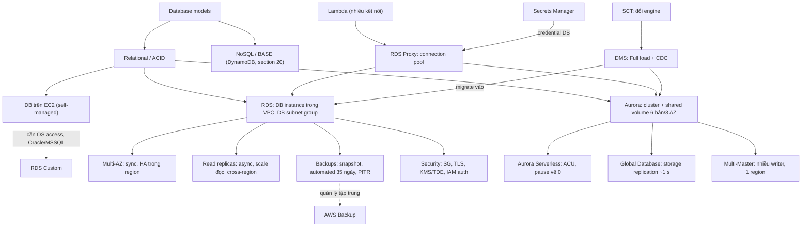

# 11 Databases

Section database quan hệ của khóa học: bắt đầu từ lý thuyết mô hình dữ liệu và ACID/BASE, đi qua lựa chọn tự chạy DB trên EC2, rồi toàn bộ họ RDS (kiến trúc, Multi-AZ, backup, read replica, bảo mật, RDS Custom), họ Aurora (provisioned, Serverless, Global Database, Multi-Master), RDS Proxy và kết thúc bằng migrate với DMS. Phần NoSQL và analytics (DynamoDB, ElastiCache, Redshift) nằm ở [[_MOC 20 NoSQL and Analytics]]. Đây là một trong những section nặng điểm nhất của đề SAA-C03.

← [[00 Home]] · Section trước: [[_MOC 10 Route 53]] · Section tiếp theo: [[_MOC 12 Network Storage and Backup]] →

## Lộ trình học
1. [[Database Models]] — relational với schema cố định so với các mô hình NoSQL (key-value, wide column, document, column, graph) và cách nhận diện trong đề.
2. [[ACID vs BASE]] — CAP theorem; ACID ưu tiên consistency (RDS), BASE ưu tiên availability và scale (NoSQL/DynamoDB).
3. [[Databases on EC2]] — tự cài DB trên EC2 thường là bad practice, nhưng hợp lệ khi cần OS access, engine/version lạ hay replication đặc thù.
4. [[RDS Architecture]] — "database server as a service" trong VPC, đặt qua DB subnet group, mỗi instance có EBS riêng, kết nối bằng endpoint DNS.
5. [[RDS Multi-AZ]] — HA trong một region: Multi-AZ Instance (1 standby đồng bộ, failover 60–120 s) và Multi-AZ Cluster (1 writer + 2 reader, ~35 s).
6. [[RDS Backups and Restore]] — manual snapshot không hết hạn và automated backup 0–35 ngày với log 5 phút cho PITR; restore luôn tạo instance mới.
7. [[RDS Read Replicas]] — bản sao chỉ đọc, async, cùng hoặc khác region; scale đọc và promote cho RTO thấp, không cứu được data corruption.
8. [[RDS Security]] — SSL/TLS in transit, KMS/EBS hoặc TDE at rest, IAM DB Authentication chỉ thay password khi đăng nhập.
9. [[RDS Custom]] — RDS có quyền vào OS và tùy biến engine, chỉ cho Oracle và SQL Server; tài nguyên hiện trong account của bạn.
10. [[Aurora]] — cluster 1 primary + tối đa 15 replica dùng chung cluster volume 6 bản/3 AZ; reader endpoint, backtrack, fast clone.
11. [[Aurora Serverless]] — capacity theo ACU min/max, tự scale và pause về 0; dành cho workload thất thường, dev/test.
12. [[Aurora Global Database]] — replication tầng storage sang secondary region (~1 s) cho cross-region DR và global read scaling.
13. [[Aurora Multi-Master]] — mọi instance đều ghi được, failover gần như tức thì nhưng app tự quản kết nối; trong một region.
14. [[RDS Proxy]] — connection pool managed cho RDS/Aurora, giải lỗi too many connections từ Lambda và làm failover trong suốt.
15. [[DMS]] — replication instance chạy task Full load / Full load + CDC / CDC only; đổi engine thì thêm SCT.

## Bản đồ khái niệm

## Liên kết sang section khác
- [[RPO and RTO]] — khung để so sánh backup, read replica, Multi-AZ và Global Database.
- [[HA vs FT vs DR]] — phân biệt Multi-AZ (HA), Multi-Master (gần FT) và cross-region (DR).
- [[KMS]] — encryption at rest của RDS/Aurora và snapshot.
- [[Security Groups]] — kiểm soát truy cập mạng vào RDS bằng tham chiếu SG của app tier.
- [[Secrets Manager]] — lưu và rotate mật khẩu DB, credential phía RDS Proxy.
- [[Lambda]] — client điển hình cần RDS Proxy hoặc Data API.
- [[DynamoDB Architecture]] — lựa chọn NoSQL khi không cần quan hệ và cần scale lớn.
- [[DynamoDB Global Tables]] — multi-active ghi ở nhiều region, khác Aurora Global Database.
- [[ElastiCache]] — giảm tải đọc bằng cache, khác RDS Proxy.
- [[AWS Backup]] — quản lý backup RDS/Aurora tập trung, giữ lâu hơn 35 ngày.

## 🎯 Top mẹo thi của section
- Key-value đơn giản/caching → key-value store; **DynamoDB là wide column**; reporting/analytics/column-based → **Redshift**; OLTP row-based → RDS; quan hệ phức tạp kiểu social → graph. ([[Database Models]])
- Thấy **BASE** → NoSQL; thấy **ACID** → RDS; ACID đi cùng DynamoDB → DynamoDB Transactions. ([[ACID vs BASE]])
- Mặc định chọn managed DB; chỉ chọn **DB trên EC2** khi cần OS/root access, engine/version không hỗ trợ hoặc replication đặc thù. ([[Databases on EC2]])
- RDS không có OS/SSH access; cần OS access với **Oracle/SQL Server** → **RDS Custom**, với MySQL/PostgreSQL → EC2. ([[RDS Custom]])
- **Synchronous = Multi-AZ** (HA, standby không phục vụ đọc, failover đổi DNS 60–120 s); **asynchronous = read replica** (scale đọc, cross-region). ([[RDS Multi-AZ]])
- "1 writer + 2 readable standby, failover dưới 35 giây" → **Multi-AZ DB Cluster**, không phải Aurora. ([[RDS Multi-AZ]])
- Automated backup giữ tối đa **35 ngày**, PITR nhờ log **5 phút**; giữ lâu hơn → manual snapshot hoặc AWS Backup; **restore = instance mới, endpoint mới**. ([[RDS Backups and Restore]])
- **Data corruption** → point-in-time restore; **instance/region lỗi, cần RTO thấp** → promote read replica. ([[RDS Read Replicas]])
- IAM DB Authentication chỉ thay **password** (token 15 phút); IAM **không** cấp quyền đọc/ghi bảng. Mã hóa DB đang plaintext → snapshot → copy có encrypt → restore. ([[RDS Security]])
- Thuộc số Aurora: **6 bản/3 AZ**, **15 replica**, **128 TiB**; rollback tại chỗ không đổi endpoint → **Backtrack**; bản sao test nhanh, ít storage → **Fast clone**. ([[Aurora]])
- Workload **thất thường/không đoán trước**, dev/test muốn tắt khi rảnh → **Aurora Serverless**. ([[Aurora Serverless]])
- Cross-region DR cho DB quan hệ với RPO/RTO rất thấp, hoặc đọc latency thấp ở nhiều châu lục → **Aurora Global Database**; cần ghi ở nhiều region với NoSQL → DynamoDB Global Tables. ([[Aurora Global Database]])
- "Too many connections", **Lambda + RDS**, hoặc "failover trong suốt với app" → **RDS Proxy**; proxy chỉ truy cập từ VPC và không phải cache. ([[RDS Proxy]])
- Migrate DB ít/không downtime → **DMS Full load + CDC**; đổi engine → **SCT + DMS**; nhiều TB, mạng yếu → DMS + SCT + **Snowball**. ([[DMS]])
