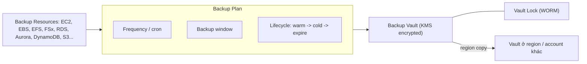

# AWS Backup

> **TL;DR:** AWS Backup là dịch vụ **data protection fully managed**. Nó gom việc cấu hình, lập lịch, lưu trữ và giám sát backup của nhiều dịch vụ AWS về **một chỗ**, có thể trải trên **nhiều account và nhiều region**, thay cho việc tự viết script snapshot cho từng dịch vụ.

## 🖼️ Sơ đồ
![[AWS Backup.excalidraw]]
*Mở bằng plugin Excalidraw để chỉnh sửa · ảnh tĩnh: [[AWS Backup.svg]]*

![[AWS Backup - lifecycle.excalidraw]]
*Mở bằng plugin Excalidraw để chỉnh sửa · ảnh tĩnh: [[AWS Backup - lifecycle.svg]]*

## Khái niệm cốt lõi
- Ở mức SAA-C03, cứ coi đây là sản phẩm **backup và restore**. Ngoài ra nó còn có phần auditing và quản trị giám sát.
- Lợi ích hằng ngày lớn nhất là **hợp nhất quản lý**. Không cần bật backup [[RDS Backups and Restore|RDS]] ở một nơi, cấu hình DynamoDB ở nơi khác, rồi viết cron job để chụp [[EBS Snapshots]]. AWS Backup làm tất cả theo một chính sách chung.
- **Multi-account**: kết hợp [[AWS Organizations]] và [[AWS Control Tower]] để quản lý backup tập trung cho cả tổ chức.
- **Cross-region**: copy backup sang region khác để bảo vệ dữ liệu khi cả region gặp sự cố (DR).
- **Dịch vụ được hỗ trợ** (danh sách luôn mở rộng):
  - Compute: [[EC2 Basics|EC2]], VMware (cả VMware chạy trên AWS)
  - Block storage: [[EBS]]
  - File storage: [[EFS]], các loại FSx ([[FSx for Windows]], [[FSx for Lustre]]...)
  - Database: [[Aurora]], RDS, Neptune, DynamoDB, DocumentDB
  - Object storage: [[S3 Basics|S3]]
  - Cả storage lẫn cấu hình backup/retention đều được quản lý tập trung.

## Cách hoạt động / Kiến trúc
| Thành phần | Vai trò |
|---|---|
| **Backup Plan** | Chính sách: **tần suất** (hourly, 12h, daily, weekly theo ngày trong tuần, monthly theo ngày trong tháng, hoặc **cron expression**, tối thiểu là mỗi giờ), **backup window** (giờ bắt đầu và thời lượng), **lifecycle** (khi nào chuyển sang cold storage, khi nào hết hạn), **vault** đích, **region copy**. Có thể bật **continuous backup** cho dịch vụ hỗ trợ để có PITR. |
| **Backup Resources** | *Cái gì* được backup: một S3 bucket, một RDS DB... (gán vào plan, ví dụ theo tag) |
| **Backup Vault** | **Đích** lưu backup (container). Cần ít nhất một vault. Gán [[KMS]] key để mã hóa. Mặc định là read/write, tức backup **xóa được**. |
| **Vault Lock** | Bật chế độ **WORM** (write-once, read-many) cho vault |
| **On-demand backup** | Backup thủ công khi cần, không bắt buộc phải qua plan |
| **PITR** (point-in-time recovery) | Với dịch vụ hỗ trợ (ví dụ S3, RDS), restore về trạng thái tại một thời điểm bất kỳ trong retention window |

### Lifecycle và cold storage
- Backup có thể được chuyển sang **cold storage** để giảm chi phí. Khi đã chuyển thì phải nằm ở đó **tối thiểu 90 ngày**.
- Lifecycle cũng quy định thời điểm backup **expire** và bị xóa tự động.

### Vault Lock
- Bật WORM cho vault. Có **72 giờ cool-off** sau khi bật, và trong thời gian này vẫn gỡ được lock. Hết 72 giờ thì lock có hiệu lực hoàn toàn: **không ai, kể cả AWS, xóa được** backup trước hạn.
- Retention period vẫn có hiệu lực: backup vẫn **hết hạn tự nhiên** theo lifecycle. Lock chỉ ngăn xóa sớm hoặc lách quy định.
- Thiết kế cho tình huống **compliance**.
- **Không nhầm** với [[S3 Object Lock]] hay Glacier Vault Lock. Đây là tính năng riêng của AWS Backup.
- (Hiện nay Vault Lock có hai mode. *Governance* cho phép user có quyền IAM phù hợp gỡ lock. *Compliance* có thời gian grace tối thiểu 72 giờ, sau đó bất biến. Thứ khóa học mô tả chính là compliance mode.)

## 🎯 Mẹo thi SAA-C03
- Đề nói "**quản lý backup tập trung** cho nhiều dịch vụ, nhiều account, nhiều region", "chính sách backup thống nhất", "thay script snapshot tự viết" thì chọn **AWS Backup**.
- Đề nói "backup **không thể bị xóa**, kể cả bởi root/admin", "WORM", "compliance/ransomware" thì chọn **AWS Backup Vault Lock**. Đừng nhầm với S3 Object Lock khi đối tượng không phải S3 object.
- Đề nói "DR cross-region cho backup" thì dùng **region copy** trong backup plan, hoặc copy sang account khác qua Organizations.
- Đề nói "restore về một thời điểm cụ thể" thì dùng **continuous backup / PITR** (dịch vụ hỗ trợ: RDS, S3...).
- Nhớ con số: **cold storage tối thiểu 90 ngày**, **Vault Lock cool-off 72 giờ**, tần suất nhỏ nhất qua cron là **mỗi giờ**.
- Ở SAA-C03 chỉ cần hiểu ở mức kiến trúc (theo Adrian), không cần đi sâu.

## Liên kết
- Tiên quyết: [[RPO and RTO]], [[HA vs FT vs DR]]
- Liên quan: [[EFS]], [[EBS Snapshots]], [[RDS Backups and Restore]], [[DynamoDB Architecture]], [[AWS Organizations]], [[AWS Control Tower]], [[KMS]]
- Phân biệt với: [[S3 Object Lock]], [[S3 Replication]], [[EBS Snapshots]]
- Section: [[_MOC 12 Network Storage and Backup]]
