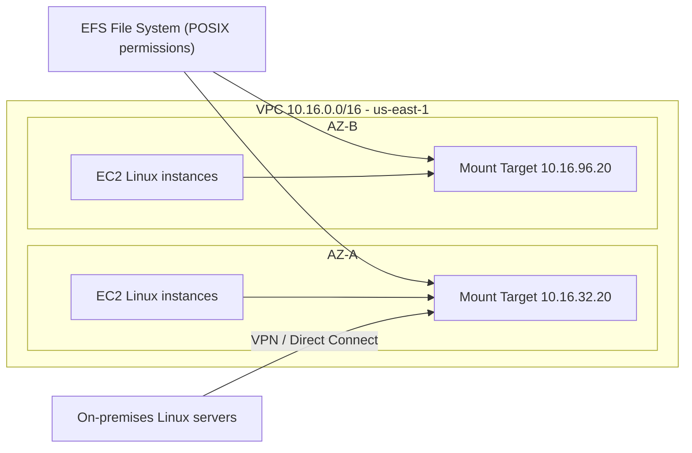

# EFS

> **TL;DR:** Elastic File System (EFS) là dịch vụ **shared network file system** của AWS, cài đặt chuẩn **NFSv4**. Một file system có thể được mount đồng thời trên **nhiều compute Linux** (EC2, Lambda, container ECS/EKS, cả **EC2 Mac**) và server on-premises qua hybrid networking, nhờ vậy dữ liệu tách khỏi vòng đời instance và instance tiến gần tới **stateless**.

## 🖼️ Sơ đồ
![[EFS.excalidraw]]
*Mở bằng plugin Excalidraw để chỉnh sửa · ảnh tĩnh: [[EFS.svg]]*

![[EFS - options.excalidraw]]
*Mở bằng plugin Excalidraw để chỉnh sửa · ảnh tĩnh: [[EFS - options.svg]]*

## Khái niệm cốt lõi
- **File system** là thực thể gốc của EFS. Trong Linux, mọi thiết bị/file system đều được mount vào một thư mục trong cây thư mục, ví dụ `/efs/media`.
- Dùng được với nhiều loại compute trong AWS: **EC2 Linux**, **[[Lambda]]**, **container trên ECS/EKS**, và cả **EC2 Mac**.
- **File storage, không phải block storage**: [[EBS]] là block storage gắn vào *một* instance (trong một AZ). EFS là file storage dùng chung cho *nhiều* instance. Cả hai đều tồn tại độc lập với EC2: terminate instance thì dữ liệu vẫn còn.
- **POSIX permissions**: file system dùng quyền kiểu POSIX (chuẩn tương thích của Linux) nên mọi bản phân phối Linux đều hiểu được.
- **Private service**: EFS được tạo trong VPC và mặc định chỉ truy cập được bên trong VPC đó, thông qua **mount target**.
- Lúc tạo phải chọn kiểu triển khai: **Regional** (mặc định, khuyến nghị; dữ liệu trải trên nhiều AZ) hoặc **One Zone** (rẻ hơn, chỉ một AZ, **không chịu được mất AZ**).
- Có thể truy cập từ ngoài VPC nếu VPC được nối với mạng khác: [[VPC Peering]], [[Site-to-Site VPN]], [[Direct Connect]]. Server Linux on-premises dùng các kết nối này để đi tới cùng mount target. Khi mount từ on-premises, AWS khuyên dùng **IP của mount target** thay cho DNS name của EFS, vì DNS đó có thể không resolve được ngoài VPC nếu chưa cấu hình thêm.
- **Linux (và macOS trên EC2), không Windows**: EFS là NFS cho Linux. Cần file share cho Windows (SMB) thì dùng [[FSx for Windows]].
- Bài toán Aus-E-Mart: web store lưu ảnh sản phẩm trên đĩa local của từng instance. Mất instance là mất ảnh, và nhiều instance không dùng chung được. Đưa thư mục ảnh lên EFS giải quyết vấn đề này, mở đường cho scaling và self-healing (xem [[Lab - Architecture Evolution]]).

## Cách hoạt động / Kiến trúc
- EFS file system "nằm" trong VPC và được phơi ra qua các **mount target**. Mỗi mount target nằm trong một subnet và nhận một **IP từ dải IP của subnet đó** (slide: 10.16.32.20 ở AZ-A, 10.16.96.20 ở AZ-B).
- Instance kết nối tới mount target để dùng file system. Mỗi mount target gắn một [[Security Groups|Security Group]] để kiểm soát ai được kết nối (NFS dùng TCP 2049).
- **HA** (kiểu Regional): muốn chịu lỗi AZ thì phải đặt **một mount target ở mỗi AZ** mà VPC dùng và cần truy cập EFS. Best practice là tạo mount target ở mọi AZ có workload dùng EFS. Kiểu **One Zone** thì chỉ có một mount target ở AZ đã chọn.

### Performance mode
| Mode | Đặc điểm | Dùng khi |
|---|---|---|
| **General Purpose** (mặc định) | Latency thấp | Web server, CMS, home directory, file serving thông thường. AWS khuyên dùng cho hầu hết, gần như mọi trường hợp. |
| **Max I/O** (**legacy**, AWS xếp là *previous generation*) | Aggregate throughput và IOPS cao hơn, đổi lại **latency cao hơn** | Workload song song cao: big data, media processing, phân tích khoa học. AWS khuyên **không** dùng làm mặc định. |

### Throughput mode
| Mode | Đặc điểm | Tương tự EBS |
|---|---|---|
| **Elastic** (**mặc định**, đơn giản nhất) | Throughput **tự co giãn theo tải**, không cấp phát, không burst credit; **trả theo lượng đọc/ghi** | — |
| **Bursting** | Có burst pool, throughput **tăng theo dung lượng** dữ liệu lưu (file system càng lớn càng nhanh) | [[EBS Volume Types\|gp2]] |
| **Provisioned** | Chỉ định throughput **độc lập** với dung lượng (file system nhỏ vẫn đặt throughput cao được), giá cao hơn | io1/io2 |

Trên console, Elastic và Provisioned nằm trong nhóm **Enhanced**; **Max I/O không dùng được với Enhanced**. Đề thi không yêu cầu nhớ con số hiệu năng cụ thể.

### Storage class và lifecycle
- **Standard**: cho file truy cập thường xuyên, là mặc định.
- **Infrequent Access (IA)**: rẻ hơn, cho file ít truy cập (ví dụ vài lần mỗi quý). Giống S3, lưu rẻ hơn nhưng **truy cập tốn phí**, chọn sai class cho dữ liệu dùng thường xuyên thì đắt hơn.
- Giống [[S3 Storage Classes]], có **lifecycle policy** để chuyển file giữa các class. Mặc định trên console (demo): chuyển sang **IA** sau một thời gian không truy cập, sang **Archive** sau **90 ngày** không truy cập, và có thể bật **chuyển về Standard ngay lần truy cập đầu tiên**. (Ví dụ 30 ngày → IA là bản khóa cũ nêu.)
- Lúc tạo file system còn có lựa chọn về độ bền dữ liệu:
  - **Regional (Standard)**: dữ liệu được lưu dư thừa qua **nhiều AZ**. Dùng cho production.
  - **One Zone**: dữ liệu dư thừa nhưng **chỉ trong một AZ**, rẻ hơn. Hợp cho test/dev hoặc dữ liệu không quan trọng.

### Các tùy chọn khác khi tạo file system
- **Automatic backups** qua [[AWS Backup]]. Production nên bật.
- **Encryption at rest** dùng [[KMS]]. Khi bật, client cần quyền trên cả EFS lẫn KMS key.
- **File system policy** (resource policy): chặn root access mặc định, ép read-only mặc định, chặn anonymous access, **bắt buộc encryption in transit** cho mọi client. Production nên bật ít nhất tùy chọn cuối.

## Demo / Lab
**Mount một EFS lên hai instance chạy Aus-E-Mart Web Store, dùng chung ảnh sản phẩm**
1. CloudFormation (one-click, us-east-1) tạo VPC Aus-E-Mart cùng hai instance A (AZ-A) và B (AZ-B) chạy web store **chưa có ảnh**.
2. Tạo file system `AEM-EFS` trong `aem-vpc1` (Customize; nút Create dùng ngay setting khuyến nghị). Tắt automatic backup cho demo (production nên bật). Lifecycle management mặc định: sang IA, sang **Archive sau 90 ngày** không truy cập, tùy chọn **về Standard khi được truy cập lần đầu**. Tắt encryption (bật thì chọn KMS key của bạn hoặc AWS managed key).
3. Performance: chọn **Enhanced + Elastic** (mặc định; Provisioned cho throughput đảm bảo nhưng đắt hơn nhiều; Bursting là kiểu credit pool như gp2) và **General Purpose** (Max I/O không đi được với Enhanced).
4. Kiểu **Regional** nên tạo mount target ở nhiều AZ: đặt trong các subnet app (đặt ở subnet DB cũng được, miễn instance truy cập được), gắn **instance security group** do stack tạo để instance A và B kết nối được. Có thể đặt **file system policy** (chặn anonymous, ép read-only, chặn root access). Mount target mất vài phút mới available.
5. Trên mỗi instance: `sudo dnf install amazon-efs-utils`, thêm dòng `<file-system-id>:/ <thư mục ảnh của web store> efs ...` vào `/etc/fstab` để tự mount mỗi lần khởi động, rồi `sudo mount -a`. Kiểm tra bằng `df -k`.
6. Tạo `test.txt` trên instance A, thấy ngay trên instance B. Tải và giải nén ảnh sản phẩm vào thư mục EFS từ một instance → refresh web store trên **cả hai** instance đều thấy ảnh. Cập nhật ảnh một lần là mọi instance thấy (cấu hình thì nên để ở SSM Parameter Store).
7. Dọn dẹp: xóa file system (dán ID để xác nhận), rồi xóa stack. (Bản khóa cũ lưu ý có thể phải xóa mount target trước.)

## Demo cũ: WordPress dùng EFS
(Demo 0220 của bản khóa cũ; khóa mới không còn demo này.)

- Stack nền gồm VPC, EFS (mount target ở mỗi app subnet) và Aurora cluster restore từ snapshot. Stack WordPress import resource bằng [[CFN Cross-Stack References|cross-stack references]], còn [[EC2 User Data Bootstrapping|user data]] mount EFS vào `/var/www/html/wp-content`. Instance role có quyền trên EFS.
- Upload lại ảnh cho bài viết. Ảnh nằm trên EFS, không nằm trên đĩa local.
- Xóa stack WordPress 1 (terminate instance), tạo stack WordPress 2 với instance hoàn toàn mới: ảnh vẫn hiển thị. Tạo lại WordPress 1: giờ có **hai instance dùng chung một DB ([[Aurora]]) và một file system (EFS)**.
- Bài học: application tier giờ đã stateless. Đây là bước chuẩn bị cho [[Launch Templates]], [[Auto Scaling Groups]] và [[Elastic Load Balancer|ALB]] ở section sau.

## 🎯 Mẹo thi SAA-C03
- Đề nói "**shared file system cho nhiều EC2 Linux**" (hoặc Lambda, ECS/EKS, EC2 Mac), "NFS", "POSIX", "nhiều instance cùng đọc/ghi một bộ file" thì chọn **EFS**. Nếu là **Windows/SMB/Active Directory** thì chọn [[FSx for Windows]]. HPC hoặc xử lý dữ liệu tốc độ rất cao thì chọn [[FSx for Lustre]].
- EFS dành cho **Linux** (và macOS trên EC2), **không cho Windows**. Đáp án nào mount EFS lên Windows là bẫy.
- **HA = một mount target mỗi AZ**. Instance ở AZ không có mount target vẫn phụ thuộc AZ khác.
- EFS vs [[EBS]]: EBS là block, gắn vào một instance (trừ Multi-Attach io1/io2 rất hạn chế), giới hạn trong một AZ. EFS là file, dùng chung, multi-AZ.
- **General Purpose** là mặc định, chọn cho hầu hết workload. **Max I/O** là **legacy / previous generation**, chỉ cân nhắc cho workload song song cao, chấp nhận latency cao hơn.
- Throughput: **Elastic** là mặc định (tự co giãn, trả theo lượng đọc/ghi); **Bursting** (như gp2, hiệu năng tăng theo dung lượng); **Provisioned** (như io1/io2, throughput tách khỏi dung lượng). Đề nói "cần throughput cao nhưng dữ liệu nhỏ" thì chọn Provisioned hoặc Elastic; "tải khó đoán, không muốn quản lý" thì Elastic.
- Đề nói "tiết kiệm chi phí cho file ít truy cập" thì dùng **IA + lifecycle policy**. Nếu dữ liệu không quan trọng hoặc dev/test thì cân nhắc **One Zone**.
- On-premises truy cập EFS qua **VPN hoặc Direct Connect** tới mount target; mount bằng **IP của mount target** (DNS name của EFS có thể không resolve ngoài VPC).
- Bắt buộc mã hóa khi truyền thì dùng **file system policy enforce encryption in transit**. Mã hóa lúc lưu thì dùng **KMS**, nhưng chỉ bật được khi tạo file system.

## Liên kết
- Tiên quyết: [[Storage Fundamentals]], [[VPC Subnets]], [[Security Groups]]
- Liên quan: [[AWS Backup]], [[KMS]], [[Aurora]], [[Lab - Architecture Evolution]], [[Auto Scaling Groups]], [[DataSync]], [[Site-to-Site VPN]], [[Direct Connect]]
- Phân biệt với: [[EBS]], [[Instance Store]], [[FSx for Windows]], [[FSx for Lustre]], [[S3 Basics]], [[Storage Gateway]]
- Section: [[_MOC 12 Network Storage and Backup]]
