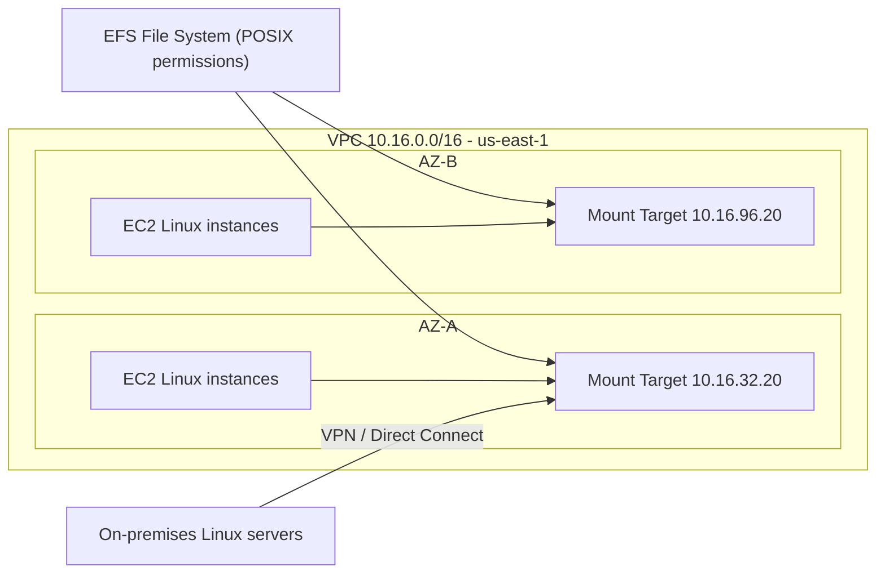

# EFS

> **TL;DR:** Elastic File System (EFS) là dịch vụ **shared network file system** của AWS, cài đặt chuẩn **NFSv4**. Một file system có thể được mount đồng thời trên **nhiều EC2 Linux instance** (và cả server on-premises qua hybrid networking), nhờ vậy dữ liệu tách khỏi vòng đời instance và instance tiến gần tới **stateless**.

## 🖼️ Sơ đồ
![[EFS.excalidraw]]
*Mở bằng plugin Excalidraw để chỉnh sửa · ảnh tĩnh: [[EFS.svg]]*

![[EFS - options.excalidraw]]
*Mở bằng plugin Excalidraw để chỉnh sửa · ảnh tĩnh: [[EFS - options.svg]]*

## Khái niệm cốt lõi
- **File system** là thực thể gốc của EFS. Trong Linux, mọi thiết bị/file system đều được mount vào một thư mục trong cây thư mục, ví dụ `/nfs/media` hay `/efs/wp-content`.
- **File storage, không phải block storage**: [[EBS]] là block storage gắn vào *một* instance (trong một AZ). EFS là file storage dùng chung cho *nhiều* instance. Cả hai đều tồn tại độc lập với EC2: terminate instance thì dữ liệu vẫn còn.
- **POSIX permissions**: file system dùng quyền kiểu POSIX (chuẩn tương thích của Linux) nên mọi bản phân phối Linux đều hiểu được.
- **Private service**: EFS mặc định chỉ truy cập được bên trong VPC nơi nó được tạo, thông qua **mount target**.
- Có thể truy cập từ ngoài VPC nếu VPC được nối với mạng khác: [[VPC Peering]], [[Site-to-Site VPN]], [[Direct Connect]]. Server Linux on-premises dùng các kết nối này để đi tới cùng mount target.
- **Chỉ Linux**: AWS chỉ hỗ trợ chính thức EFS trên instance Linux. Cần file share cho Windows (SMB) thì dùng [[FSx for Windows]].
- Bài toán Animals4life: WordPress lưu media (ảnh, video, audio) trên đĩa local của instance. Mất instance là mất media, và không thể chạy nhiều instance. Đưa thư mục `wp-content` lên EFS giải quyết vấn đề này, mở đường cho scaling và self-healing (xem [[Lab - Architecture Evolution]]).

## Cách hoạt động / Kiến trúc
- EFS file system "nằm" trong VPC và được phơi ra qua các **mount target**. Mỗi mount target nằm trong một subnet và nhận một **IP từ dải IP của subnet đó** (slide: 10.16.32.20 ở AZ-A, 10.16.96.20 ở AZ-B).
- Instance kết nối tới mount target để dùng file system. Mỗi mount target gắn một [[Security Groups|Security Group]] để kiểm soát ai được kết nối (NFS dùng TCP 2049).
- **HA**: giống [[NAT Gateway]], muốn chịu lỗi AZ thì phải đặt **một mount target ở mỗi AZ** mà VPC dùng. Best practice là tạo mount target ở mọi AZ có workload dùng EFS.

### Performance mode
| Mode | Đặc điểm | Dùng khi |
|---|---|---|
| **General Purpose** (mặc định) | Latency thấp | Web server, CMS, home directory, file serving thông thường. Hầu hết trường hợp. |
| **Max I/O** | Aggregate throughput và IOPS cao hơn, đổi lại **latency cao hơn** | Workload song song cao: big data, media processing, phân tích khoa học |

### Throughput mode
| Mode | Đặc điểm | Tương tự EBS |
|---|---|---|
| **Bursting** (mặc định trong khóa học) | Có burst pool, throughput **tăng theo dung lượng** dữ liệu lưu | [[EBS Volume Types\|gp2]] |
| **Provisioned** | Chỉ định throughput **độc lập** với dung lượng | io1/io2 |

(Khóa học chỉ nói hai mode trên; hiện nay còn mode **Elastic**: tự co giãn theo tải, trả tiền theo lượng dùng, là mặc định khi tạo trên console. AWS cũng khuyến nghị General Purpose + Elastic thay cho Max I/O.) Đề thi không yêu cầu nhớ con số hiệu năng cụ thể.

### Storage class và lifecycle
- **Standard**: cho file truy cập thường xuyên, là mặc định.
- **Infrequent Access (IA)**: rẻ hơn, cho file ít truy cập.
- Giống [[S3 Storage Classes]], có **lifecycle policy** để chuyển file giữa các class, ví dụ file không truy cập 30 ngày thì chuyển sang IA. (Hiện nay có thêm class **Archive** cho dữ liệu gần như không truy cập.)
- Lúc tạo file system còn có lựa chọn về độ bền dữ liệu:
  - **Regional (Standard)**: dữ liệu được lưu dư thừa qua **nhiều AZ**. Dùng cho production.
  - **One Zone**: dữ liệu dư thừa nhưng **chỉ trong một AZ**, rẻ hơn. Hợp cho test/dev hoặc dữ liệu không quan trọng.

### Các tùy chọn khác khi tạo file system
- **Automatic backups** qua [[AWS Backup]]. Production nên bật.
- **Encryption at rest** dùng [[KMS]]. Khi bật, client cần quyền trên cả EFS lẫn KMS key.
- **File system policy** (resource policy): chặn root access mặc định, ép read-only mặc định, chặn anonymous access, **bắt buộc encryption in transit** cho mọi client. Production nên bật ít nhất tùy chọn cuối.

## Demo / Lab
**Demo 1, mount một EFS lên hai instance (0218, 0219)**
1. CloudFormation tạo VPC Animals4life cùng hai instance A và B.
2. Tạo file system `A4L-EFS` (Customize): storage class Standard (multi-AZ), tắt backup và encryption cho demo, General Purpose + Bursting.
3. Mount target: một cái cho mỗi AZ (us-east-1a/1b/1c), đặt trong các subnet app A/B/C, gắn instance security group (SG này cho phép mọi thứ có cùng SG kết nối với nhau).
4. Trên mỗi instance: `mkdir -p /efs/wp-content`, cài `amazon-efs-utils`, thêm dòng `<file-system-id>:/ /efs/wp-content efs ...` vào `/etc/fstab` để tự mount mỗi lần khởi động, rồi chạy `mount /efs/wp-content`. Kiểm tra bằng `df -k`.
5. Tạo file trên instance A, sau đó thấy ngay file đó trên instance B. Đây là bằng chứng EFS là shared network file system.
6. Dọn dẹp: có thể phải **xóa mount target trước** rồi mới xóa được file system.

**Demo 2, WordPress dùng EFS (0220)**
- Stack nền gồm VPC, EFS (mount target ở mỗi app subnet) và Aurora cluster restore từ snapshot. Stack WordPress import resource bằng [[CFN Cross-Stack References|cross-stack references]], còn [[EC2 User Data Bootstrapping|user data]] mount EFS vào `/var/www/html/wp-content`. Instance role có quyền trên EFS.
- Upload lại ảnh cho bài viết. Ảnh nằm trên EFS, không nằm trên đĩa local.
- Xóa stack WordPress 1 (terminate instance), tạo stack WordPress 2 với instance hoàn toàn mới: ảnh vẫn hiển thị. Tạo lại WordPress 1: giờ có **hai instance dùng chung một DB ([[Aurora]]) và một file system (EFS)**.
- Bài học: application tier giờ đã stateless. Đây là bước chuẩn bị cho [[Launch Templates]], [[Auto Scaling Groups]] và [[Elastic Load Balancer|ALB]] ở section sau.

## 🎯 Mẹo thi SAA-C03
- Đề nói "**shared file system cho nhiều EC2 Linux**", "NFS", "POSIX", "nhiều instance cùng đọc/ghi một bộ file" thì chọn **EFS**. Nếu là **Windows/SMB/Active Directory** thì chọn [[FSx for Windows]]. HPC hoặc xử lý dữ liệu tốc độ rất cao thì chọn [[FSx for Lustre]].
- EFS là **Linux-only**. Đáp án nào mount EFS lên Windows là bẫy.
- **HA = một mount target mỗi AZ**. Instance ở AZ không có mount target vẫn phụ thuộc AZ khác.
- EFS vs [[EBS]]: EBS là block, gắn vào một instance (trừ Multi-Attach io1/io2 rất hạn chế), giới hạn trong một AZ. EFS là file, dùng chung, multi-AZ.
- **General Purpose** là mặc định, chọn cho hầu hết workload. **Max I/O** chỉ dùng cho workload song song cao, chấp nhận latency cao hơn.
- **Bursting** (như gp2, hiệu năng tăng theo dung lượng) và **Provisioned** (như io1/io2, throughput tách khỏi dung lượng). Đề nói "cần throughput cao nhưng dữ liệu nhỏ" thì chọn Provisioned (hoặc Elastic).
- Đề nói "tiết kiệm chi phí cho file ít truy cập" thì dùng **IA + lifecycle policy**. Nếu dữ liệu không quan trọng hoặc dev/test thì cân nhắc **One Zone**.
- On-premises truy cập EFS qua **VPN hoặc Direct Connect** tới mount target.
- Bắt buộc mã hóa khi truyền thì dùng **file system policy enforce encryption in transit**. Mã hóa lúc lưu thì dùng **KMS**, nhưng chỉ bật được khi tạo file system.

## Liên kết
- Tiên quyết: [[Storage Fundamentals]], [[VPC Subnets]], [[Security Groups]]
- Liên quan: [[AWS Backup]], [[KMS]], [[Aurora]], [[Lab - Architecture Evolution]], [[Auto Scaling Groups]], [[DataSync]], [[Site-to-Site VPN]], [[Direct Connect]]
- Phân biệt với: [[EBS]], [[Instance Store]], [[FSx for Windows]], [[FSx for Lustre]], [[S3 Basics]], [[Storage Gateway]]
- Section: [[_MOC 12 Network Storage and Backup]]
