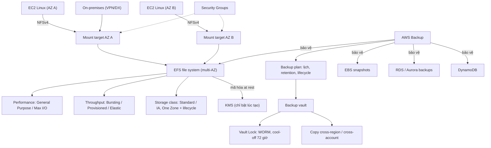

# 12 Network Storage and Backup

Section ngắn gồm hai dịch vụ: EFS, file system mạng NFSv4 dùng chung cho nhiều EC2 Linux, giúp tách dữ liệu khỏi instance để tiến tới kiến trúc stateless; và AWS Backup, nơi quản lý backup tập trung cho nhiều dịch vụ, nhiều account và region. EFS là mảnh ghép quan trọng trong [[Lab - Architecture Evolution]] ở [[_MOC 13 HA and Scaling]], còn các lựa chọn file storage khác (FSx, Storage Gateway, DataSync) nằm ở [[_MOC 17 Hybrid and Migration]].

← [[00 Home]] · Section trước: [[_MOC 11 Databases]] · Section tiếp theo: [[_MOC 13 HA and Scaling]] →

## Lộ trình học
1. [[EFS]] — shared network file system chuẩn NFSv4, mount đồng thời trên nhiều EC2 Linux qua mount target mỗi AZ; có performance mode, throughput mode, storage class và lifecycle.
2. [[AWS Backup]] — dịch vụ data protection fully managed: backup plan, vault, lifecycle sang cold storage, copy cross-region/cross-account và Vault Lock chống xóa.

## Bản đồ khái niệm

## Liên kết sang section khác
- [[EBS]] — block storage gắn một instance, một AZ; đối trọng của EFS.
- [[Instance Store]] — lưu trữ tạm trên host, khác hẳn file system mạng.
- [[FSx for Windows]] — chọn khi cần SMB, Windows, Active Directory.
- [[FSx for Lustre]] — chọn cho HPC, xử lý dữ liệu tốc độ rất cao.
- [[Lab - Architecture Evolution]] — dùng EFS để tách media WordPress khỏi EC2 trước khi đưa vào ASG.
- [[EBS Snapshots]] và [[RDS Backups and Restore]] — cơ chế backup gốc mà AWS Backup điều phối.
- [[S3 Object Lock]] — WORM cho object S3, phân biệt với Vault Lock.
- [[AWS Organizations]] — áp backup policy và copy backup giữa các account.
- [[RPO and RTO]] — khung đánh giá chiến lược backup và restore.

## 🎯 Top mẹo thi của section
- "Shared file system cho nhiều EC2 **Linux**, NFS, POSIX" → **EFS**; Windows/SMB/AD → FSx for Windows; HPC → FSx for Lustre. ([[EFS]])
- EFS là **Linux-only**; đáp án mount EFS lên Windows là bẫy. ([[EFS]])
- HA của EFS = **một mount target mỗi AZ**; instance ở AZ không có mount target vẫn phụ thuộc AZ khác. ([[EFS]])
- EBS là block, gắn một instance, trong một AZ; EFS là file, dùng chung, multi-AZ. ([[EFS]])
- **General Purpose** cho hầu hết workload; **Max I/O** chỉ cho workload song song cao, chấp nhận latency cao hơn. ([[EFS]])
- "Throughput cao nhưng dữ liệu nhỏ" → **Provisioned** (hoặc Elastic) throughput thay vì Bursting. ([[EFS]])
- Tiết kiệm cho file ít truy cập → **IA + lifecycle policy**; dữ liệu không quan trọng/dev-test → **One Zone**. ([[EFS]])
- Mã hóa at rest của EFS **chỉ bật được khi tạo**; ép mã hóa in transit bằng **file system policy**; on-premises truy cập qua VPN/Direct Connect. ([[EFS]])
- "Quản lý backup tập trung cho nhiều dịch vụ, nhiều account, nhiều region", thay script snapshot tự viết → **AWS Backup**. ([[AWS Backup]])
- "Backup không thể bị xóa, kể cả root, WORM, ransomware" → **AWS Backup Vault Lock** (cool-off 72 giờ); đừng nhầm với S3 Object Lock. ([[AWS Backup]])
- DR cho backup → **copy cross-region** trong backup plan hoặc copy sang account khác; restore về một thời điểm → **continuous backup/PITR**. ([[AWS Backup]])
- Nhớ số: cold storage tối thiểu **90 ngày**, tần suất backup nhỏ nhất qua cron là **mỗi giờ**. ([[AWS Backup]])
