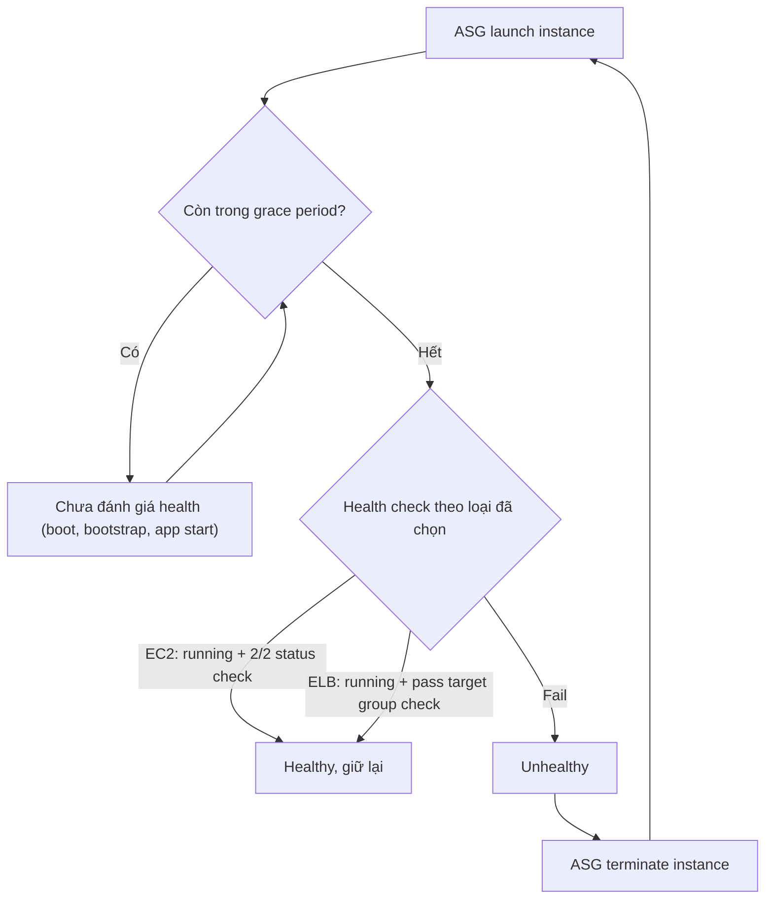

# ASG Health Checks

> **TL;DR:** [[Auto Scaling Groups|ASG]] dùng health check để đánh giá từng instance. Instance nào fail thì bị terminate và thay bằng instance mới (self-healing). Có 3 loại: **EC2** (mặc định), **ELB** (bật thêm, application-aware) và **Custom**. Đi kèm là **health check grace period** (mặc định 300s). Đặt grace period quá ngắn là nguyên nhân kinh điển khiến ASG launch rồi terminate instance liên tục.

## 🖼️ Sơ đồ
![[ASG Health Checks.excalidraw]]
*Mở bằng plugin Excalidraw để chỉnh sửa · ảnh tĩnh: [[ASG Health Checks.svg]]*

![[ASG Health Checks - grace.excalidraw]]
*Mở bằng plugin Excalidraw để chỉnh sửa · ảnh tĩnh: [[ASG Health Checks - grace.svg]]*

## Khái niệm cốt lõi
Instance fail health check sẽ bị ASG **thay thế**: terminate instance cũ rồi launch instance mới từ [[Launch Templates|Launch Template]] để giữ desired capacity. Đây là cơ chế tự chữa lành của ASG.

### 1. EC2 health check (mặc định)
- Chỉ dựa vào **trạng thái instance** và **EC2 status checks** ([[EC2 Status Checks and Auto Recovery]]).
- Mọi trạng thái khác `running` đều bị coi là **UNHEALTHY**: `stopping`, `stopped`, `shutting-down`, `terminated`, hoặc **impaired** (không đạt 2/2 status check).
- Hạn chế: instance vẫn `running` và qua 2/2 status check nhưng **ứng dụng bên trong đã chết** (web server crash, app treo) thì EC2 check vẫn báo healthy.

### 2. ELB health check (phải bật)
- Instance chỉ **HEALTHY** khi thỏa **cả hai**: đang `running` **và** pass health check của load balancer (target group).
- Với [[Compare - ALB vs NLB|ALB]], health check là **layer 7 / application-aware**: gọi tới một trang cụ thể của ứng dụng (ví dụ `/health`), kiểm tra mã HTTP trả về. (Khóa học có nhắc so khớp text pattern; thực tế ALB health check chỉ so khớp **HTTP status code**, còn so khớp chuỗi trong nội dung là tính năng của [[R53 Health Checks]].)
- Gắn ELB check vào ASG làm cho ASG "hiểu" được ứng dụng: app hỏng thì instance bị thay, kể cả khi bản thân EC2 vẫn ổn.
- Hiện nay ELB health check vẫn chạy **cộng thêm** EC2 health check, không thay thế nó.

### 3. Custom health check
- Một **hệ thống bên ngoài** (script giám sát, công cụ của bên thứ ba, quy trình nội bộ) tự đánh dấu instance là healthy/unhealthy (qua API `SetInstanceHealth`).
- Dùng khi tiêu chí "khỏe" là logic riêng của doanh nghiệp mà EC2/ELB check không diễn tả được.

### Health check grace period
- Là khoảng chờ sau khi instance launch, **trước khi** health check bắt đầu có hiệu lực. **Mặc định 300 giây (5 phút)**, cấu hình được.
- Mục đích: cho instance đủ thời gian **khởi động hệ điều hành → chạy bootstrapping** ([[EC2 User Data Bootstrapping|user data]], [[cfn-init]]) **→ khởi động và cấu hình ứng dụng**. Trong khoảng này instance không thể bị đánh giá là fail.
- (Khóa học nói mặc định 300s. Thực tế 300s là mặc định khi tạo ASG trong console; tạo qua CLI/API thì mặc định là 0, nên phải tự đặt.)

## Cách hoạt động / Kiến trúc

**Vòng lặp chết do grace period quá ngắn:** app cần 8 phút để bootstrap nhưng grace period chỉ 2 phút. Sau 2 phút, ELB check gọi `/health` và chưa có phản hồi, nên instance bị đánh dấu unhealthy, bị terminate, ASG launch instance mới, rồi lặp lại mãi. Kết quả là ASG không bao giờ có instance nào phục vụ được, lại tốn tiền.

## Bảng so sánh / số liệu
| Loại | Mặc định? | Healthy khi | Phát hiện app chết? | Ghi chú |
|---|---|---|---|---|
| EC2 | Có | Trạng thái `running` và 2/2 status check | Không | Stopping/stopped/shutting-down/terminated/impaired đều là unhealthy |
| ELB | Không, phải bật | `running` **và** pass health check của LB | Có (với ALB, L7) | Cần ASG gắn với target group |
| Custom | Không | Hệ thống ngoài đánh dấu | Tùy logic | Mở rộng theo quy trình riêng |

| Tham số | Giá trị |
|---|---|
| Health check grace period mặc định | 300 s (5 phút) |
| EC2 status check yêu cầu | 2/2 |

## 🎯 Mẹo thi SAA-C03
- **"Instance liên tục được launch rồi bị terminate" / "ASG cứ thay instance mãi"** → nghĩ ngay tới **health check grace period quá ngắn** so với thời gian bootstrap. Cách sửa: tăng grace period ≥ thời gian launch + bootstrap + khởi động app. Adrian nhấn mạnh ý này xuất hiện trong đề.
- **"Ứng dụng bị lỗi nhưng ASG không thay instance"** → ASG đang dùng EC2 check mặc định; **bật ELB health check** trên ASG (dùng ALB health check theo path).
- Muốn health check hiểu logic ứng dụng (trang cụ thể, mã 200) → **ALB + ELB health check trên ASG**.
- Tiêu chí sức khỏe đặc thù hoặc từ công cụ giám sát bên ngoài → **custom health check**.
- Bẫy liên quan: health check trỏ vào trang phụ thuộc DB, DB sập thì mọi instance fail cùng lúc (xem [[Auto Scaling Groups]]).
- Muốn chạy thêm hành động trước khi instance vào service hoặc trước khi bị terminate (lấy log, chờ cấu hình) → dùng [[ASG Lifecycle Hooks]], không phải tăng grace period.

## Liên kết
- Tiên quyết: [[Auto Scaling Groups]], [[EC2 Status Checks and Auto Recovery]], [[Elastic Load Balancer]]
- Liên quan: [[Compare - ALB vs NLB]], [[ASG Lifecycle Hooks]], [[ASG Scaling Policies]], [[Launch Templates]], [[EC2 User Data Bootstrapping]], [[cfn-init]], [[Lab - Architecture Evolution]]
- Phân biệt với: [[R53 Health Checks]] (health check ở tầng DNS, dùng cho failover routing, không thay instance)
