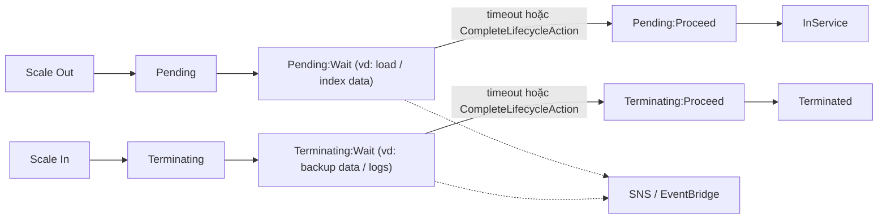

# ASG Lifecycle Hooks

> **TL;DR:** Lifecycle hook cho phép chạy **hành động tùy chỉnh** khi [[Auto Scaling Groups|ASG]] launch hoặc terminate instance. Instance bị **tạm dừng ở trạng thái Wait** cho tới khi hết timeout (mặc định **3600s**, sau đó CONTINUE hoặc ABANDON) hoặc tới khi ta gọi **`CompleteLifecycleAction`**. Hook tích hợp được với **EventBridge** và **SNS** để xử lý theo kiểu event-driven.

## 🖼️ Sơ đồ
![[ASG Lifecycle Hooks.excalidraw]]
*Mở bằng plugin Excalidraw để chỉnh sửa · ảnh tĩnh: [[ASG Lifecycle Hooks.svg]]*

## Khái niệm cốt lõi
- Bình thường ASG quyết định launch/terminate là làm luôn, ta **không chen vào được**. Hook mở ra một "khoảng dừng" để làm việc riêng.
- Hai loại transition có thể hook:
  - **Instance launch** (scale out): `Pending` → **`Pending:Wait`** → **`Pending:Proceed`** → `InService`.
  - **Instance terminate** (scale in): `Terminating` → **`Terminating:Wait`** → **`Terminating:Proceed`** → `Terminated`.
- Instance thoát khỏi trạng thái Wait khi:
  1. **Hết timeout** (mặc định **3600 giây**), rồi đi tiếp theo kết quả mặc định đã cấu hình: **CONTINUE** hoặc **ABANDON**.
  2. Ta chủ động gọi **`CompleteLifecycleAction`** sau khi xong việc.
- Thông báo: gửi tới **SNS topic** khi có transition, hoặc dùng **EventBridge** để khởi động quy trình khác (Lambda, Step Functions...). (AWS còn hỗ trợ đích **SQS**.)

## Cách hoạt động / Kiến trúc

- **Ví dụ launch hook**: nạp hoặc index dữ liệu (mất thời gian) trước khi instance nhận traffic. Instance chỉ vào `InService` và được thêm vào target group của LB khi đã sẵn sàng.
- **Ví dụ terminate hook**: backup dữ liệu hoặc log, deregister khỏi hệ thống ngoài, dọn dẹp trước khi instance bị hủy. Thường kết hợp **SSM Run Command** hoặc script trên instance, sau đó gọi `CompleteLifecycleAction`.

## 🎯 Mẹo thi SAA-C03
- "Cần **lấy log/backup dữ liệu từ instance trước khi ASG terminate**" → **lifecycle hook terminate** (`Terminating:Wait`).
- "Cần **cài đặt/cấu hình/nạp dữ liệu xong** rồi instance mới nhận traffic" → **lifecycle hook launch** (`Pending:Wait`).
- Từ khóa API: **`CompleteLifecycleAction`** để kết thúc sớm; timeout mặc định **3600s**; kết quả sau timeout là **CONTINUE/ABANDON**.
- Muốn tự động hóa theo sự kiện của hook → **EventBridge rule** (hoặc **SNS**) kích hoạt Lambda.
- Đừng nhầm với **health check grace period** ([[ASG Health Checks]]): grace period chỉ hoãn health check, không chặn instance vào InService. Cũng đừng nhầm với cfn-signal/CreationPolicy của CloudFormation ([[CFN Wait Conditions and cfn-signal]]).

## Liên kết
- Tiên quyết: [[Auto Scaling Groups]]
- Liên quan: [[EventBridge]], [[SNS]], [[Lambda]], [[ASG Scaling Policies]], [[ASG Health Checks]], [[Event-Driven Architecture]]
- Phân biệt với: [[CFN Wait Conditions and cfn-signal]], [[EC2 User Data Bootstrapping]]
