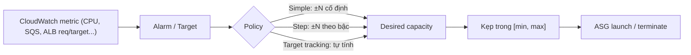

# ASG Scaling Policies

> **TL;DR:** Scaling policy là rule tự động chỉnh **desired capacity** của [[Auto Scaling Groups|ASG]] trong khoảng min–max. Có manual, scheduled, và ba kiểu dynamic: **Simple**, **Step**, **Target Tracking**, cộng thêm scale theo **SQS queue**. Điểm hay bị hỏi: Simple luôn thêm/bớt một lượng cố định, còn Step thay đổi lượng thêm/bớt theo **mức độ vượt ngưỡng**.

## 🖼️ Sơ đồ
![[ASG Scaling Policies.excalidraw]]
*Mở bằng plugin Excalidraw để chỉnh sửa · ảnh tĩnh: [[ASG Scaling Policies.svg]]*

![[ASG Scaling Policies - step.excalidraw]]
*Mở bằng plugin Excalidraw để chỉnh sửa · ảnh tĩnh: [[ASG Scaling Policies - step.svg]]*

## Khái niệm cốt lõi
- **ASG không bắt buộc có scaling policy.** Không có policy thì min/max/desired là giá trị tĩnh và ASG vẫn chạy bình thường (vẫn self-heal).
- **Manual scaling** = tự chỉnh min/max/desired. Dùng khi test, khẩn cấp, hoặc **giữ capacity cố định** để kiểm soát chi phí.
- **Scheduled scaling**: đổi giá trị theo lịch, khi biết trước giai đoạn tải cao hoặc thấp (bài [[Auto Scaling Groups]]).
- **Dynamic scaling** phản ứng với nhu cầu thay đổi, và luôn tác động vào desired capacity:

| Kiểu | Cơ chế | Ưu / nhược |
|---|---|---|
| **Simple** | Một CloudWatch alarm vào trạng thái ALARM thì thêm/bớt **một lượng cố định**, ví dụ CPU > 40% thì +1, < 40% thì −1 | Đơn giản nhưng cứng nhắc, kém hiệu quả |
| **Step** | Alarm kèm các **step adjustments** (cận trên/dưới); lệch càng xa thì thêm/bớt càng nhiều | Linh hoạt, hợp tải biến động; **AWS khuyến nghị Step thay cho Simple** |
| **Target tracking** | Đặt **giá trị mục tiêu** cho một metric, ASG tự tính lượng điều chỉnh | Dễ nhất; lệch càng xa mục tiêu thì action càng mạnh |
| **Scale theo SQS** | Dựa trên `ApproximateNumberOfMessagesVisible` | Pattern worker pool: queue dài thì thêm worker, queue cạn thì thu nhỏ để giảm chi phí |

- Metric có sẵn cho target tracking: **ASGAverageCPUUtilization**, **ASGAverageNetworkIn**, **ASGAverageNetworkOut**, **ALBRequestCountPerTarget**. (Hiện nay target tracking còn nhận custom metric.)
- *Ngoài khóa học*: AWS còn có **Predictive scaling**, dùng ML dự báo tải theo chu kỳ từ lịch sử metric.

## Cách hoạt động / Kiến trúc

### Simple scaling: ví dụ
- ASG `min 1 / max 4 / desired 1`, CPU trung bình đang 10%.
- Hai rule: CPU > 50% thì **+2**; CPU < 50% thì **−2**.
- CPU nhảy lên 60%: desired 1 → 3 (vẫn ≤ max 4), launch thêm 2 instance.
- CPU về 10%: desired 3 → 1 (bị chặn ở min), terminate 2 instance.
- Vấn đề: vượt 1% hay vượt 50% thì vẫn chỉ +2. Phản ứng **không tương xứng** với mức độ thay đổi.

### Step scaling: ví dụ (slide)
| CPU | Hành động (scale out) | CPU | Hành động (scale in) |
|---|---|---|---|
| 50–59% | không làm gì | 40–49% | không làm gì |
| 60–69% | +1 | 30–39% | −1 |
| 70–79% | +2 | 20–29% | −2 |
| 80–100% | +3 | 0–19% | −3 |

Diễn biến trên ASG `min 1 / max 4`:

| Thời điểm | CPU | Policy muốn | Kết quả |
|---|---|---|---|
| 1 | 5% | −3 | Giữ **1** (chạm min) |
| 2 | 100% | +3 | Lên **4** (chạm max) |
| 3 | 55% | 0 | Giữ **4** |
| 4 | 5% | −3 | Xuống **1** |
| 5 | 5% | −3 | Vẫn **1** (min) |
| 6 | 60% | +1 | Lên **2** |

- Min/max luôn là **giới hạn cứng**: policy không bao giờ đẩy desired ra ngoài khoảng này.

## 🎯 Mẹo thi SAA-C03
- Câu hỏi "**Simple vs Step**": Step tốt hơn vì phản ứng **tương xứng với mức độ** thay đổi tải. Chỉ chọn Simple khi đề ưu tiên tuyệt đối sự đơn giản.
- "Giữ CPU trung bình ở ~50%" hoặc "giữ số request mỗi target ổn định" → **Target tracking** (với ALB thì dùng **ALBRequestCountPerTarget**).
- "Số message trong SQS tăng, cần thêm consumer" → scale theo **ApproximateNumberOfMessagesVisible** (xem [[SQS]], [[Event-Driven Architecture]]).
- "Biết trước lịch tải" (Black Friday, giờ hành chính) → **Scheduled**. "Tải lặp lại theo chu kỳ, muốn scale *trước* khi tải tới" → nghĩ tới Predictive.
- "Giữ số instance cố định để kiểm soát chi phí" hoặc "đang test" → **Manual** (min = max = desired).
- Nhớ: policy chỉ đổi **desired**; **min và max là ranh giới cứng**.

## Liên kết
- Tiên quyết: [[Auto Scaling Groups]], [[CloudWatch Basics]], [[Horizontal vs Vertical Scaling]]
- Liên quan: [[CloudWatch Agent]] (metric memory/disk), [[SQS]], [[Compare - ALB vs NLB]] (ALBRequestCountPerTarget), [[ASG Health Checks]], [[ASG Lifecycle Hooks]]
- Phân biệt với: [[Aurora Serverless]] và [[DynamoDB Operations and Performance]] (cơ chế auto scaling riêng của database)
