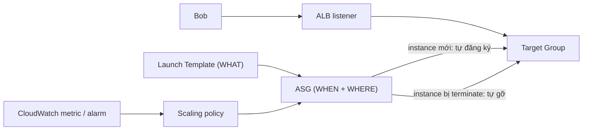

# Auto Scaling Groups

> **TL;DR:** ASG tự động scale EC2: nó luôn giữ số instance đang chạy **bằng desired capacity** bằng cách thêm hoặc terminate instance. ASG lấy cấu hình instance từ [[Launch Templates|Launch Template/Configuration]], đặt instance vào các subnet ở nhiều AZ, tự thay instance hỏng (**self-healing**), và khi gắn với [[Elastic Load Balancer|ELB]] target group sẽ tạo thành kiến trúc **elastic**.

## 🖼️ Sơ đồ
![[Auto Scaling Groups.excalidraw]]
*Mở bằng plugin Excalidraw để chỉnh sửa · ảnh tĩnh: [[Auto Scaling Groups.svg]]*

## Khái niệm cốt lõi
- ASG dùng **một** Launch Configuration hoặc **một version cụ thể** của Launch Template tại một thời điểm. Có thể đổi sang LC/LT khác, nhưng mọi instance mới đều dựng theo một định nghĩa duy nhất đó.
- Ba giá trị quan trọng nhất: **Minimum size**, **Desired capacity**, **Maximum size**. Thường viết gọn là `min/desired/max`, ví dụ `1:2:4`.
  - Ràng buộc: `min ≤ desired ≤ max`.
  - **Việc nền tảng duy nhất**: desired = 2 mà mới có 1 instance thì launch thêm; desired = 2 mà đang có 3 thì terminate bớt một.
- ASG có thể để **hoàn toàn thủ công** (tự sửa các giá trị, ASG làm phần còn lại). Thông thường người ta gắn **scaling policy** để policy tự chỉnh *desired capacity* giữa min và max.
- **ASG miễn phí**: chỉ trả tiền cho tài nguyên nó tạo ra (EC2, EBS...).

## Cách hoạt động / Kiến trúc

### Vị trí đặt instance
- ASG gắn với **một VPC** và **nhiều subnet** trong VPC đó. Instance được launch vào các subnet này.
- ASG cố **cân bằng số instance giữa các AZ**. Ví dụ 3 subnet ở 3 AZ, desired = 3 thì thường mỗi AZ một instance (không phải lúc nào cũng được, ASG sẽ cân lại khi có thể).

### Các cách scale (tổng quan, chi tiết ở [[ASG Scaling Policies]])
| Loại | Mô tả | Khi dùng |
|---|---|---|
| **Manual** | Tự chỉnh min/desired/max | Test, xử lý khẩn cấp, giữ cố định capacity |
| **Scheduled** | Đổi desired theo lịch | Biết trước giờ cao điểm hoặc thấp điểm (đợt sale, ngoài giờ làm việc) |
| **Dynamic: Simple** | Một cặp rule theo một metric, ví dụ CPU > 50% thì +1, < 50% thì −1 | Ưu tiên sự đơn giản |
| **Dynamic: Step** | Nhiều bậc theo độ lệch, ví dụ > 50% thì +1, > 80% thì +3 | Phản ứng nhanh hơn khi tải tăng đột biến; **gần như luôn tốt hơn Simple** |
| **Dynamic: Target tracking** | Đặt mức mong muốn, ví dụ CPU trung bình 40%, ASG tự điều chỉnh | Muốn giữ một metric ổn định |

- Metric không chỉ là CPU: memory, disk I/O (**cần [[CloudWatch Agent]]** cho metric bên trong OS), độ dài **SQS queue** ([[SQS]]), hoặc custom metric như response time.
- Target tracking hỗ trợ: average CPU, average network in/out, và **ALB request count per target**.

### Cooldown period
- Đơn vị là giây: thời gian **chờ sau một scaling action** rồi mới làm action tiếp theo (mặc định 300s cho simple scaling).
- Tránh scale loạn khi metric dao động, và tránh tốn tiền vì mỗi instance launch ra đều bị tính **tối thiểu một khoảng billing** dù dùng bao lâu.

### Health và self-healing
- Mặc định ASG theo dõi sức khỏe bằng **EC2 status checks**. Instance hỏng thì ASG **terminate và launch instance mới** thay thế. Terminate tay một instance thì ASG cũng tự bù lại.
- **Mẹo HA giá rẻ**: LT tự build được instance + ASG trải trên nhiều subnet ở nhiều AZ + `min = max = desired = 1`. Instance hỏng, bị terminate, hay cả AZ sập thì ASG dựng lại instance, có thể ở **AZ khác**. Đơn giản, rẻ, hiệu quả.
- Có thể chuyển sang dùng **ELB health check** (application-aware). Chi tiết và cạm bẫy ở [[ASG Health Checks]].

### Tích hợp với Load Balancer

- Thay vì thêm instance vào target group bằng tay, ta **gắn ASG với target group**: instance được launch thì **tự đăng ký**, bị terminate thì **tự gỡ**.
- Đây là **elasticity**: metric đo tải điều chỉnh số instance, LB **trừu tượng hóa** người dùng khỏi từng instance.
- Health check cần **chọn đúng mục tiêu**:
  - Chỉ kiểm tra một trang HTML tĩnh thì app hỏng logic vẫn báo OK.
  - Ngược lại, health check chạm vào DB mà **DB sập** thì *mọi* instance đều fail và bị terminate/dựng lại liên tục, dù lỗi nằm ở DB chứ không ở instance.

### Scaling processes (suspend/resume)
| Process | Khi **suspend** |
|---|---|
| `Launch` | Không scale out (dù có alarm hay scheduled action) |
| `Terminate` | Không terminate instance |
| `AddToLoadBalancer` | Instance mới không được thêm vào LB |
| `AlarmNotification` | Bỏ qua CloudWatch alarm |
| `AZRebalance` | Không cân lại instance giữa các AZ |
| `HealthCheck` | Tắt health check cho cả group |
| `ReplaceUnhealthy` | Không thay instance unhealthy |
| `ScheduledActions` | Không chạy scheduled action |

- Ngoài ra có thể đặt **từng instance** ở trạng thái **Standby** hoặc **InService**. Standby nghĩa là ASG không đụng tới instance đó, rất hợp khi cần **bảo trì** một instance.

## 🎯 Mẹo thi SAA-C03
- **Biết trước thời điểm tải cao hoặc thấp** → **Scheduled scaling**.
- **Tải biến động mạnh, cần phản ứng theo mức độ** → **Step scaling** (tốt hơn Simple). **Giữ một metric ở mức mục tiêu** → **Target tracking**.
- Scale theo **memory** → cần **CloudWatch Agent** vì EC2 không tự đẩy metric memory.
- Worker xử lý hàng đợi → scale theo **SQS ApproximateNumberOfMessagesVisible**.
- **HA rẻ cho một instance** → ASG `1/1/1` trải trên nhiều AZ.
- **Instance bị launch rồi terminate liên tục** → nghi **health check grace period** quá ngắn hoặc health check phụ thuộc DB ([[ASG Health Checks]]).
- **Tiết kiệm chi phí**: dùng **cooldown** để tránh scale dồn dập; dùng **nhiều instance nhỏ** thay vì ít instance lớn để tăng **granularity** (thêm 1 trong 20 instance nhỏ rẻ hơn nhiều so với thêm 1 trong 2 instance lớn).
- **ASG + ALB = elasticity + abstraction**.
- **ASG defines WHEN & WHERE, LT defines WHAT.**
- Cần bảo trì một instance mà ASG không thay nó → đặt **Standby**. Không muốn ASG tự cân AZ → suspend **AZRebalance**.

## Liên kết
- Tiên quyết: [[Launch Templates]], [[Elastic Load Balancer]], [[Horizontal vs Vertical Scaling]], [[EC2 Status Checks and Auto Recovery]], [[CloudWatch Basics]]
- Chi tiết: [[ASG Scaling Policies]], [[ASG Health Checks]], [[ASG Lifecycle Hooks]]
- Liên quan: [[CloudWatch Agent]], [[SQS]], [[EC2 Purchase Options]], [[EFS]] (lưu state chung để instance stateless), [[Lab - Architecture Evolution]], [[CFN Wait Conditions and cfn-signal]]
- Phân biệt với: [[EC2 Status Checks and Auto Recovery]] (auto recovery khôi phục *cùng* instance trong cùng AZ, còn ASG thay bằng instance mới, có thể ở AZ khác)
