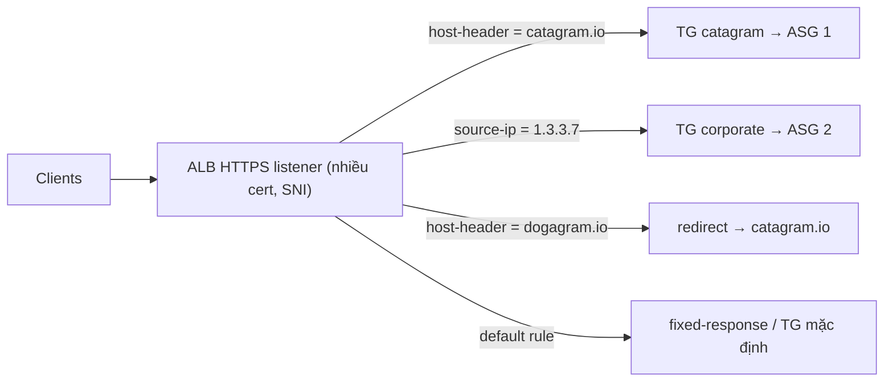

# Compare - ALB vs NLB

> **TL;DR:** **ALB** là load balancer layer 7, chỉ dành cho HTTP/HTTPS(/WebSocket). Nó hiểu nội dung request nên định tuyến được theo host, path, header, cookie... nhưng luôn **terminate** kết nối. **NLB** là layer 4 (TCP/TLS/UDP): rất nhanh, có **IP tĩnh**, chuyển thẳng TCP xuống backend được (mã hóa end-to-end không bị cắt), và là nền của **PrivateLink**. Cách nhớ của Adrian: thuộc danh sách lý do chọn NLB, ngoài danh sách đó thì chọn ALB.

## 🖼️ Sơ đồ
![[Compare - ALB vs NLB.excalidraw]]
*Mở bằng plugin Excalidraw để chỉnh sửa · ảnh tĩnh: [[Compare - ALB vs NLB.svg]]*

![[Compare - ALB vs NLB - rules.excalidraw]]
*Mở bằng plugin Excalidraw để chỉnh sửa · ảnh tĩnh: [[Compare - ALB vs NLB - rules.svg]]*

## Khái niệm cốt lõi

### Consolidation: lợi ích lớn của v2
- Với **CLB**: mỗi ứng dụng HTTPS (ví dụ `catagram.io`, `dogagram.io`) cần một CLB riêng, vì CLB **không hỗ trợ SNI** và chỉ có 1 SSL cert.
- Với **ALB**: một ALB phục vụ cả hai domain. Listener HTTPS gắn nhiều cert (SNI), **host-based rule** chuyển request tới các **target group** khác nhau, mỗi target group gắn với một [[Auto Scaling Groups|ASG]]. 100 ứng dụng legacy dùng 100 CLB có thể gộp lại thành rất ít ALB.

### Application Load Balancer (ALB)
- **Layer 7 thật sự**, listener chỉ được là **HTTP hoặc HTTPS**.
  - **Không** hiểu giao thức layer 7 khác như SMTP, SSH hay giao thức game riêng.
  - **Không** có listener TCP/UDP/TLS.
- Nhìn được nội dung L7: content type, **cookie**, custom header, vị trí người dùng, hành vi ứng dụng.
- Kết nối HTTP/HTTPS **luôn bị terminate trên ALB**, sau đó ALB mở một **kết nối mới** tới ứng dụng. Hệ quả:
  - **Không thể có SSL không đứt đoạn** từ client tới instance. Đội bảo mật có thể yêu cầu điều này, khi đó ALB bị loại.
  - Dùng HTTPS thì ALB **bắt buộc có SSL certificate** (thường lấy từ [[ACM]]).
- **Chậm hơn NLB** vì phải xử lý nhiều tầng hơn trong network stack.
- **Health check layer 7**: gửi request ứng dụng thật (một trang cụ thể, so khớp mã phản hồi) chứ không chỉ kiểm tra kết nối mạng.
- Target hỗ trợ: EC2 instance, IP, [[Lambda]] (không chỉ EC2).

### ALB Rules
- **Rule** quyết định xử lý thế nào với kết nối đến một **listener**.
- Xét theo **thứ tự priority**; rule cuối cùng là **default rule** (catch-all).
- **Conditions**: `host-header`, `http-header`, `http-request-method`, `path-pattern`, `query-string`, `source-ip`.
- **Actions**: `forward` (tới target group), `redirect` (sang URL/domain khác), `fixed-response` (trả mã lỗi hoặc thành công cố định), `authenticate-oidc`, `authenticate-cognito` (xem [[Cognito]]).
- Ví dụ trong bài:
  - Host header `catagram.io` → forward tới TG catagram.
  - Source IP `1.3.3.7` (khách doanh nghiệp) → forward tới TG thứ hai với bản ứng dụng riêng. Kết nối từ ALB tới TG này là một **kết nối riêng**, không phải pass-through.
  - Host `dogagram.io` → **redirect** sang `catagram.io`.

### Network Load Balancer (NLB)
- **Layer 4**: TCP, TLS, UDP (và TCP_UDP). **Không thấy** HTTP/HTTPS, nên không đọc được header hay cookie và **không có session stickiness kiểu cookie**. (Hiện nay NLB vẫn có stickiness theo *source IP* ở target group.)
- **Rất nhanh**: hàng triệu request/giây, latency khoảng **25%** của ALB, vì không phải xử lý các tầng trên.
- Hợp với giao thức **không phải HTTP/HTTPS**: SMTP, SSH, game server, ứng dụng tài chính dùng giao thức riêng.
- Health check: khóa học nói chỉ có **ICMP/TCP handshake**, không application-aware. (Hiện nay target group của NLB hỗ trợ health check TCP, HTTP và HTTPS, nhưng ý thi vẫn là: kiểm tra sức khỏe ứng dụng sâu thì ALB mạnh hơn.)
- **Static IP**: mỗi AZ có một IP tĩnh, gắn được Elastic IP. Rất hữu ích để khách doanh nghiệp **whitelist** trên firewall.
- **TCP listener forward thẳng** tới instance: các tầng trên TCP (TLS/HTTPS) **không bị terminate**, nên giữ được **mã hóa end-to-end không đứt đoạn**.
- Là nền của **PrivateLink**: cung cấp dịch vụ cho VPC khác (xem [[Interface VPC Endpoints]]).

## Bảng so sánh / số liệu
| Tiêu chí | ALB | NLB |
|---|---|---|
| OSI layer | 7 | 4 |
| Listener | HTTP, HTTPS (WebSocket, HTTP/2, gRPC) | TCP, TLS, UDP, TCP_UDP |
| Giao thức không phải web | Không | Có |
| Đọc header/cookie/path | Có | Không |
| Routing rules (host/path/header/query/source IP) | Có | Không (chỉ chọn theo port/protocol) |
| SSL/TLS | Luôn terminate trên ALB, cần cert | TCP listener: pass-through end-to-end; TLS listener: terminate |
| Unbroken end-to-end encryption | Không | Có (TCP listener) |
| Hiệu năng | Chậm hơn | Hàng triệu rps, latency ~25% ALB |
| Static IP / Elastic IP | Không (DNS name thay đổi IP) | Có, mỗi AZ một IP |
| Health check | L7, application-aware | Khóa học: ICMP/TCP cơ bản |
| Session stickiness (cookie) | Có (`AWSALB`) | Không (chỉ source IP) |
| Authentication (OIDC/Cognito) | Có | Không |
| PrivateLink (endpoint service) | Không | Có |
| Target Lambda | Có | Không |
| Cross-zone mặc định | Bật | Tắt |

## Khi nào chọn cái nào
Chọn **NLB** khi đề có một trong các ý sau:
1. **Unbroken encryption** từ client tới instance (không terminate trên LB).
2. **Static IP** để whitelist.
3. **Hiệu năng cao nhất**: hàng triệu rps, latency thấp.
4. Giao thức **không phải HTTP/HTTPS** (TCP/UDP thô, SMTP, SSH, game).
5. **PrivateLink**.

Mọi trường hợp khác thì chọn **ALB**, vì tính năng L7 của nó có giá trị trong hầu hết kịch bản web.

## 🎯 Mẹo thi SAA-C03
- Từ khóa "**end-to-end encryption**", "certificate không được để trên LB", "security team cấm terminate SSL" → **NLB + TCP listener** (xem chế độ pass-through ở [[SSL Offload and Session Stickiness]]).
- "**Whitelist IP**", "khách hàng cần IP cố định của LB" → **NLB** (hoặc [[Global Accelerator]] cho static anycast IP).
- "**Path-based / host-based routing**", "`/api` và `/images` đi tới backend khác nhau", "nhiều domain trên một LB" → **ALB**.
- "**UDP**", "game", "IoT", "SMTP" → **NLB**.
- "Expose dịch vụ cho VPC/account khác **không cần peering**" → **PrivateLink + NLB**.
- "Xác thực người dùng ngay tại LB" → ALB với `authenticate-cognito` hoặc `authenticate-oidc`.
- Health check cần kiểm tra **logic ứng dụng** (một trang cụ thể trả 200) → ALB, kết hợp ELB health check trong ASG ([[ASG Health Checks]]).
- Stickiness bằng cookie chỉ có trên **ALB**.

## Liên kết
- Tiên quyết: [[Elastic Load Balancer]], [[OSI Model]], [[Layer 4 Transport]], [[SSL and TLS]]
- Liên quan: [[SSL Offload and Session Stickiness]], [[Auto Scaling Groups]], [[ACM]], [[Interface VPC Endpoints]], [[Cognito]], [[Lambda]]
- Phân biệt với: [[Gateway Load Balancer]], [[Global Accelerator]], [[CloudFront Architecture]]
