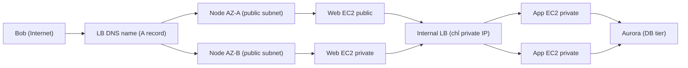
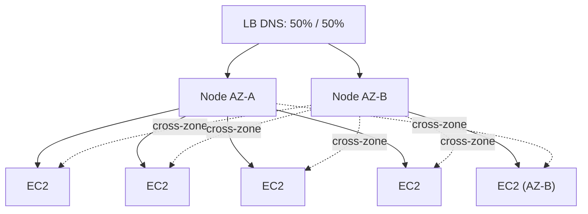

# Elastic Load Balancer

> **TL;DR:** ELB nhận kết nối từ client rồi phân phối sang các backend đã đăng ký, nhờ đó client không cần biết hạ tầng phía sau. Số lượng backend có thể tăng, giảm, hỏng hay được sửa mà khách không nhận ra. Về vật lý, một ELB là **một DNS A record trỏ tới nhiều node**, mỗi AZ có ít nhất một node. Các node này tự scale theo tải.

## 🖼️ Sơ đồ
![[Elastic Load Balancer.excalidraw]]
*Mở bằng plugin Excalidraw để chỉnh sửa · ảnh tĩnh: [[Elastic Load Balancer.svg]]*

![[Elastic Load Balancer - cross-zone.excalidraw]]
*Mở bằng plugin Excalidraw để chỉnh sửa · ảnh tĩnh: [[Elastic Load Balancer - cross-zone.svg]]*

## Khái niệm cốt lõi

### Lịch sử: v1 và v2
- "ELB" là tên chung cho cả họ load balancer. Khóa học nói có **3 loại**; hiện nay có **4** vì thêm [[Gateway Load Balancer]] (GWLB, layer 3, dùng cho appliance bảo mật), được học riêng ở cuối section.
- **v1, Classic Load Balancer (CLB)**, ra đời năm **2009**:
  - Cân bằng được HTTP/HTTPS và các giao thức tầng thấp hơn, nhưng **không thực sự là layer 7**: không hiểu HTTP nên không ra quyết định dựa trên tính năng của HTTP.
  - Thiếu tính năng, có thể đắt hơn, và chỉ hỗ trợ **1 SSL certificate cho mỗi CLB** (không có SNI). Hệ quả: mỗi ứng dụng HTTPS cần một CLB riêng, hệ thống lớn có thể cần hàng trăm CLB, trong khi chúng có thể **gộp (consolidate)** lại thành một LB v2.
  - Khuyến nghị: **tránh hoặc migrate**. Không còn kịch bản nào nên chọn CLB thay vì v2.
- **v2**: nhanh hơn, rẻ hơn, hỗ trợ **target groups** và **rules**, nên một LB phục vụ được nhiều ứng dụng.
  - **Application Load Balancer (ALB)**: layer 7, hỗ trợ HTTP, HTTPS và WebSocket.
  - **Network Load Balancer (NLB)**: layer 4, hỗ trợ TCP, TLS và UDP. Dùng cho mọi thứ không phải HTTP/HTTPS: email (SMTP), SSH, game có giao thức riêng...
  - Chọn giữa ALB và NLB là kỹ năng bắt buộc cho kỳ thi, xem [[Compare - ALB vs NLB]].

### Các lựa chọn khi tạo LB
- **IP version**: IPv4 hoặc **dual-stack** (IPv4 + IPv6).
- **AZ/subnet**: chọn **đúng một subnet trong mỗi AZ**, tối thiểu 2 AZ.
- **Internet-facing hay internal**:
  - *Internet-facing*: node có **public IPv4** (và private IP).
  - *Internal*: node chỉ có **private IP**.
  - Đây là **khác biệt duy nhất**. Kiến trúc, node và tính năng giống hệt nhau.
- **Listener configuration**: LB lắng nghe protocol/port nào ở phía front, và nói chuyện với target bằng protocol/port nào ở phía back. Listener quyết định LB **làm gì** với traffic.

## Cách hoạt động / Kiến trúc

### Node và DNS
- Một "ELB" ta thấy trong console thực chất là **nhiều node**. Với mỗi subnet được chọn, AWS đặt **≥1 node** vào subnet đó.
- Khi tạo, LB nhận một **DNS name (A record)** phân giải ra **tất cả các node**. Request được rải đều lên các node.
- Node **HA trong AZ**: node hỏng thì được thay. Node **scale theo tải**: tải tăng thì thêm node trong các subnet đã cấu hình.
- Yêu cầu IP: mỗi subnet cần **≥ 8 IP trống**. Về lý thuyết **/28** là đủ (16 IP − 5 reserved = 11 trống), nhưng AWS khuyến nghị **/27 hoặc lớn hơn** để LB có chỗ scale (xem [[VPC Subnets]], [[Subnetting]]).

### Internet-facing LB và instance private
- Internet-facing LB kết nối được tới **cả instance public lẫn private**. EC2 **không cần public IP** để dùng với LB. Điều kiện duy nhất là node LB phải tới được backend.
- Muốn LB nhận traffic từ Internet thì nó **bắt buộc** phải là internet-facing, vì cần public IP trên node.

### LB tách các tier (multi-tier, loose coupling)
- Ví dụ 3 tier: internet-facing LB, web ASG, **internal LB**, app ASG, rồi Aurora.
- **Không có LB**: Bob gắn với một web instance cụ thể, web instance đó gắn với một app instance cụ thể. Một instance hỏng hoặc scale là trải nghiệm bị gián đoạn. Các tier **tightly coupled**, phải biết về nhau.
- **Có LB giữa các tier**: Bob chỉ nói chuyện với node ELB và không biết mình vào web server nào; web server cũng không biết app tier có bao nhiêu instance. Coupling được **nới lỏng**, mỗi tier **scale độc lập**. Ví dụ app tier tăng từ 2 lên 4 instance mà web tier không cần cấu hình lại gì.

### Cross-Zone Load Balancing
- DNS chia đều tải cho các node: mỗi node nhận **100% / số node**. Với 2 AZ, mỗi AZ một node, mỗi node nhận 50%.
- **Hạn chế cũ**: node chỉ được phân phối tới instance **trong cùng AZ**. Với 4 instance ở AZ-A và 1 instance ở AZ-B:
  - Mỗi instance ở AZ-A nhận 50% / 4 = **12.5%** tổng tải.
  - Instance duy nhất ở AZ-B nhận **50%**. Tải lệch nặng.
- **Cross-zone LB**: mọi node phân phối đều tới **mọi target đã đăng ký ở mọi AZ**. Ở ví dụ trên, mỗi instance nhận khoảng 20%.
- Mặc định:
  - **ALB**: luôn **bật** (khóa học). Hiện nay có thể tắt ở cấp target group.
  - **NLB** (và GWLB): mặc định **tắt**; bật lên thì có thể phát sinh phí data transfer giữa các AZ.
  - **CLB**: tạo bằng console thì bật, tạo bằng API/CLI thì tắt.
  - (Phần mặc định của NLB/CLB là kiến thức AWS hiện tại, khóa học chỉ nói "trước đây mặc định tắt, ALB thì bật sẵn".)

## Bảng so sánh / số liệu
| Hạng mục | Giá trị |
|---|---|
| Số AZ tối thiểu | 2+ (một subnet mỗi AZ) |
| Node mỗi AZ | ≥1, tự scale |
| IP trống mỗi subnet | ≥ 8 |
| Kích thước subnet | /27 khuyến nghị (/28 là mức tối thiểu kỹ thuật) |
| CLB SSL cert | 1 cert / LB |
| CLB ra đời | 2009 |

## 🎯 Mẹo thi SAA-C03
- Thấy **CLB** trong đáp án thì gần như luôn **loại**, trừ khi đề nói rõ hệ thống legacy. Nhiều domain HTTPS dùng chung một LB thì chọn **ALB với SNI**.
- **Tải không đều giữa các AZ** (một AZ ít instance bị quá tải) thì bật **cross-zone load balancing**.
- **Internet-facing chỉ là chuyện IP của node.** Instance backend có thể nằm trong **private subnet** và không cần public IP. Câu hỏi về "cần bao nhiêu subnet/tier" thường kiểm tra ý này.
- Subnet cho LB: chọn **/27** nếu có trong đáp án; nếu chỉ có **/28** (không có /27) thì /28 có lẽ đúng. Nhớ "**8+ free IP**".
- Dùng **internal LB** giữa web tier và app tier để các tier scale độc lập.
- LB = **một DNS name**. Muốn trỏ domain riêng vào LB thì dùng Route 53 **Alias** (xem [[CNAME vs Alias]]).
- Cần **IP tĩnh** cho LB thì chọn NLB (xem [[Compare - ALB vs NLB]]).

## Liên kết
- Tiên quyết: [[Regional and Global Architecture]], [[VPC Subnets]], [[Horizontal vs Vertical Scaling]], [[OSI Model]]
- Liên quan: [[Auto Scaling Groups]], [[ASG Health Checks]], [[SSL Offload and Session Stickiness]], [[CNAME vs Alias]], [[Lab - Architecture Evolution]]
- Phân biệt với: [[Compare - ALB vs NLB]], [[Gateway Load Balancer]], [[R53 Multivalue Routing]] (cân bằng bằng DNS, không phải LB thật)
